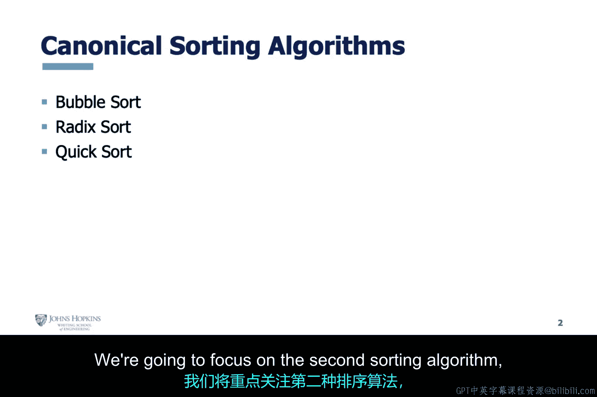
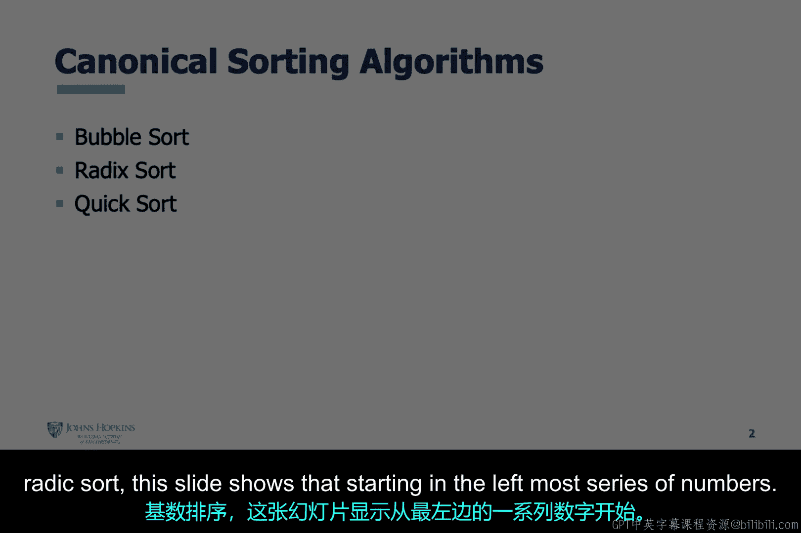
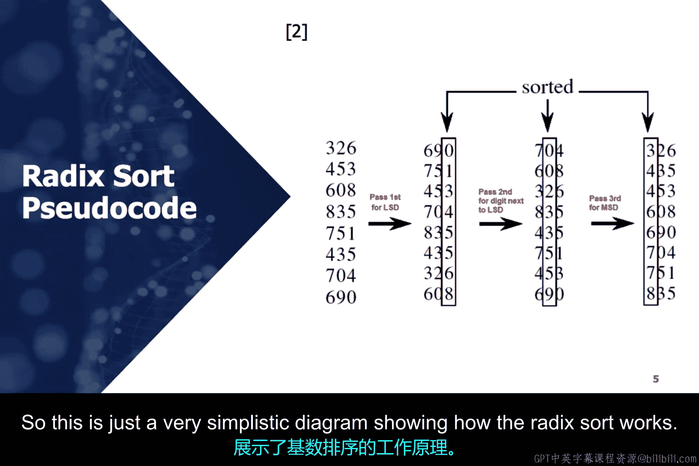
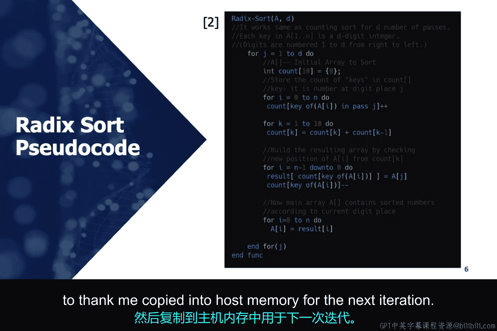
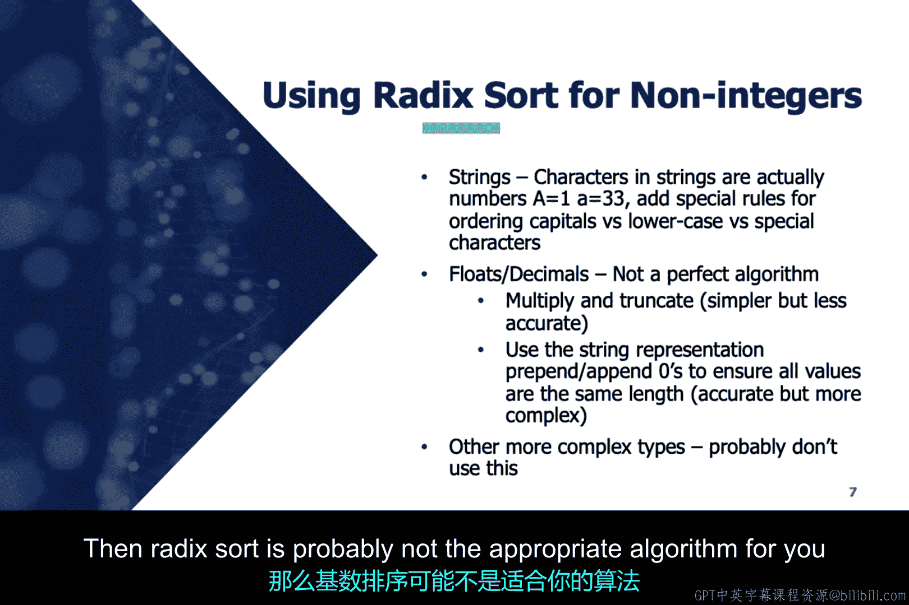

# 078：GPU排序算法伪代码-基数排序 🧮

在本节课中，我们将学习第二种GPU排序算法：基数排序。我们将探讨其工作原理、对应的伪代码实现，并分析如何将其应用于非整数类型的数据。

上一节我们讨论了排序算法及GPU伪代码的创建与使用，本节中我们来看看基数排序的具体实现。

## 基数排序工作原理 📊

下图展示了基数排序的过程。它从一系列数字的最左侧（即最低有效位）开始排序。

排序过程首先处理最右边的数字（即个位）。算法将数字0到8进行排序。例如，在第一轮中，数字`6`和`90`的个位是`0`，`608`的个位是`8`。算法根据个位值对整个数字进行排序。

然后，算法移动到下一列（十位）。例如，`704`的十位数字最小。当同一列中的数字具有相同值时，算法会进行次级排序。

最终，当处理到最后一列（最高有效位，在本例中是百位列）时，整个序列就完成了排序。在整个过程中，例如`704`会排在`751`之前，因为它在之前的排序轮次中就已经排在前面了。

这张图非常简略地展示了基数排序的工作方式。

## 基数排序伪代码分析 💻

现在让我们查看基数排序的伪代码。

首先，你会注意到一个`for`循环：`for j = 1 to D`。这里的`D`代表待排序数值的位数或列数。在之前的例子中，`D`是3。这个循环应该是一个在主机端执行的外部循环，因为它代表了排序的“趟”数。伪代码中使用的“pass”一词，指的就是完整执行一轮排序。

基数排序的一个优点是，每处理一列时，对该列的排序操作可以在一次内核执行中，由大量线程并行完成。

接下来，伪代码中预设了`count[10]`数组，因为数字位值范围是0到9，共10种可能。数组初始值设为0。实际上，`count[0]`将记录在当前处理的列（第`j`列）中，位值为0的元素有多少个。

然后是一个`for`循环：`for i = 0 to n`，其中`n`是待排序值的总数。这个循环的初始作用是遍历所有值，并统计计数。例如，如果有三个元素在当前列（第`j`列）的位值是0，那么`count[0]`就会增加3。这是一个非常适合用GPU内核执行的地方，该内核的唯一任务就是遍历所有值并递增计数。但需要注意，稍后必须有一种方法来同步`count`数组的值。

接着是变量`k`的处理。伪代码表示，我们不仅要知道位值为0的计数，还要知道小于等于当前位值的累计计数。例如，当处理位值1时，需要将`count[1]`和`count[0]`的计数相加。这本质上是计算前缀和。

查看伪代码，接下来的循环完成了排序的主要工作。它根据已知的计数信息构建结果数组。具体来说，它从最高位值到最低位值遍历上一轮排序的结果，然后根据当前列的位值，将元素放置到正确的位置。例如，如果知道有8个元素在当前列的位值是1，就可以在排序时按顺序放置这8个元素。

理解起来可能有些复杂。建议回顾之前展示排序过程的图片：排好一列后，进入下一列。排序下一列时，需要基于前一列的结果进行次级排序。例如，一个元素因为当前列的值更高而需要前移，但同时也要考虑它在前一列中的排序位置。

当然，这里的`for i`循环，如同所有`for`循环一样，可以分离出来作为一个独立的内核。和往常一样，需要考虑内存同步问题。

在循环的最后，将值复制到全局数组中。实际上，在执行`for i = n-1`这个循环时，你已经将数据复制回了设备的全局内存。然后，这些数据可以被复制到主机内存，以供下一趟迭代使用。

## 处理非整数数据 🔄

现在，让我们暂时离开伪代码，讨论一下当处理的数据不是整数时，如何应用基数排序。

首先要考虑的是浮点数或小数。浮点数的小数点位置不固定，因此不能直接使用之前串行代码中的按列（位）组织方式。

一种方法是乘以10的幂次，将小数点全部移到最右边，并记录乘了多少次。在排序比较时使用这些调整后的整数值，排序完成后再移回小数点。但这可能不是最精确的方法，因为在表示过程中可能会损失一些精度。

另一种方法是将其视为字符串来处理。我们稍后会讨论字符串排序。可以考虑通过填充零，使所有字符串达到相同的长度和精度，然后进行字符串排序。

字符串可以很好地工作，因为一个字符串本质上就是一套编码系统（如ASCII或Unicode）将大小写字母、特殊字符转换成的数字。例如，大写字母‘A’的编码是65，小写字母‘a’的编码是97。你可以根据编码规则进行排序。你可能需要制定一些规则，比如希望小写字母排在大写字母之前，或者将所有字母转换为小写后再视为相同处理。

如果你要排序的数据不能很好地映射为数值（例如是多维数据），那么基数排序可能就不适合作为你的算法选择。

## 总结 📝

本节课中，我们一起学习了基数排序算法。我们分析了其从最低有效位到最高有效位逐列排序的工作原理，并详细解读了对应的GPU伪代码实现，包括计数、前缀和及元素重排等关键步骤。最后，我们还探讨了基数排序应用于浮点数和字符串等非整数类型数据时的处理思路与潜在挑战。理解基数排序的并行潜力及其数据适应性，对于在GPU上高效实现排序至关重要。