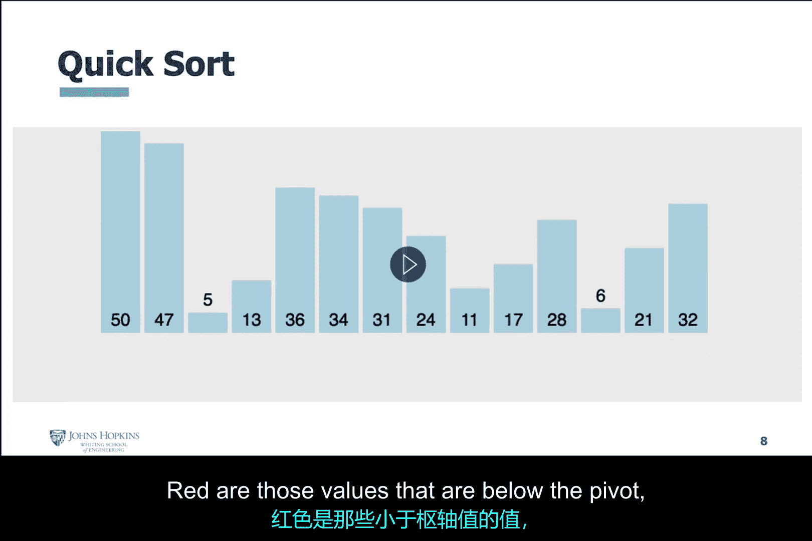
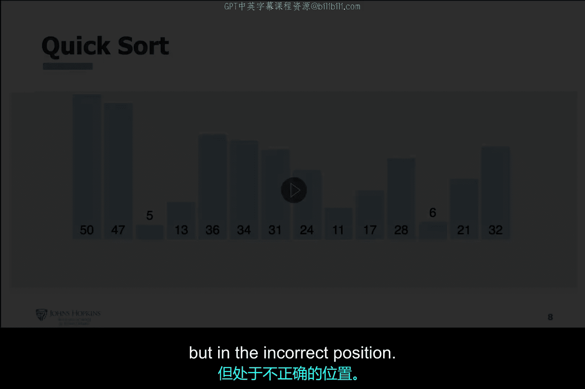
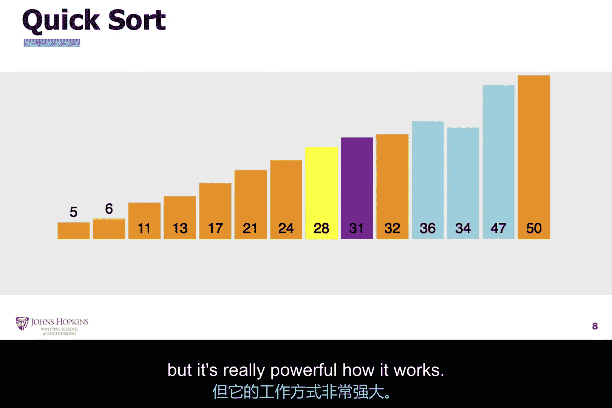
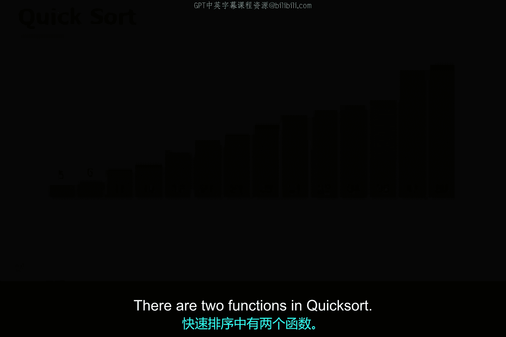
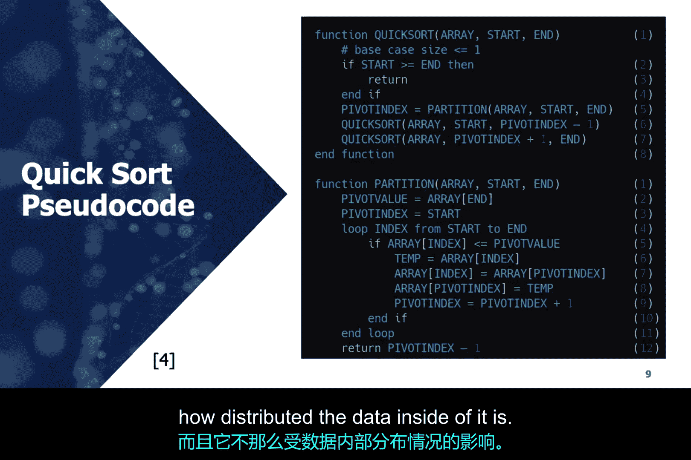
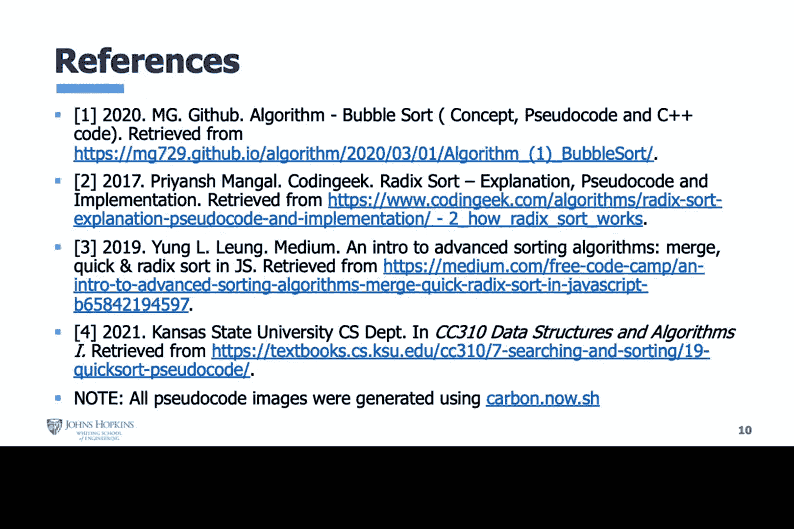

# 079：GPU排序算法伪代码-快速排序 🚀

在本节课中，我们将学习最后一个排序算法——快速排序，并探讨其在GPU上的伪代码实现。快速排序是一种高效的排序算法，通过递归地分区数组来工作。

## 概述

快速排序的核心思想是“分而治之”。它选择一个“基准”值，将数组分为两部分：一部分包含小于基准值的元素，另一部分包含大于基准值的元素。然后，对这两部分递归地应用相同的过程。

## 颜色图例说明

在接下来的动画演示中，我们将使用不同的颜色来代表数组元素的状态。理解这些颜色对于跟随算法流程至关重要。

以下是各种颜色代表的含义：

*   **蓝色**：表示当前未排序且未被检查的元素。
*   **琥珀色/橙色**：表示该元素已处于最终的正确排序位置。
*   **黄色**：表示当前选定的“基准”值，其他元素正与之比较。
*   **绿色**：表示被确定为小于基准值的元素。
*   **紫色**：表示被确定为大于基准值的元素，并且已处于相对于基准的正确一侧。
*   **红色**：表示该元素小于基准值，但当前位于基准点（或中点）的错误一侧（即右侧），需要被交换到左侧。

动画开始时，所有元素都是蓝色的。随着算法运行，你会看到越来越多的元素变成琥珀色，这些是已归位的元素。黄色是当前比较的基准，绿色和紫色是已分好区的元素，而红色则是需要被移动的元素。

## 算法工作原理



在快速排序中，首先选择一个基准点（通常是起始索引的值）。算法会尝试为这个基准值找到其在数组中的正确位置。在寻找过程中，会进行元素交换，将小于基准值的元素移动到左侧。基准值会逐渐向右移动，其左侧的元素通过交换变得相对有序。这个过程虽然有些复杂，但效率非常高。



## 快速排序伪代码分析

快速排序的实现主要包含两个函数：`quicksort` 主函数和 `partition` 分区函数。





### 主函数：quicksort

`quicksort` 函数负责驱动整个排序过程。它有两个主要任务：调用 `partition` 函数对数据进行分区，然后递归地对分区产生的左右两个子数组执行快速排序。

需要注意的是，这是一个递归算法。这提醒我们，在GPU上直接实现可能需要仔细考虑，因为GPU对递归的支持有限。不过，它确实可以在CUDA中实现。

递归会一直进行，直到达到基本情况，即当 `start` 索引大于或等于 `end` 索引时，这意味着当前需要排序的区间已经没有元素或只有一个元素（已经有序），函数就会返回，递归调用栈会逐层退出。

**伪代码结构如下：**
```pseudocode
function quicksort(array, start, end):
    if start >= end:
        return  // 基本情况：区间为空或只有一个元素
    pivot_index = partition(array, start, end) // 分区并获取基准索引
    quicksort(array, start, pivot_index - 1) // 递归排序左半部分
    quicksort(array, pivot_index + 1, end)   // 递归排序右半部分
```

### 分区函数：partition

`partition` 函数是快速排序的核心。它确定当前处理数组区间（由 `start` 和 `end` 定义）的基准值（通常选择区间最右侧的元素）。然后，它将一个“分区索引”初始化为区间的起始位置。

接着，函数从区间的第一个元素遍历到最后一个元素（不包括基准值本身）。它将当前遍历到的元素与基准值进行比较。

如果当前元素的值小于基准值，说明它应该位于基准的左侧。函数会将该元素与“分区索引”所在位置的元素进行交换，然后将“分区索引”向右移动一位。这样做的效果是，所有小于基准值的元素都被“推”到了数组的左侧部分。

遍历结束后，“分区索引”指向的位置就是基准值最终应该放置的地方。此时，将基准值与此处的元素交换。至此，基准值就处在了其正确的位置上，并且其左侧的所有元素都小于它，右侧的所有元素都大于它。

函数最后返回基准值的最终索引。这个返回值至关重要，它标志着基准值已归位，并且其左侧和右侧的子数组需要在接下来的递归调用中被分别排序。

**分区过程的核心逻辑可以概括为：**
`pivot_index` 跟踪的是“小于基准值的子数组”的边界。每当发现一个小于基准值的元素，就将其交换到边界处，并扩展边界。

## 算法效率

快速排序之所以在许多情况下比冒泡排序等其他算法更快，主要有以下几个原因：

1.  **比较次数更少**：它并不需要像冒泡排序那样进行大量冗余的成对比较。
2.  **分而治之**：算法将大问题分解为小问题，每次递归处理时，并非操作全部数据，减少了冗余操作。
3.  **高效性依赖于数据规模**：其平均时间复杂度为 **O(n log n)**，这比冒泡排序的 **O(n²)** 要高效得多。
4.  **受数据分布影响相对较小**：虽然最坏情况（如数组已排序）下性能会退化到 **O(n²)**，但平均性能很好，且可以通过随机选择基准值来优化。

## 总结





本节课我们一起学习了快速排序算法。我们了解了其“分而治之”的核心思想，分析了其在GPU上的伪代码实现，包括递归主函数 `quicksort` 和核心的分区函数 `partition`。我们还通过颜色图例直观地理解了算法的动态执行过程。最后，我们探讨了快速排序高效率的关键所在，即通过分区减少不必要的比较和操作，使其平均性能达到 **O(n log n)**。理解这个算法为我们在并行计算环境中处理排序问题提供了重要的基础。