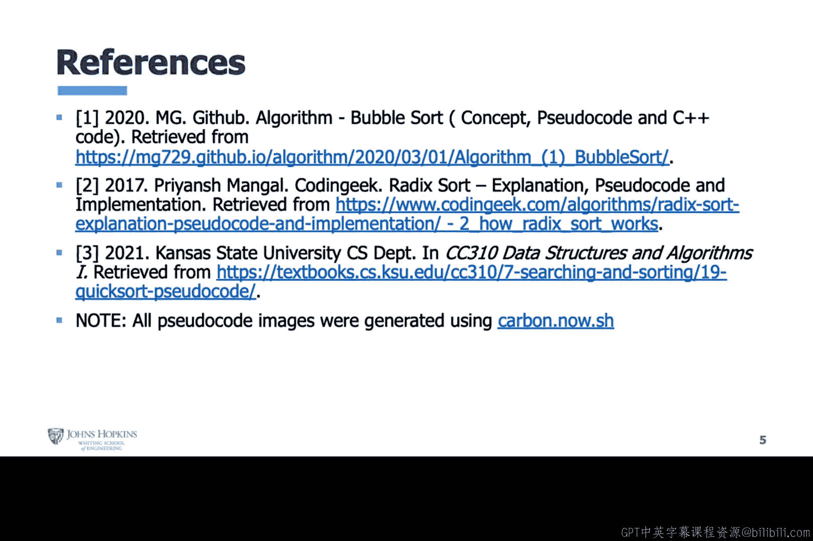

# 080：内存管理与GPU伪代码-冒泡排序 🧠

在本节课中，我们将学习如何将GPU伪代码应用于实际的内存管理。我们将探讨在何处使用全局内存，在何处使用常量内存，并通过冒泡排序的例子来具体分析。

## 概述

上一节我们开始理解GPU的伪代码。本节中，我们将看看这些概念如何实际应用于内存使用。我们将分析冒泡排序算法在GPU上的实现，并思考数据一致性、内存类型选择以及线程间协作等问题。

## 内存使用策略

首先，我们需要决定在何处使用全局内存，在何处使用常量内存等。当我们看到一个`for`循环时，应该意识到，一个内核的执行并不意味着它只处理一两份数据。

## 线程与数据处理

如果有多份数据需要处理，例如有100份数据和64个线程在运行，可能每个线程需要处理两份数据，执行交换操作后就结束了。在这种情况下，以及在任何线程处理两份或更多数据的情况下，需要考虑的是：

*   如何保持数据的一致性？
*   是否存在某些数据（如当前索引、索引大小）可以作为常量？

## 循环在GPU上的分解

在外层`for`循环中，这部分工作可以在主机端代码中完成。而在内层`for`循环中，则必须在线程内部执行。

以下是一个线程可能处理多个数据项的情况：
```c
// 伪代码示例：线程处理数据块
int thread_id = get_thread_id();
int data_per_thread = total_data / total_threads;
int start_index = thread_id * data_per_thread;
for (int i = 0; i < data_per_thread - 1; i++) {
    // 比较和交换操作
    if (data[start_index + i] > data[start_index + i + 1]) {
        swap(data[start_index + i], data[start_index + i + 1]);
    }
}
```

## 子数组排序与同步

你可能会注意到，如果有数千个线程和数万份数据，最终可能会得到数千个已排序的子数组。但随后，你必须在所有这些子数组之间进行排序。

因此，接下来你可能需要执行一个同步步骤，然后共享数据，例如改变正在查看的索引。一种非常低效的做法是向某个方向逐个移动所有数据。因为跨所有线程的最左值和最右值将被排序，这与冒泡排序的特性相符，即它遍历所有数据并进行多次排序。

## 内存利用策略

在这种情况下，你可能需要考虑如何利用内存，包括共享内存、全局内存以及任何常量内存。

## 交换标志的处理

最后是布尔交换标志的问题。你不会共享一个单一的布尔变量来指示是否在所有线程中交换值，但你可以使用类似位标志数组的东西，基本用来表示该索引是否发生了交换。

或者，你可能拥有相同的数组，然后记录“我把它交换到了这个位置”，这向另一个具有更高索引值的线程指示了某些信息，或者指示它被交换成了什么。

请记住这些要点。也许你能由此构思出更好的冒泡排序版本。


## 总结




本节课中，我们一起学习了如何将GPU编程的伪代码概念应用于实际的内存管理。我们以冒泡排序为例，分析了在GPU上分解循环、管理线程间数据一致性、选择合适的内存类型（全局、共享、常量）以及处理线程间通信（如交换标志）的策略。理解这些基础是设计高效GPU算法的关键。