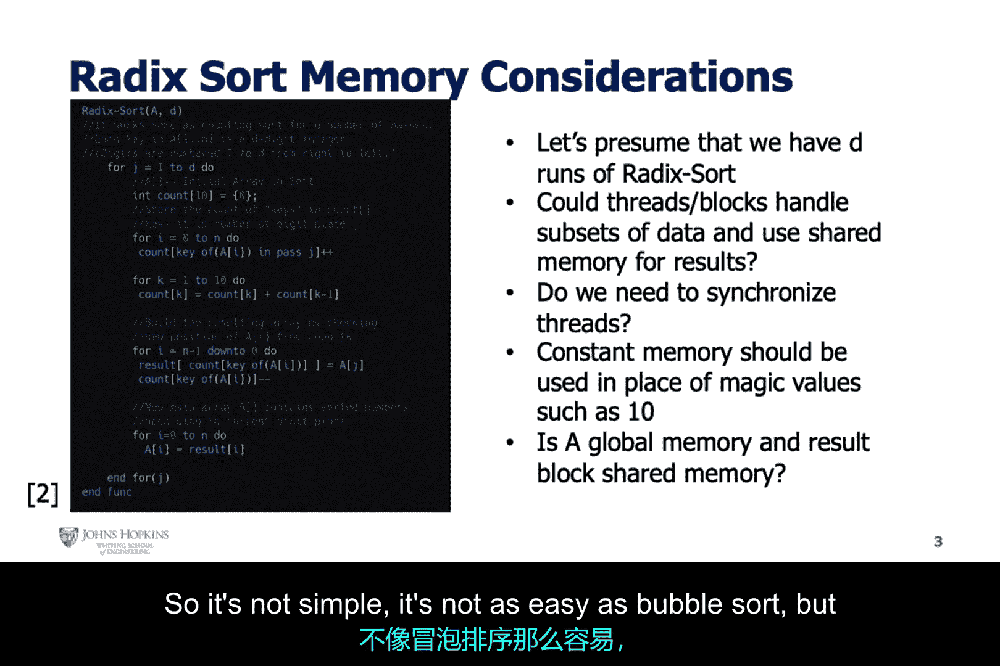

# 081：内存管理与基数排序GPU伪代码 🧠

在本节课中，我们将探讨GPU编程中的内存管理策略，并分析基数排序算法的GPU实现伪代码。我们将重点关注如何利用不同的内存层次结构来优化性能。

## 概述

基数排序是一种非比较型整数排序算法，它通过逐位处理数据来实现排序。在GPU上实现此算法时，高效的内存管理至关重要。我们将分析一段伪代码，并讨论如何利用全局内存和共享内存来提升性能。

## 内存使用策略分析

上一节我们介绍了基数排序的基本概念，本节中我们来看看其GPU伪代码实现中的内存使用策略。

观察伪代码，外层循环 `for j = 1 to D` 由主机（CPU）执行。在这个循环内部，有一系列 `for` 循环，每个循环都对应一个非常简单的内核线程执行。

### 简单循环的内存策略

以下是两个相对简单的循环，它们的内存访问模式较为友好：

*   `for i = 0 to n`
*   `for k = 1 to 10`

这两个循环可以直接使用**全局内存**来执行。或者，你也可以选择使用**共享内存**进行计算，然后将共享内存中的结果汇总到全局内存中。对于计数操作，有多种可行的策略。

### 复杂操作的内存策略

然而，在输入数据内部进行交换或移动以实现排序的操作（对应循环 `for i = n-1 to 0`）则复杂得多。

你可能需要制定一个策略：将数据的“先前顺序”存储在**全局内存**中。然后，以线程块或甚至整个线程网格为单位工作的线程组可以回溯这些数据，执行从属的交换操作。

当然，它们需要获取计数值。这个值可能是一个常量，或者在本例中，由于它是递减的，你可能希望将其放在**全局内存**中。但实际的排序结果，你可以利用**共享内存**来完成。这是一种加速计算的方法。

### 不同策略的权衡

如果你全部使用全局内存，那么最后一个循环 `for i = 0 to n` 的操作会自动完成。

但如果你使用共享内存，并在其中进行排序（如前所述），你可能需要在 `for j = 1 to D` 这个外层循环中进行多次传递：将数据复制回主机内存，在主机端进行合并，然后再运行下一次传递。

因此，这并不简单，也不像冒泡排序那样容易实现，但在GPU上实现基数排序实际上并不算太困难。

## 核心概念图示

为了更直观地理解上述内存访问模式，请参考以下伪代码结构示意图：

以及GPU内存层次结构与计算流程的对应关系：

## 总结

本节课中我们一起学习了在GPU上实现基数排序时的内存管理策略。关键点在于根据计算阶段的特点，灵活运用**全局内存**和**共享内存**。对于简单的、规整的计数操作，两者皆可；对于复杂的、需要数据交换的排序阶段，结合使用全局内存存储中间状态和共享内存进行高效计算是常见的优化手段。理解这些策略有助于你设计出更高效的GPU并行算法。