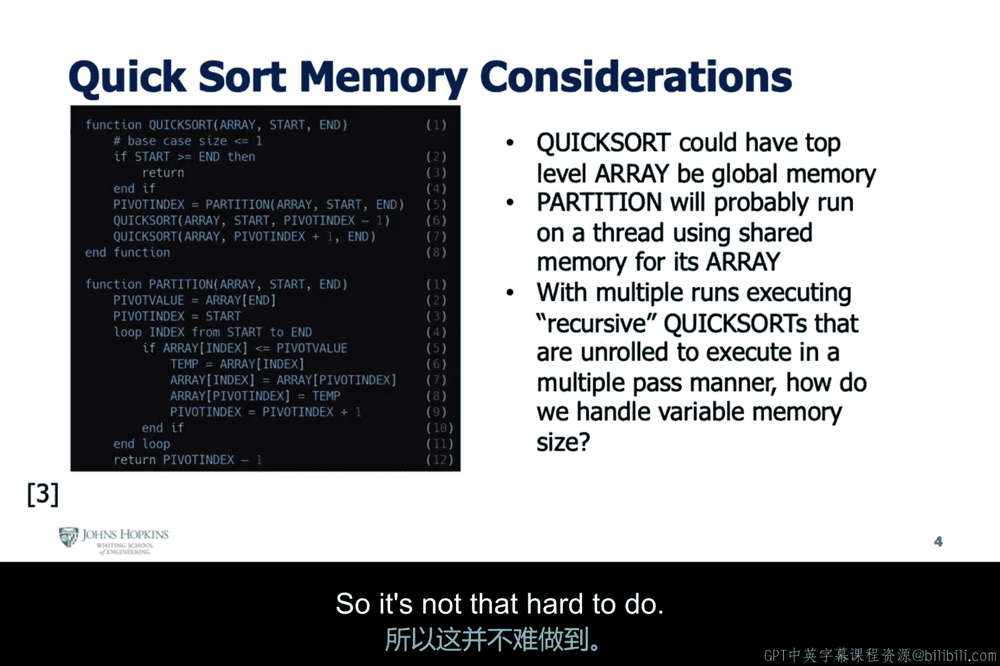
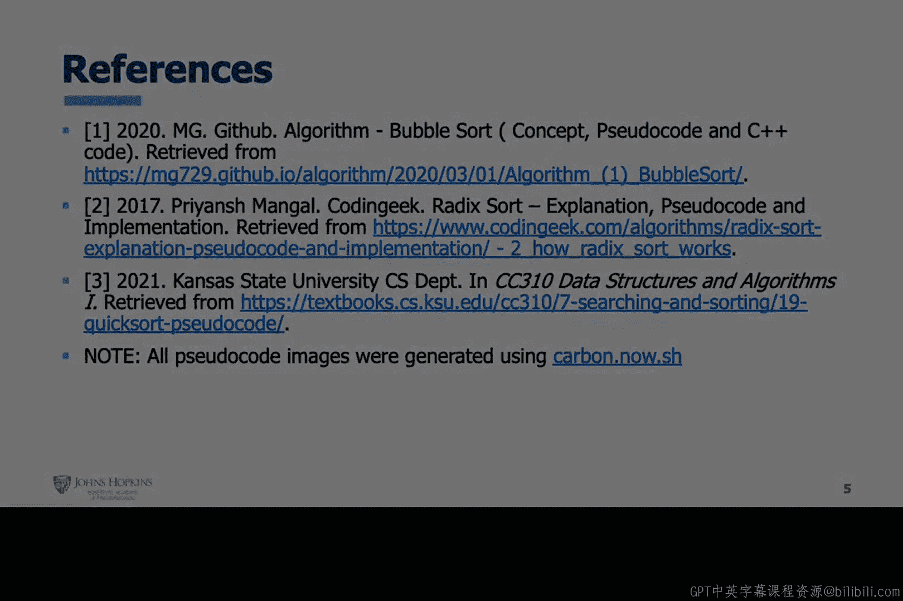

# 082：内存管理与快速排序GPU伪代码复杂度分析

在本节课中，我们将探讨在GPU上实现快速排序算法时，内存管理的复杂性以及相应的伪代码设计思路。我们将重点关注如何将递归算法转化为适合GPU并行执行的模式，并分析其中的关键挑战。

上一节我们介绍了GPU编程的基本概念，本节中我们来看看一个具体算法——快速排序在GPU上的实现挑战。

## 内存复杂度分析

实现快速排序或编写不基于通用C代码的伪代码时，内存复杂度是需要考虑的核心问题。通常，你需要使用大量的**全局内存**。

如果你遵循快速排序及其分区函数的标准范式，那么全局内存的使用是不可避免的。

## 递归算法的顺序化执行

然而，可能存在一种方法，将递归算法转化为顺序执行的行为。实现方式如下：

在每个层级，每一次遍历可以视为一个阶段。例如，第一次遍历将数据对半分割。

这或许只需要两个线程块来处理。然后，可能由一个线程块内的单个线程来执行后续操作。

当该部分完成后，下一次遍历会进一步细分数据。

你可以将数据细分到由单个线程处理一小部分共享数据的程度。然后，让线程在同步机制下工作。

## 同步与通信机制

以下是实现同步与通信需要考虑的几个方面：

*   **同步机制**：可能需要使用**流（Streams）** 和**事件（Events）**，使得线程仅在数据段就绪时才开始工作。例如，一个线程负责排序索引1到20的数据，并在完成后发出信号。
*   **内存共享**：必须跨线程块共享内存，使得负责更小子集（例如索引3到8）的线程能够进行其部分的排序。
*   **同步点**：实现中可能需要设置大量的同步点。使用流和事件会提供多种实现方式。

## 处理可变输入数组

另一个需要考虑的问题是，如何处理大小可变的输入数组？现实中，你可能会通过处理起始和结束索引，并始终使用相同的共享内存或全局内存来解决。

实际上，数组只是一个指针，你操作的只是它的一个子集。在本示例的实现思路中，更倾向于认为每次遍历传递的是数组以及几乎固定的起止索引，因此实现起来并不十分困难。

本节课中我们一起学习了在GPU上为快速排序设计伪代码时的内存管理挑战。关键点在于将递归算法转化为可并行执行的层级化任务，并妥善处理全局内存访问、线程间同步以及可变尺寸数据的索引计算问题。理解这些概念对于在GPU上高效实现复杂算法至关重要。