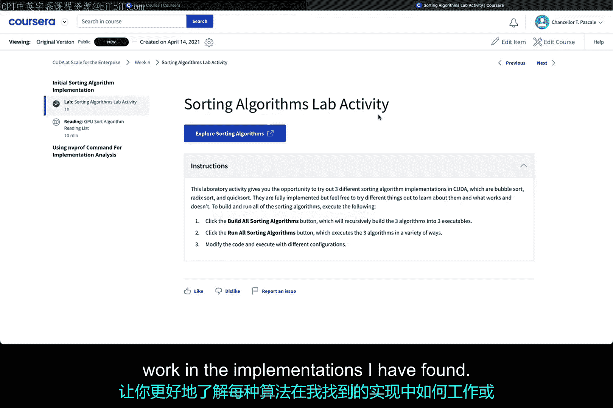
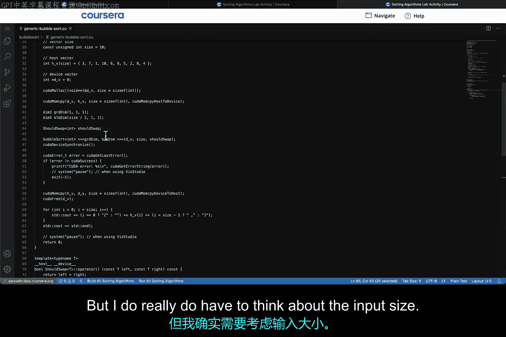

# 083：排序算法实验-冒泡排序 🧪

在本节课中，我们将一起学习GPU编程课程中的一个实验活动：冒泡排序算法的实现。我们将分析一个具体的CUDA代码示例，理解其工作原理，并探讨其局限性以及可能的改进方向。



---

## 概述

本节实验旨在通过一个具体的代码实现，帮助我们理解如何在GPU上实现经典的冒泡排序算法。我们将从代码结构入手，分析其核心函数，并讨论该实现对于不同数据规模和线程配置的适应性。

## 代码结构分析

首先，我们来看一下这个冒泡排序实现的主要结构。`main`函数包含了除冒泡排序和交换操作之外的大部分逻辑。

以下是该实现的核心组成部分：

*   **数据规模**：当前示例使用的输入数据规模较小。我鼓励你尝试将其增大，例如设置为1000个值，以观察其表现。
*   **内存操作**：代码正确地确定了线程块（block）和网格（grid）的尺寸，并进行了必要的数据拷贝。
*   **核心函数**：实现包含了判断是否需要交换的`should_swap`函数和执行交换的`swap`函数。

## 核心函数详解

上一节我们介绍了代码的整体结构，本节中我们来看看具体的函数实现。

### 交换判断函数

`should_swap`函数用于比较两个值，决定它们是否需要交换位置。其逻辑是：如果左侧的值大于右侧的值，则返回真（需要交换）。这可以用一个简单的条件判断来描述：
```c
bool should_swap(int left, int right) {
    return left > right;
}
```

### 交换函数

`swap`函数使用一个临时变量来交换两个值，这是交换操作的经典实现：
```c
void swap(int *a, int *b) {
    int temp = *a;
    *a = *b;
    *b = temp;
}
```

### 冒泡排序内核（Kernel）

这是算法的核心部分，即GPU上运行的`bubble_sort`内核。它遍历分配给它的数据（大小为`n`），每个线程从左到右确定自己的索引，执行交换操作，然后通过`__syncthreads()`进行线程同步。该内核主要操作全局内存。

其基本逻辑是：在它关心的数据范围内，从左到右进行交换。当`n`等于整个输入数组的大小时，这种做法是可行的。

## 实现的局限性与思考

上面我们分析了内核的基本工作流程，现在我们来探讨这个实现的一些局限性。

当前实现的一个关键假设是线程数量与数据规模`n`相匹配。但当`n`非常大（例如1000），而可用的线程数量有限（例如只有32个）时，情况会变得复杂。

*   如果每个线程只负责排序数组中与其对应的特定部分，那么最终我们得到的将是多个已排序的“子数组”，而非一个完全有序的整体数组。
*   这就需要在不同线程之间进行额外的“跨线程”交换和合并操作，当前的实现并未处理这部分逻辑。

因此，虽然这个代码是一个不错的起点，但它可能无法高效地利用多个线程对大规模数据进行排序。你可能需要设计多次迭代或更复杂的通信机制来完善它。

## 总结与挑战

本节课中我们一起学习了一个GPU上的冒泡排序算法实现。我们分析了其代码结构、核心函数以及工作原理。

**总结如下：**
1.  该实现清晰地展示了冒泡排序在GPU上的基本思路。
2.  它适用于数据规模与线程数量相匹配的理想情况。
3.  其主要局限性在于处理大规模数据且线程数不足时，缺乏跨线程的协同排序机制。



我给你的挑战是：尝试修改和扩展这段代码，使其能够有效地利用固定数量的线程（例如32个或256个）来排序远超线程数量的大规模数组。你可以思考如何将数据分块、如何在多次内核启动中逐步完成排序，或者如何在线程间高效地交换数据。请尽情尝试并享受编程的乐趣！