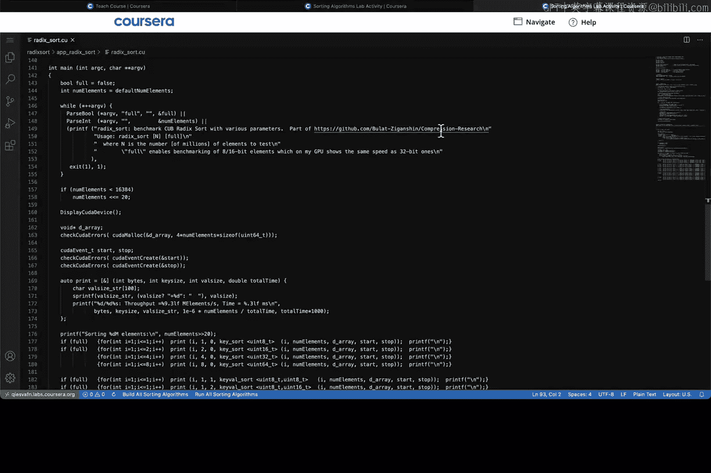
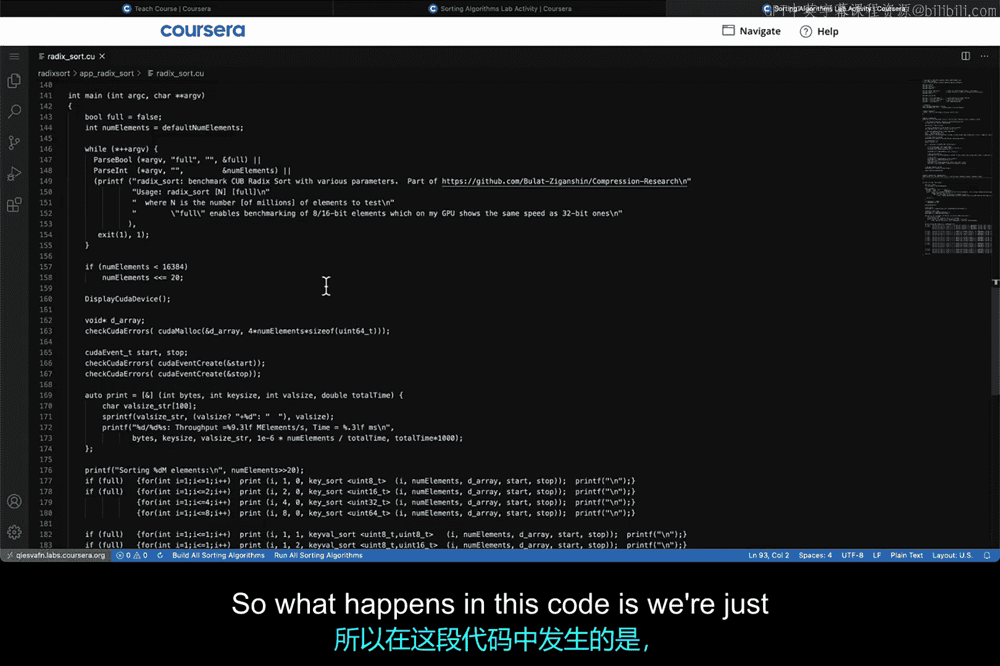
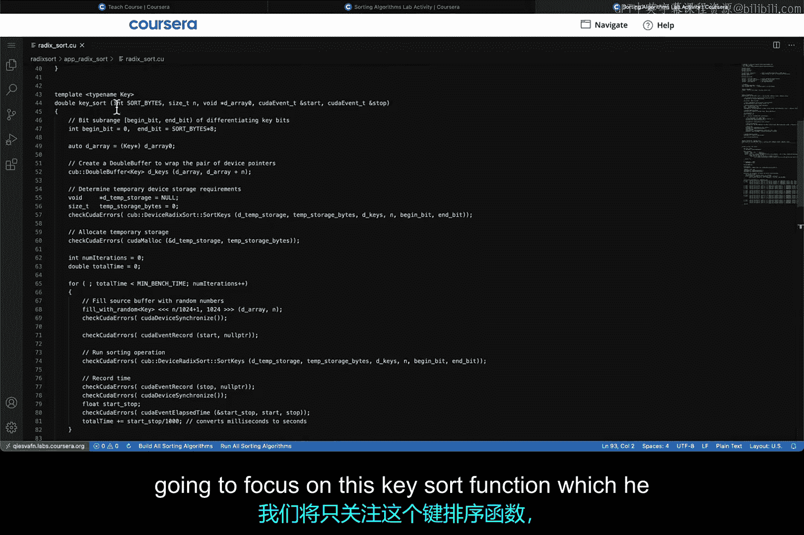
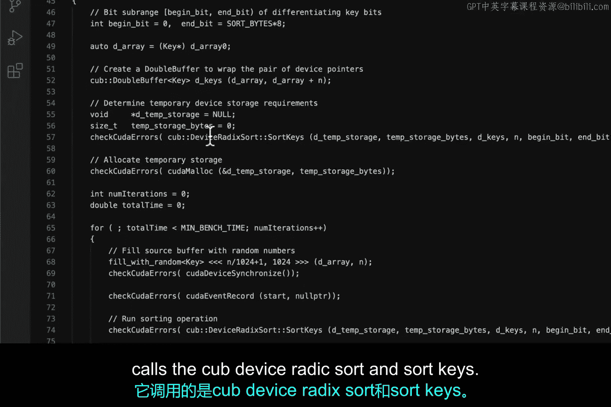
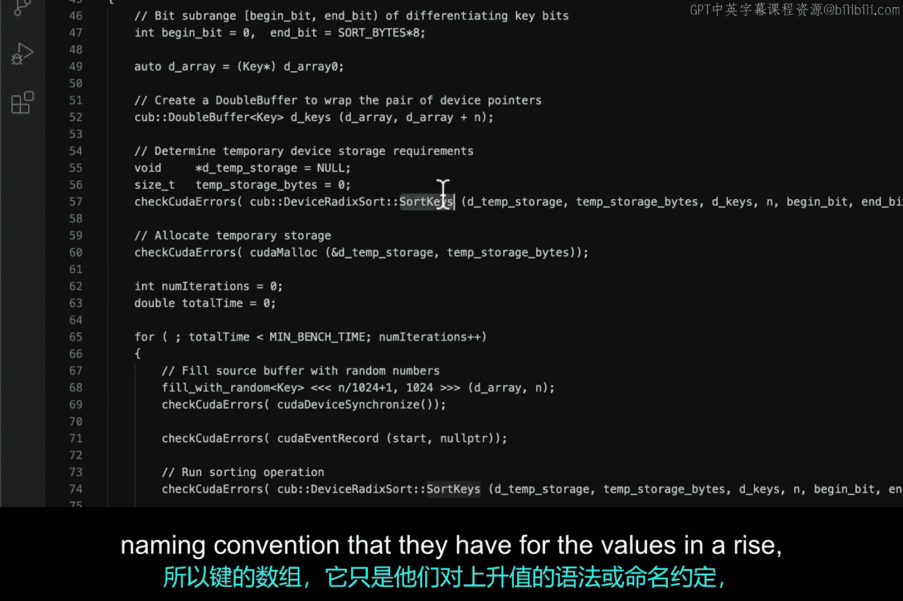
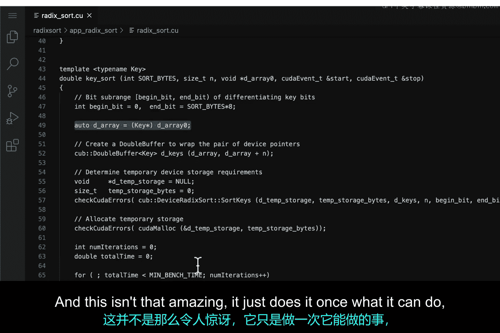
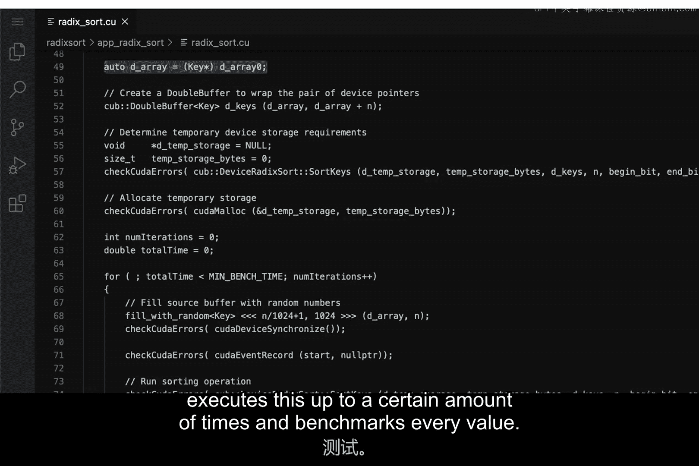
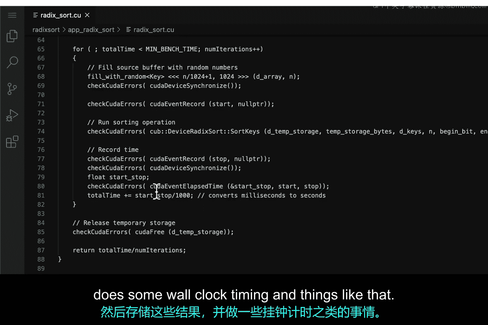

# 084：排序算法实验-基数排序 🧮

在本节课中，我们将学习一个用于基准测试的算法框架。该框架主要用于评测 NVIDIA CUB 库（一个类似于 Thrust 的 CUDA 高级库）中两种排序方法的性能。我们将重点关注“键排序”的实现与原理。

上一节我们介绍了排序算法的背景，本节中我们来看看具体的基准测试代码是如何工作的。

## 算法框架概述

该算法本质上是一个测试工具，用于对 CUB 库进行基准测试。CUB 是 NVIDIA 实验室提供的一个能力库，与 Thrust 库类似。

它的作用是基准测试两种排序方式。这两种方式都使用基数排序，但一种仅对“键”进行排序，另一种则对“键值对”进行排序。

## 理解“键”与“值”

这里的“键”和“值”概念可能会令人困惑。需要明确的是：
*   **键** 是被排序的对象。
*   **值** 是不被排序的关联数据。

这是一种常见做法。例如，当你有一个字典（或映射）时，你可能希望根据键来排序，而不是根据值。当然，也可以反过来根据值排序键，但这通常不太直观，因为你需要从值反向引用到键，而通常的映射关系是从键指向值。

## 键排序功能分析

在这段代码中，我们将重点关注 `sort_keys` 函数。

该函数调用了 CUB 库的 `DeviceRadixSort::SortKeys` 函数。记住，“排序键”意味着我们只对代表键的数组进行排序。

实际上，它只是接收一个数组并对其进行排序。这个数组就是键的数组。“键”和“值”的命名只是 CUB 库采用的语法或命名约定。

以下是创建和排序键数组的核心步骤：

1.  **创建键数组**：代码中创建了一个包含键值的数组。
2.  **使用双缓冲区**：代码创建了一个该数组的“双缓冲区”。这主要是为了处理可能同时发生的访问和更改，开发者无需过度关注其细节，库已妥善处理。双缓冲区的优势在于，你可以从起始或末尾访问数据。
3.  **调用排序函数**：随后调用 `SortKeys` 函数执行排序。单次排序本身并不复杂。

## 基准测试与性能评估

该代码更重要的作用是进行多次执行和基准测试。

它能做的一件更有趣的事情是：循环执行排序操作一定次数，对每一次操作进行基准测试，并存储这些结果。

代码会进行精确的时钟计时（如挂钟时间）。因此，当你运行此程序时，它不仅会完成排序，还会为你提供该特定函数相当精确的性能结果。

结果打印功能在代码的此处实现。

## 键值对排序

该框架同样会对“键值对”进行相同的基准测试。你可以将其类比为字典或映射。

基本原理是：对键进行排序，而与之关联的值本身不变。排序后，指针（或索引）指向的是排序后的键，而不再是原始的键。实际上，它并不改变原始数据结构，而是为你提供了一份排序后的键的副本，以及正确指向这些键的指针。

## 扩展与应用

这个基准测试框架可能很有用。它默认处理大量数据（如数百万个元素），但也许你想进一步增加压力测试，或者自己实现一些它未涵盖的核心功能。

你可以随时查阅 CUB 库的文档和源代码，了解其实现方式。也许你会想自己动手实现部分功能。无论如何，你可以通过此工具探索 CUB 库能为你提供多快的排序速度。

有时，解决排序问题的方案是：我理解其原理，但现在我想使用一个更快的现成工具。

---

**本节课中我们一起学习了**：一个用于评测 CUB 库基数排序性能的基准测试框架。我们理解了“键”与“值”在排序上下文中的区别，分析了代码中实现键排序的关键步骤，并了解了该框架如何通过多次迭代和精确计时来进行性能评估。最后，我们探讨了键值对排序的概念以及如何利用此框架进行扩展和深入探索。