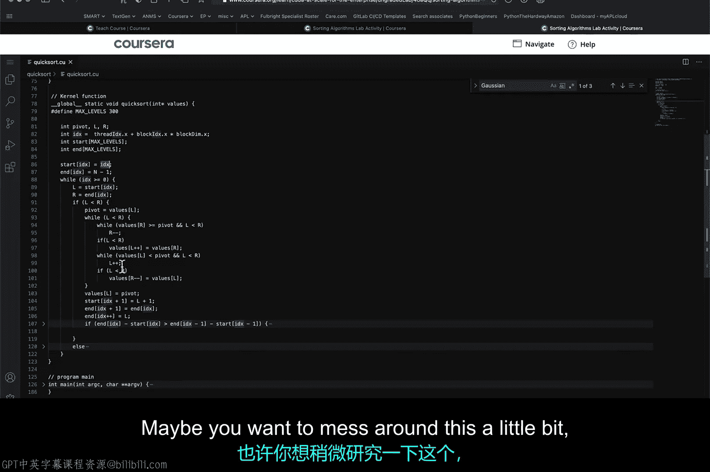

# 085：排序算法实验-快速排序 🚀

在本节课中，我们将要学习基于经典伪代码实现的快速排序算法。我们将分析一个具体的CUDA项目实现，理解其核心逻辑、数据划分方式以及线程间的同步机制。

---

上一节我们介绍了快速排序的基本概念，本节中我们来看看一个具体的CUDA实现。该实现源自一个GitHub项目，代码结构清晰，并且考虑到了不同的输入数据分布，这是一个很好的实践。

以下是该实现的一些特点：
*   它支持多种数据分布，如均匀分布、高斯分布、已排序数据等，这有助于测试算法在不同场景下的性能。
*   代码结构遵循典型的CUDA编程模式。

---

现在让我们看看主函数 `main` 的实现。

主函数执行了典型的CUDA程序流程。它首先定义了线程数（128）和数据大小（512），然后生成指定分布的数据。接着，它根据线程数和每个线程块（plot）的线程数启动内核。最后，它执行同步操作以确保可以查看计算结果。

---

了解了程序的整体流程后，接下来我们深入分析排序函数本身，看看它与我们之前看到的伪代码有何异同。

该函数使用了一个预定义的常量 `MAX_LEVELS`（值为300），这代表了递归或迭代的最大深度。接下来，它需要确定基准值（pivot）的索引，并划分出左分区和右分区。这是通过 `partition` 函数完成的。

每个线程的索引被定义后，程序会为所有 `MAX_LEVELS` 创建两个数组，用于存储每个层级处理的子数组的起始和结束索引。这种设计的巧妙之处在于，它允许线程在任何时候都能知道自己正在处理全局内存或共享内存中的哪一部分数据。

初始时，当前线程的起始索引是其线程ID，结束索引是 `n-1`（n为数据大小，例如512）。这意味着每个线程最初都认为自己需要处理整个数组（从自己的位置到末尾）。划分操作会沿着当前线程的索引进行。

然后，代码检查基础情况：如果左索引小于右索引，则继续移动基准值。基准值现在是该索引处的值。在 `while` 循环中，当左索引小于右索引时：
1.  如果 `data[R]` 大于基准值，则将右索引 `R` 减一，缩小待处理数组的范围。
2.  如果左索引小于右索引（这是关键条件），则将 `data[L+1]` 的值设置为 `data[R]` 的值。
3.  接着，在另一个循环中，检查 `data[L]` 是否小于基准值，并且 `L` 是否小于 `R`。如果是，则简单地将左索引 `L` 向右移动。
4.  在某些时刻，当 `data[L]` 不小于基准值时，需要进行值交换。

这个实现使用了大量本地和共享内存操作，逻辑较为复杂，可能不是最直观的实现方式。需要注意的是，在每次运行后都必须进行同步（`__syncthreads()`），因为此时共享内存或全局内存的状态已被许多线程改变，同步能确保所有线程在下一时刻看到一致且连贯的数据。

---

本节课中我们一起学习了快速排序算法在CUDA上的一个具体实现。我们分析了其主函数流程、排序内核如何利用线程索引进行数据划分、以及关键的同步机制。这个实现展示了在GPU上处理递归类算法时，如何通过迭代和显式的栈（`start`/`end`数组）来管理任务，并强调了在修改共享状态后同步的重要性。你可以尝试用更大的数据来测试这个实现，观察其性能表现。