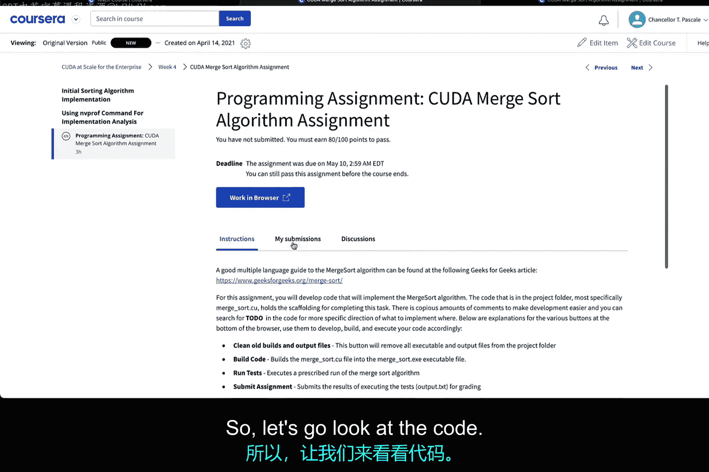
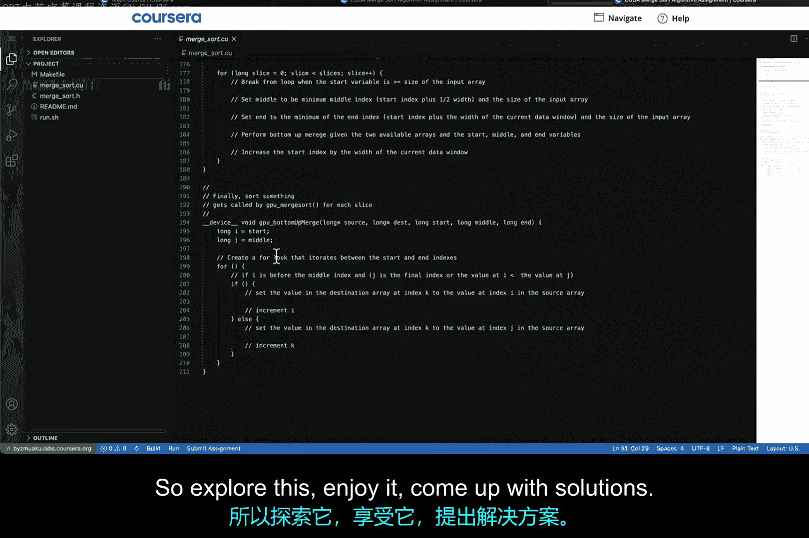

# 086：归并排序作业项目 🧩

在本节课中，我们将快速浏览归并排序的作业项目。该项目属于课程模块4，旨在通过实践加深对GPU并行排序算法的理解。

## 概述

作业提供了一个基于GeeksforGeeks多语言实现的归并排序框架。界面包含一系列功能按钮，如清理构建、构建代码、运行测试和提交作业。每个按钮的功能都有明确描述。

以下是界面中可配置的关键参数：
*   **线程块维度**：可设置每个线程块在各个维度上的线程数量。
*   **网格块维度**：可设置网格在各个维度上的块数量。
*   **元素数量**：定义将随机生成的待排序元素数量。

目前实现并未完全优化以处理多维配置，但探索算法及其伪代码以验证其工作方式是很有价值的。

## 代码结构解析

上一节我们介绍了作业的界面和参数，本节中我们来看看代码的具体实现。

代码主体包含一个`main`函数，其执行流程如下：
1.  解析之前提到的命令行参数。
2.  在主机内存中创建指定大小的`long`类型数组。
3.  打印排序前的数组。
4.  执行GPU归并排序。
5.  打印排序后的数组。

这里的排序是**GPU归并排序**。其核心思想是：算法接收一个数据切片，初始时切片很小（对应于递归树的最底层）。随着归并排序的轮次完成并向上“冒泡”，算法处理的切片会越来越大。相应地，在递归树中越往上，使用的线程数会越少。

实际上，代码并非递归实现，而是将其展开为迭代过程。算法主体执行**自底向上的归并**，具体通过调用`bottom_up_merge`函数实现，该函数内部包含循环。虽然存在条件分支，并非最优实现，但作为归并排序的初版实现已相当不错。

## 总结

本节课中我们一起学习了归并排序作业项目的框架、配置参数以及核心代码结构。这是一个基于自底向上归并策略的GPU实现，鼓励大家深入探索代码，理解其工作原理，并尝试提出自己的优化解决方案。