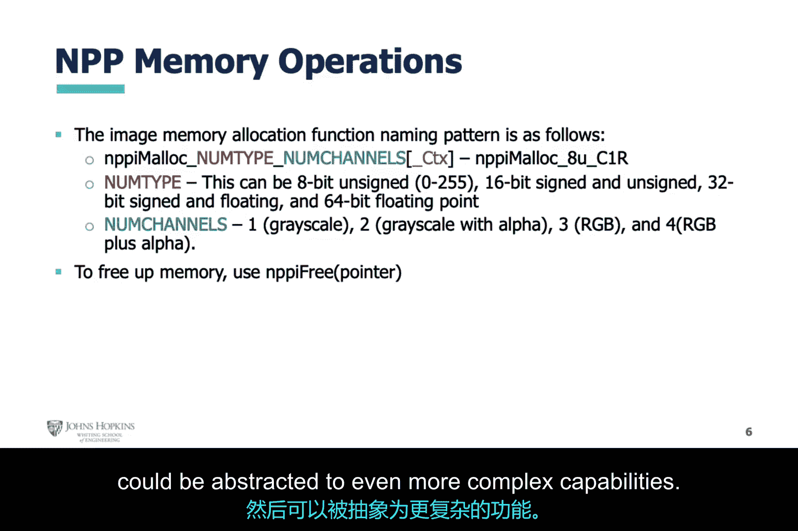

# 087：NPP图像处理语法解析 📚

在本节课中，我们将学习NVIDIA性能基元库（NPP）在图像处理方面的核心语法与使用方法。我们将重点介绍如何利用NPP库简化图像处理流程，包括数据类型的定义、内存管理以及各种图像处理操作。

## 概述

NVIDIA性能基元库（NPP）为开发者提供了一套高性能的图像处理函数。本节课程将解析其核心语法，帮助开发者理解如何利用NPP进行高效的图像处理。

## 主机内存图像对象

上一节我们介绍了NPP库的基本概念，本节中我们来看看如何在主机内存中表示图像数据。

为了简化将图像导入主机内存的过程，我们将使用CUDA示例项目中`common/UtilNPP`目录下的`imageCPU`功能。这是一段非常优秀的代码，它抽象了底层数据表示的具体细节。

以下是图像对象或数据类型的命名模式：

*   它以 `imageCPU_` 开头，后跟数值类型。
*   数值类型可以是8位、16位、32位的有符号/无符号整数或浮点数。
*   接下来的部分是通道数。通道数对应色彩光谱中的通道数量：1代表灰度图；2代表带Alpha通道的灰度图；3代表RGB（红、绿、蓝）；4代表带Alpha通道的RGB。

因此，一个完整的数据类型可能类似于 `imageCPU_8u_C1`（8位无符号单通道图像）。但你需要将数据载入这种数据类型。通常的做法是使用像FreeImage这样的C++库，或者OpenCV等其他库。你需要确保有一种简便的方法能将位数据导入NPP。有多种方法可以实现，在本例中我们将使用FreeImage。

## 设备内存图像对象

了解了主机内存中的图像表示后，我们接下来看看设备（GPU）内存中的对应对象。

对于设备内存，存在类似的对象或数据类型。它们遵循相同的命名模式，并且我们将从同一个地方（即`common/UtilNPP`目录下的`imageNPP`）获取对它们的轻度抽象封装。

这里需要考虑的主要一点是，与主机图像对象的构造函数不同，这类数据类型的实例是从主机内存填充的。例如，`imageNPP_8u_C1`，你给它变量名和主机指针，它就会处理像`malloc`之类的所有内存操作。实际上，你可以在几页幻灯片后看到具体的内存管理示例。

## 图像处理功能：滤波

NPP库内部包含多个用于图像处理的子库。我们现在来讨论滤波功能。

以下是函数命名约定的工作方式：

*   函数名以 `nppi` 开头，其中的 `i` 代表图像。
*   接着是 `Filter`，然后是滤波器的名称。
*   之后是数值类型和通道数。
*   最后的 `_Ctx` 用于指示该函数支持CUDA流。你不一定必须包含它。

例如，这里的示例是 `nppiFilterBox_8u_C1R_Ctx`。这是一个运行在8位无符号单通道图像上的方框滤波器。其中的 `R` 你无需过多担心，对于单通道图像它通常都会存在。函数名可以是NPP滤波模块中提供的数十种滤波器中的任何一种。

## 其他图像处理功能

除了滤波功能，NPP还提供了许多其他子库。

以下是NPP库提供的其他主要图像处理功能：

*   **几何变换**：如果你需要旋转或调整图像大小，可以使用几何或线性滤波功能。
*   **色彩操作**：可以在灰度图和RGB之间进行转换，或修改伽马值以不同方式查看图像。
*   **数学运算**：例如，如果你想增强某个通道（比如为图像增加更多红色），你可以为图像中红色通道的所有像素值加上一个常数。
*   **形态学变换**：这些操作稍微复杂一些，但可以产生一些视觉效果良好的图像。你可以将其类比为社交媒体图像平台上常见的那些扭曲特效。

## 内存管理

现在，我们来到了这些高性能基元中最基础的部分：内存管理。

使用 `nppiMalloc` 函数，并遵循你已见过的模式（数值类型、通道数和 `_Ctx`），你可以为8位到64位、1到4通道的图像定义底层内存。完成后，使用 `nppiFree` 并传入图像指针即可释放内存。这个指针可以是更高级抽象对象的指针，库会为你处理这一点。

请注意，这并非图像处理所需的一切功能的完整套件。它旨在为图像提供快速、高性能的低层计算，并可被进一步抽象以构建更复杂的功能。

## 总结

本节课中我们一起学习了NVIDIA性能基元库（NPP）在图像处理方面的核心语法。我们了解了如何在主机和设备内存中表示图像数据，掌握了NPP函数的命名约定，并概览了其提供的滤波、几何变换、色彩操作、数学运算及形态学处理等多种功能。最后，我们学习了使用`nppiMalloc`和`nppiFree`进行基础的GPU内存管理。NPP为高效的GPU图像处理提供了强大的底层支持。