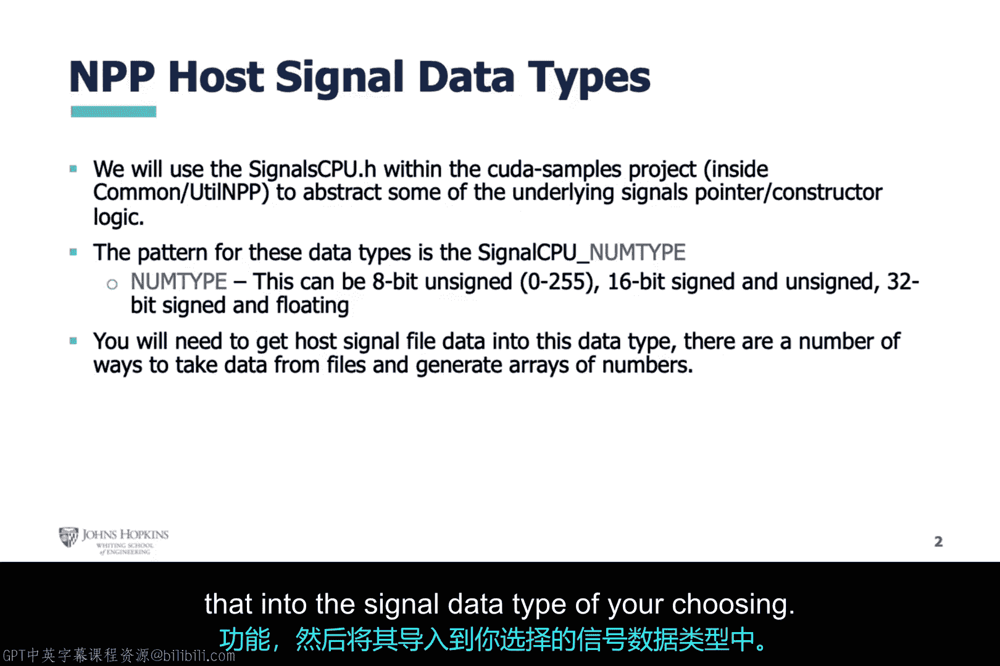
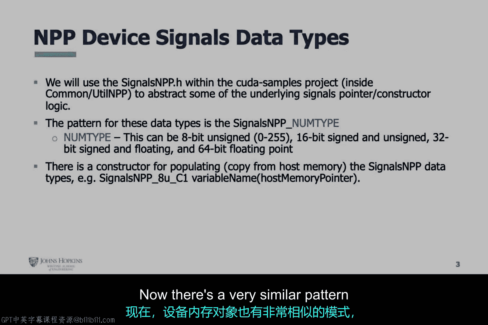
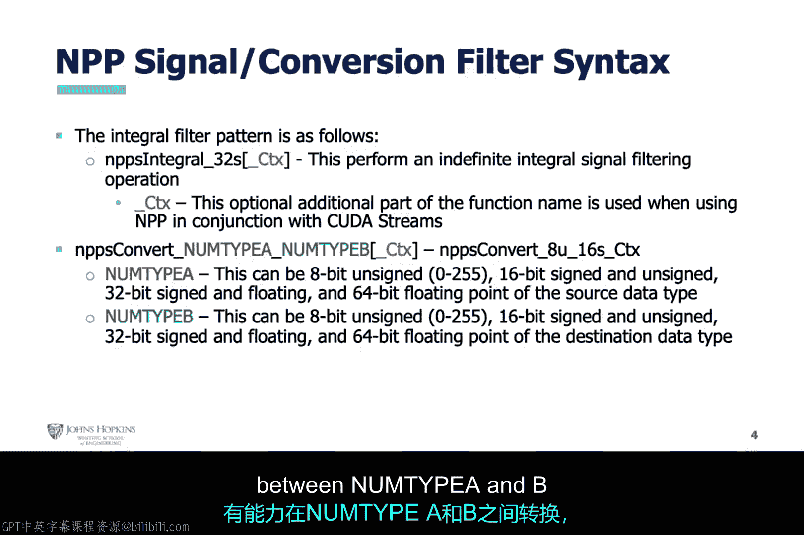
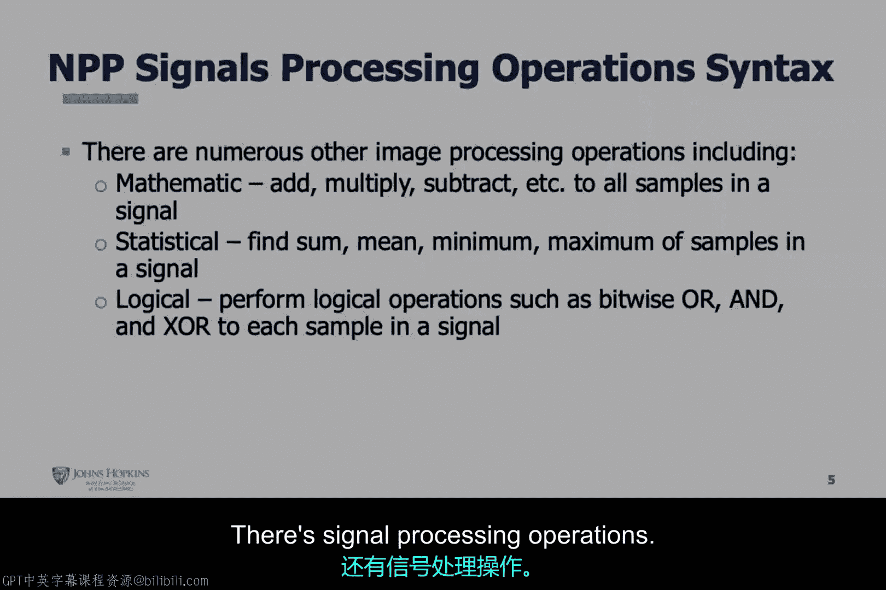
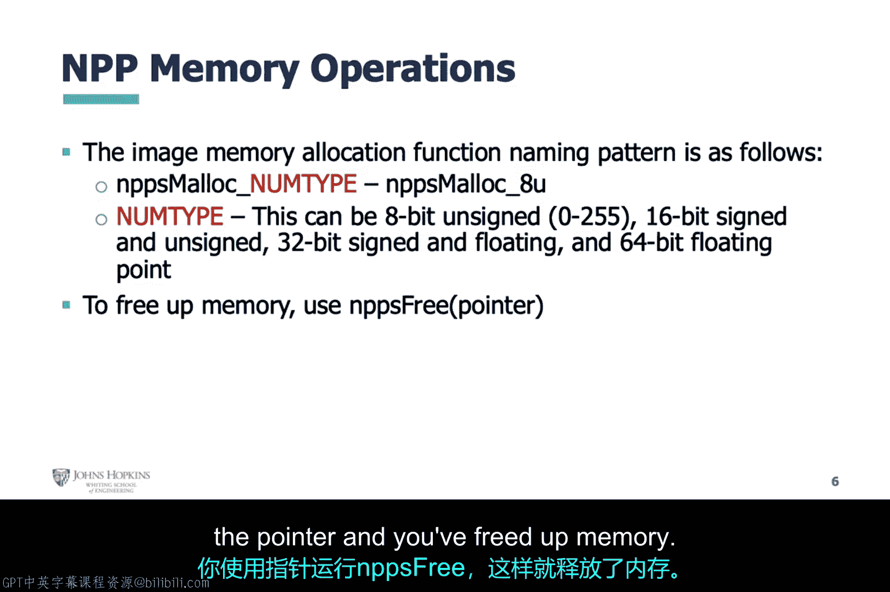
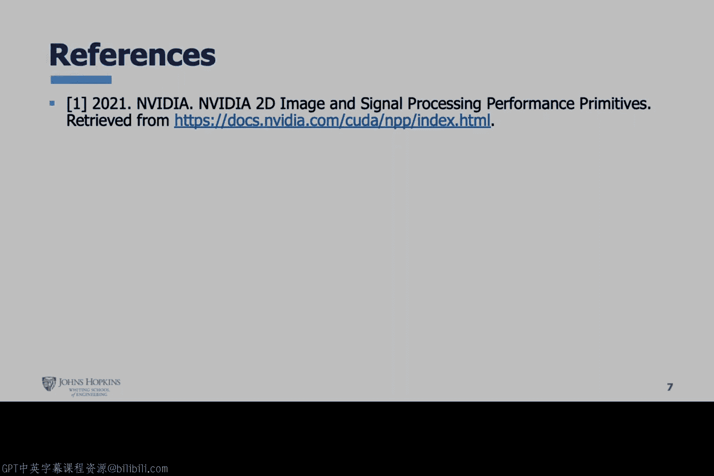

# 089：NPP信号处理语法详解 🎛️

在本节课中，我们将学习NVIDIA性能原语（NPP）库中用于信号处理的部分。我们将了解其核心数据结构、操作类型以及如何将信号数据从主机内存传输到设备内存进行处理。

## 概述

上一节我们介绍了NPP库在图像处理方面的应用。本节中，我们来看看NPP库中一个功能相似但相对小众的模块：信号处理。虽然这部分文档和示例较少，但信号处理是一个常见的使用场景，因此值得学习。与图像处理类似，我们将使用CUDA示例中提供的`NPP Commons`工具来简化操作。

## 信号处理的数据类型

信号处理的数据类型比图像处理简单。主机端的数据类型以`NppSignalCPU_`为前缀，后接数值类型。数值类型范围从8位到32位，包括有符号、无符号整数和浮点数。这代表了信号样本的大小。

需要注意的是，您处理的是信号在不同时间间隔的样本。因此，您需要根据选择的数值类型（如无符号整数、有符号整数或浮点数），来确定如何将原始数据导入。

与图像处理不同，支持导入已知信号格式（如WAV文件）的库较少。您需要寻找能够将WAV等文件转换为整数数组，再导入到所选信号数据类型的工具。

## 设备内存对象

设备端的内存对象模式与主机端非常相似。区别在于，您将使用`NppSignal`前缀，而不是`NppSignalCPU`。这些就是构成“NPP”名称基础的性能原语。

CPU端和设备端的数据类型命名存在镜像关系。设备端使用`NppSignal`，后接数值类型。它们之间应该存在一一映射关系。因此，您可以从一端选择数据类型，然后为设备端的操作选择对应的类型。

请注意，与NPP图像数据类型处理设备内存时类似，您需要传递指向主机内存的指针。查看代码时，将数据获取到内存不同位置的操作与图像处理代码非常相似。

## NPP信号处理的功能

NPP库为信号处理提供的功能和种类相对较少。以下是主要操作类别：

*   **滤波**：基本上只提供32位有符号整数的积分功能。
*   **转换**：具备在不同数值类型A和B之间进行转换的能力，库会为您处理。
*   **数学运算**：可以通过加、减、乘等数学运算来增强或减弱信号。
    
    
*   **统计运算**：例如计算信号中一系列样本的总和、最小值、最大值。
*   **逻辑运算**：例如对信号样本内的所有位执行按位与、或、异或等基本布尔逻辑操作。
*   **内存操作**：与图像处理中的操作非常相似，例如`NppMalloc`。

数值类型再次涵盖8位到64位，包括无符号、有符号整数和浮点数。完成所有操作后，您需要运行`NppFree`并传入指针来释放内存。

## 总结

本节课中，我们一起学习了NPP库的信号处理模块。我们了解了用于主机和设备的信号数据类型命名规则及其映射关系，回顾了NPP支持的主要信号处理操作，如滤波、转换、数学运算、统计和逻辑运算。最后，我们强调了使用`NppMalloc`分配和`NppFree`释放设备内存的重要性。尽管这部分库的资源和文档相对较少，但其提供的功能对于GPU加速的信号处理任务是一个实用的起点。