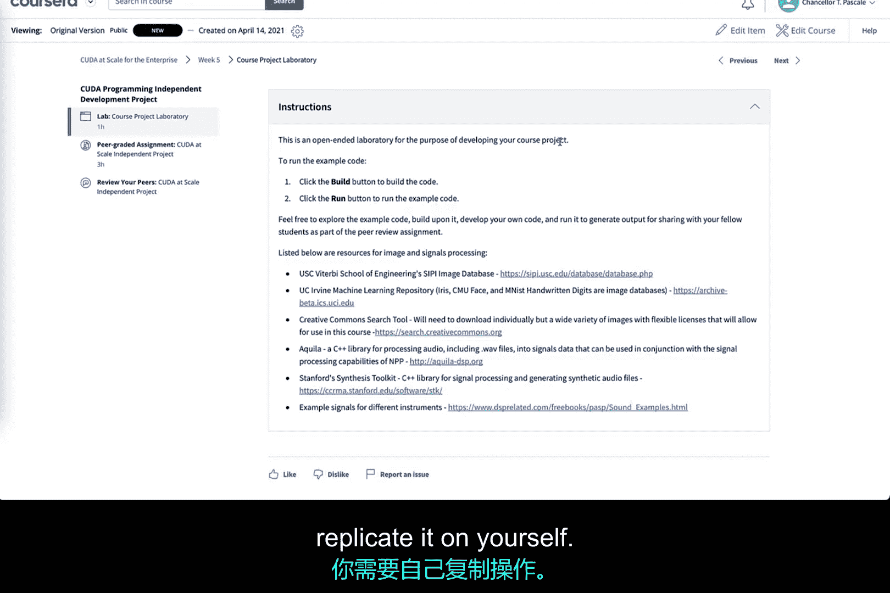
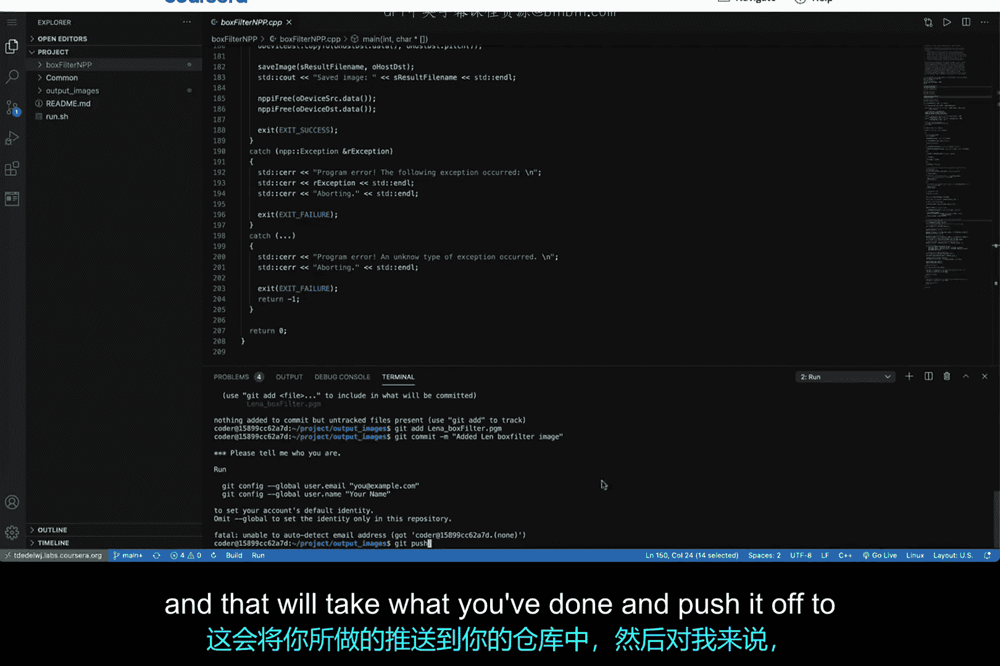
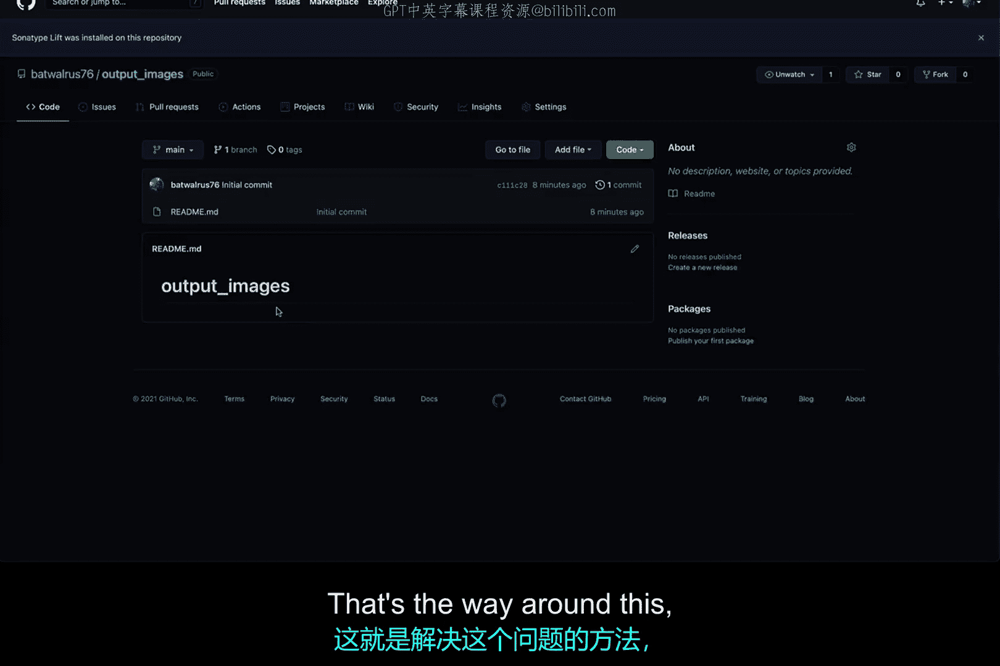
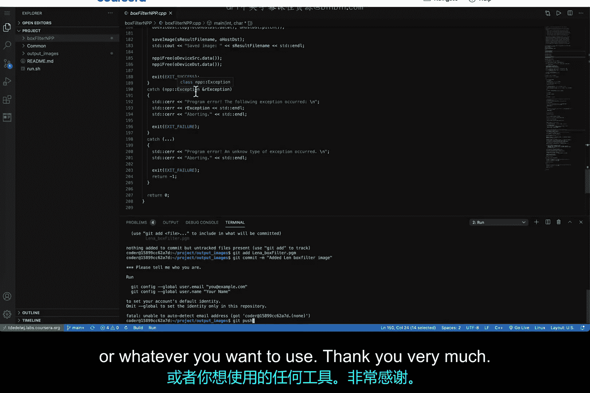

# 091：独立项目实验总览 🧪

在本节课中，我们将学习课程独立项目的整体概览。这是一个供你开发代码的沙盒环境，包含示例代码、库以及运行基础图像处理程序的能力。我们将了解如何构建和运行项目，以及如何通过Git管理你的输出成果。

---

## 项目环境与目标

上一节我们介绍了课程项目的基本概念，本节中我们来看看项目的具体环境和目标。

这是一个供你开发代码的沙盒环境。项目中包含示例代码、库以及用于运行基础图像处理程序的框架。你可以利用这个环境来学习更多关于GPU编程的知识，也可以在其基础上进行构建，甚至从头开始编写自己的代码。

项目的核心目标是让你能够运行一些基础的图像处理程序，并鼓励你在此基础上进行更深入的探索。

---

## 构建与运行示例代码



现在，我们来了解如何实际操作这个项目。以下是运行示例代码的步骤：

1.  **构建项目**：点击界面底部的“Build”按钮来编译代码。
2.  **运行项目**：编译成功后，点击“Run”按钮来执行程序。

示例代码是一个C++程序，它主要使用底层的GPU库。代码会读取一个输入图像文件，对其应用一个盒式滤波器，然后输出处理后的图像。

代码的关键部分涉及传递输入参数和处理图像：
```cpp
// 示例：传递输入文件参数并处理
./program --input input_image.pgm
```
程序会打开指定的文件，将其转换为灰度图像（如果需要），进行处理，最后将结果保存为一个新的PGM文件。

---

## 处理输出文件与Git集成

程序运行后会产生输出文件，但课程实验环境无法直接下载文件。因此，我们需要使用Git来管理这些输出。

以下是管理输出文件的步骤：

1.  **初始化Git仓库**：在项目目录外，克隆一个你自己的Git仓库（例如来自GitHub）。
2.  **复制输出文件**：将程序生成的输出文件（例如 `output_box_filtered.pgm`）复制到克隆的Git仓库目录中。
3.  **提交更改**：使用Git命令添加文件、提交更改并添加提交信息。
    ```bash
    git add output_box_filtered.pgm
    git commit -m “添加盒式滤波器处理后的图像”
    ```
4.  **推送至远程仓库**：执行 `git push` 命令，将你的更改上传到远程Git仓库（如GitHub）。

通过这种方式，你可以在GitHub等平台上查看和分享你的项目输出结果。

---

## 获取数据与进一步探索

为了完成更有趣的项目，你可能需要数据。以下是一些可用于图像和信号处理的数据源建议：

*   公开的医学影像数据集（如Kaggle上的相关竞赛数据）。
*   自然图像数据集（如CIFAR-10, ImageNet的子集）。
*   信号处理数据库（如UCI机器学习仓库中的时间序列数据）。

你可以利用这些数据，在提供的沙盒环境中实验更复杂的GPU加速算法。



---



## 总结



本节课中我们一起学习了课程独立项目的整体框架。我们了解了它是一个代码开发沙盒，掌握了如何构建和运行示例图像处理程序。更重要的是，我们学会了如何通过Git仓库来管理项目的输出文件，以克服实验环境无法直接下载文件的限制。现在，你可以开始在这个环境中探索和实现你自己的GPU加速创意了。