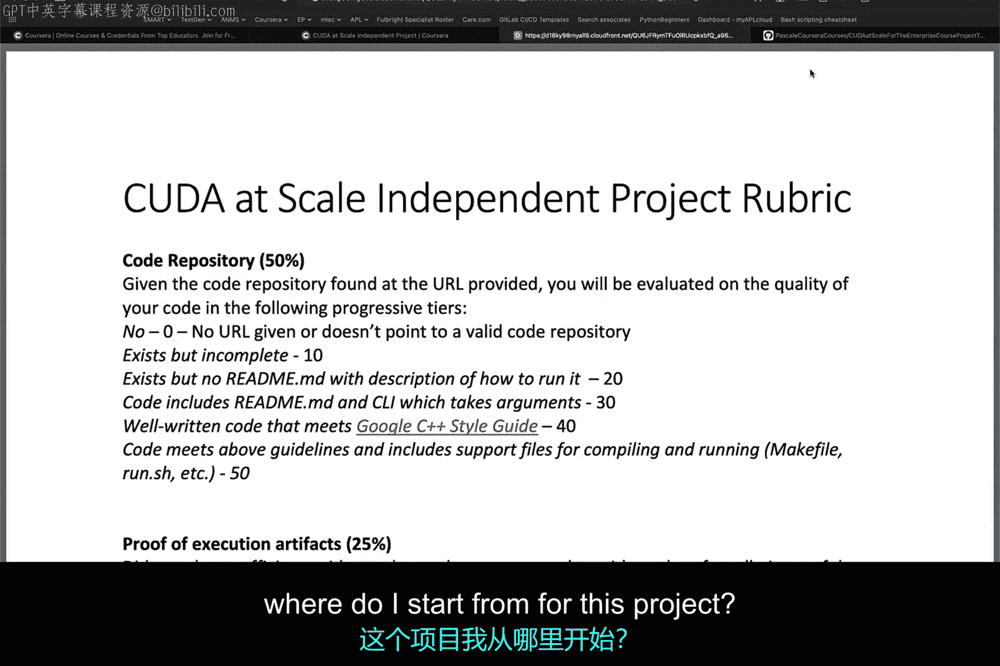
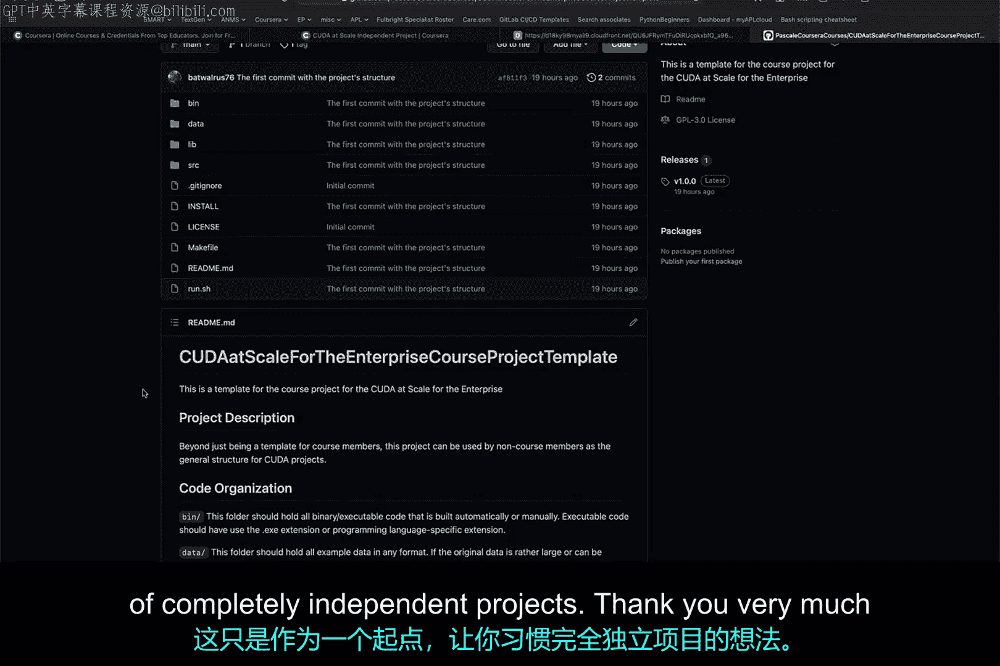

# 092：独立项目总体说明 🚀

在本节课中，我们将详细说明本课程的独立项目要求。我们将介绍项目的构成、评分标准、提交方式，并提供如何开始和推进项目的具体建议。

## 项目概述

本独立项目是课程的重要组成部分，采用同伴互评的方式进行评分。接下来，我将快速回顾项目说明，展示提交要求，并阐述我认为你应该如何推进自己的项目开发。

## 项目评分标准

以下是构成你项目成绩的三个核心部分。

### 1. 代码仓库 (占总成绩50%)

代码仓库是你项目的基础。具体要求如下：
*   你需要提供一个公开可访问的URL。
*   我倾向于使用Git（如GitHub、GitLab、Bitbucket）等版本控制仓库，以便其他学生可以克隆你的项目。
*   你也可以使用共享文件夹（如Google Drive、Box），但必须确保该文件夹及其结构是公开可访问的。
*   仓库中需要包含必要的代码和符合一定编码风格的项目文件。

### 2. 执行证明 (用于展示你的工作成果)

执行证明用于展示你已完成的工作。具体要求如下：
*   证明形式可以是有趣的图像、视频或信号处理前后的对比。
*   我虽然在课程中较多聚焦于图像处理，但如果你愿意处理音频文件（如WAV文件），并将其转换为合适的结构进行处理，这完全没有问题。
*   我倾向于你能将处理后的结果再转换回音频文件，以清晰展示输入与输出的差异。

### 3. 项目描述 (应同时放在README.md中)

项目描述需要清晰地阐述你的工作。具体要求如下：
*   这段文字描述也应放在你的代码仓库的`README.md`文件中（特别是使用GitHub或GitLab时）。
*   描述内容需要说明你的项目目标、完成的工作，以及项目完成后的思考或未能达成全部目标的原因。
*   本项目的目标并非创造世界上最完美的应用，而是展示你的学习成果，并为其他同学提供一个可能的新用例参考。

## 如何开始你的项目

你可能会问，这个项目应该从哪里开始？我为此创建了一个项目模板。

这个模板是公开的，位于我的课程项目目录中。它本身内容不多，主要提供了一个标准的项目结构。

模板中的`README`文件描述了文件的一般存放位置。一个典型的项目结构应包含：
*   **`README.md`**：项目描述和使用说明。
*   **`src/` 目录**：存放源代码。
*   **`install/` 目录 (可选)**：如果项目需要安装，存放相关文件。
*   **构建文件**：如 `Makefile` 或 `CMakeLists.txt`。
*   **运行脚本**：或是在文档中清晰描述如何运行项目。

即使你选择使用共享文件夹，也应遵循类似的结构。我强烈建议使用GitHub等平台公开分享你的代码，这有助于展示你的工作流程（如提交历史），虽然这不会直接影响你的分数。

## 项目构思与开发建议

现在你有了起点，接下来需要思考项目内容。以下是一些建议：

*   **在`README`中清晰定义目标**：例如，“本项目旨在探索图像在灰度与彩色之间转换的效果差异”。
*   **进行计算和验证**：你可以在代码内部或外部使用工具，通过像素级对比来量化展示两张图像的差异。公式可以表示为：
    **`差异度 = Σ |像素_输出(x,y) - 像素_输入(x,y)|`** （对所有像素求和）
*   **探索课程内容**：你可以尝试对图像应用不同的滤镜，深入探索NPP库。虽然本项目位于NPP模块，旨在让你进行更自由形式的实践，并为后续更复杂的项目做准备。
*   **保持适度**：本项目不应是耗时数周或需要投入16-24小时的大型工程。建议你花费几个小时，基于已编写的代码或想尝试的想法进行实践。
*   **完成最小可行产品**：完成足以证明你理解所学知识、并能产生可识别效果的最小工作量。

## 项目打包与提交

你需要将项目打包以便提交。具体要求如下：
*   提供一个包含代码和（可能的）输入数据的公开URL。
*   将实际的成果物（输入和输出文件）使用ZIP或TAR.GZ等格式打包。
*   撰写一份优秀的项目描述。这份描述应包含一些通常不会写在技术`README`中的内容，例如开发过程中遇到的失败经历、特别成功的部分，以及完成项目后的个人体验与感想。

## 关于同伴互评的提醒

在评价他人项目时，请做到：
*   **欣赏他人的努力**：认可他人投入的工作。
*   **提供建设性反馈**：在自由文本反馈区，专业、简洁地指出代码的优点、你发现的问题，或你未曾想到但觉得很好的思路。
*   **保持专业**：反馈应具有建设性且专业。

希望以上说明能帮助你顺利启动项目。请不要把它看得过于沉重，它旨在作为一个起点，让你适应完全独立的项目开发模式。

本节课中，我们一起学习了独立项目的总体框架。我们明确了项目的三大评分部分：代码仓库、执行证明和项目描述。我们介绍了如何利用提供的模板开始项目，并给出了项目构思、开发以及最终打包提交的实用建议。最后，我们强调了在同伴互评中应保持建设性和专业性。祝你项目顺利！