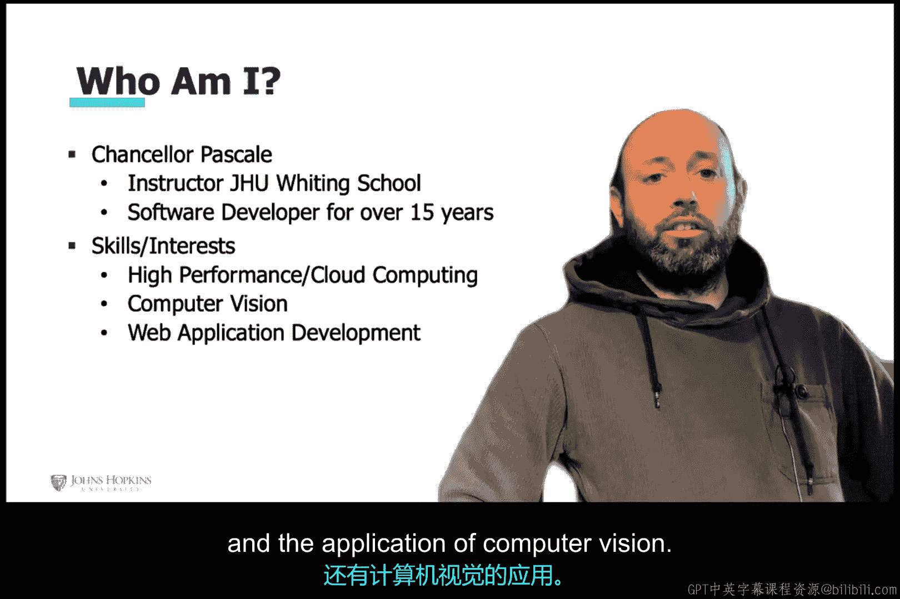
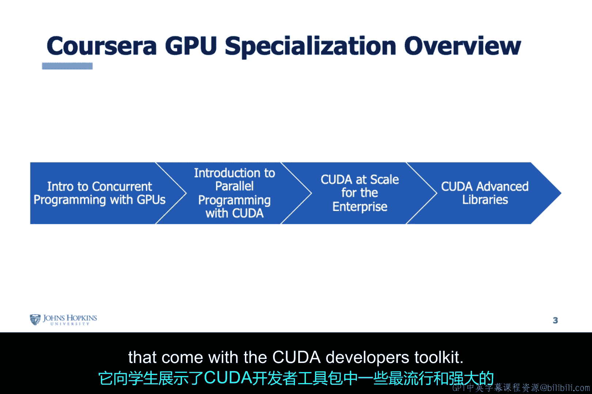
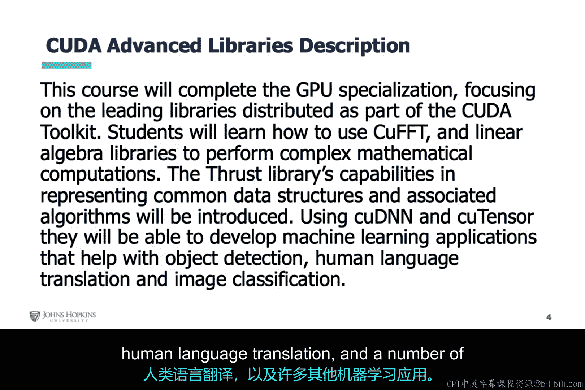
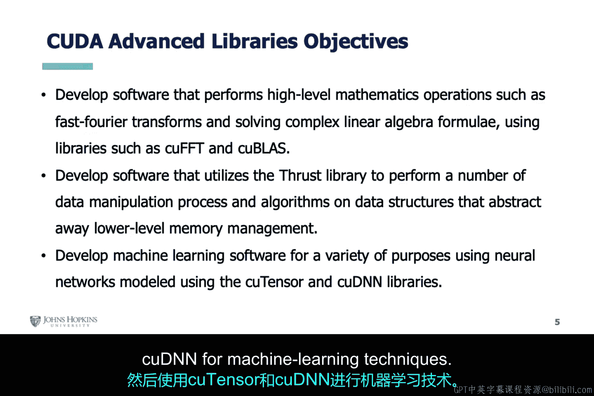

# 094：CUDA高级库课程概述 🚀

在本节课中，我们将要学习约翰霍普金斯大学GPU编程专项课程的第四门，也是最后一门课程——《CUDA高级库》。我们将了解这门课程在整个专项课程中的定位、主要内容以及学习目标。

## 课程讲师介绍 👨‍🏫

我是帕斯卡·钱塞勒。我在约翰霍普金斯大学怀廷工程学院担任讲师已有10年。我同时也是一名拥有15年经验的软件开发人员。高性能计算、云计算、Web开发以及计算机视觉的应用都是我的兴趣所在。

## GPU编程专项课程全景图 📚

上一节我们介绍了讲师背景，本节中我们来看看整个GPU编程专项课程的构成。该专项课程包含四门循序渐进的课程。

以下是四门课程的列表：
*   **第一门课程**：**《GPU并发编程导论》**。这是您当前所在的课程，我将在下一张幻灯片中更详细地描述它。
*   **第二门课程**：**《CUDA并行编程导论》**。这门课程专注于NVIDIA GPU和CUDA编程框架提供的基本硬件和软件能力。
*   **第三门课程**：**《面向企业的规模化CUDA》**。它深入探讨了CUDA更复杂的功能，以及如何将这些功能应用于超越程序员个人机器、扩展到企业级硬件的大规模场景。
*   **第四门课程**：**《CUDA高级库》**。这是GPU专项的最后一门课程，它向学生介绍了CUDA开发工具包中附带的一系列最流行和强大的库。

## 《CUDA高级库》课程详解 🧰

在了解了整个课程体系后，我们现在聚焦于本门《CUDA高级库》课程。作为GPU专项的收官之作，本课程重点介绍CUDA附带的一些高级库。

以下是本课程将涵盖的核心库及其用途：
*   **高级数学库**：例如用于快速傅里叶变换的`cuFFT`或用于线性代数的`cuBLAS`，它们用于执行更高级别的数学运算。
*   **Thrust库**：它抽象了一些指针运算和内存管理操作，并提供了核心算法库，允许您在更高层次上操作数据。
*   **机器学习库**：我们将学习适用于机器学习的库，即`cuDNN`和`cuTensor`。它们可用于目标检测、人类语言翻译以及其他多种机器学习应用。

## 本课程学习目标 🎯

前面我们介绍了课程内容，本节我们明确一下学习目标。本课程主要有三个核心目标。

以下是三个主要目标：
1.  使您能够使用`cuBLAS`和`cuFFT`等库开发更高级的数学计算能力。
2.  学习使用Thrust库在更高层次上操作数据。
3.  学习使用`cuTensor`和`cuDNN`库实现机器学习技术。

## 总结 ✨

本节课中，我们一起学习了《CUDA高级库》课程的概述。我们认识了讲师，了解了本课程在GPU编程专项中的位置，预览了将要学习的关键库（如`cuBLAS`、`cuFFT`、Thrust、`cuDNN`和`cuTensor`），并明确了课程的学习目标。希望本次介绍能让您开始思考自己在本课程乃至整个GPU编程专项中希望实现的目标。