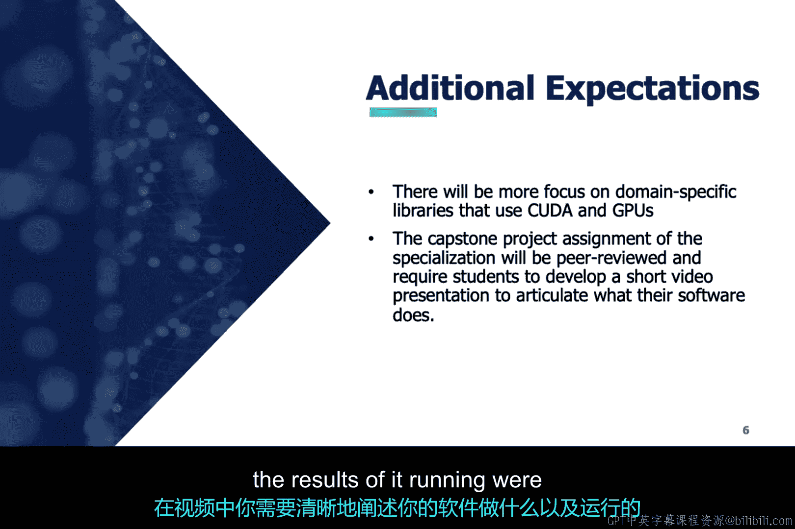

# 095：课程期望 📋

在本节课中，我们将了解《CUDA高级库》这门课程的整体期望。课程期望主要分为三个部分：**课程材料**、**时间投入**和**技术要求**。掌握这些信息将帮助你更好地规划学习路径，顺利完成课程。

---

## 课程材料期望 📚

上一节我们介绍了课程期望的三个主要方面，本节中我们来看看对课程材料的具体要求。本课程的材料构成与其他专项课程中的课程相似。

以下是课程材料的主要组成部分：
*   每个模块包含4到7节课。
*   每节课包含视频、测验、作业、实验和讨论等环节。
*   每个模块预计包含20到30分钟的视频内容。
*   非评分练习预计需要15到30分钟或更长时间。
*   根据模块的不同，评分作业预计需要30到60分钟。
*   在第五个模块，你将完成一个至少需要8小时的顶点项目，作为整个课程的总结。

---

## 时间投入期望 ⏰

了解了课程材料后，我们来看看完成这些内容大致需要投入多少时间。合理的时间规划对学习成功至关重要。

以下是各项学习活动的时间预估：
*   **观看视频**：每节视频课的目标时长是5到7分钟，部分会更短。
*   **完成实验**：所有模块都包含实验，预计需要10到15分钟，若想深入探索则可能需要更长时间。
*   **完成测验**：测验通常较短，预计可以很快完成。
*   **完成编程作业**：你同样拥有一定的探索自由，但作业的设计目标是在30到60分钟内完成。
*   **完成顶点项目**：从时间角度看，主要的投入将是顶点项目。预计至少需要8小时，因为你需要进行设计、实现，并处理相关成果，例如创建视频演示并将成果提交给同伴评审。

---

## 技术要求与能力期望 💻

在规划好时间之后，我们还需要明确课程对技术能力的具体要求。本课程将从简单的编程过渡到复杂的编程任务。

以下是课程对你的技术能力期望：
*   你需要学习包含软硬件细节的课程，并将其应用于你编写的程序中。
*   你必须理解GPU的技术能力和限制。
*   你将像以往一样，使用C++和C语言编写复杂的CUDA代码。
*   课程会提供一些数学背景知识和库语法信息，你需要完成应用这些知识的程序。
*   对于顶点项目，你需要创建一个完整的软件，应用你感兴趣或有经验的领域知识，重点是创建一个完整的、可以记录结果的作品。

---

## 两项额外期望 🎯

除了上述核心期望，本课程还有两项额外的重点要求，它们标志着学习深度的提升。

以下是两项额外的课程期望：
*   与核心CUDA和GPU编程课程不同，本课程将学习**领域特定库和主题**。你可能需要在我提供的内容之外进行探索，但我会提供参考资料，你也可以自行查找关于库特定功能的详细解释。
*   对于顶点项目，除了开发代码并可能输出内容或数据外，你还需要**制作一个简短的视频**。在视频中，你必须清晰地阐述你的软件功能及其运行结果。

---

## 总结

本节课中，我们一起学习了《CUDA高级库》课程的详细期望。我们明确了课程在**材料构成**、**时间投入**和**技术要求**三个方面的具体安排，并了解了两项额外的重点期望：学习领域特定库和完成包含视频演示的顶点项目。这些信息将帮助你为后续的学习做好充分准备。