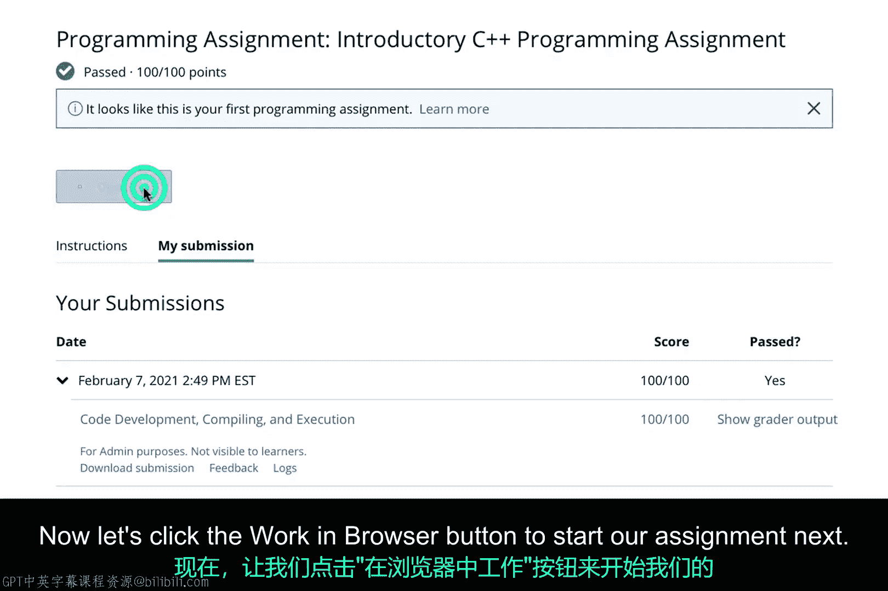
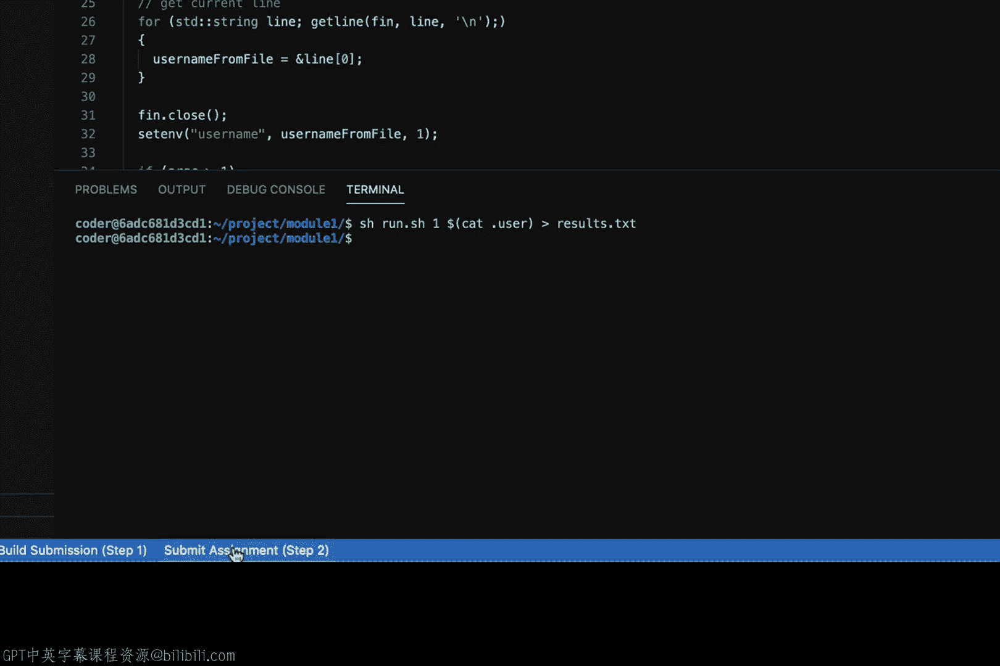
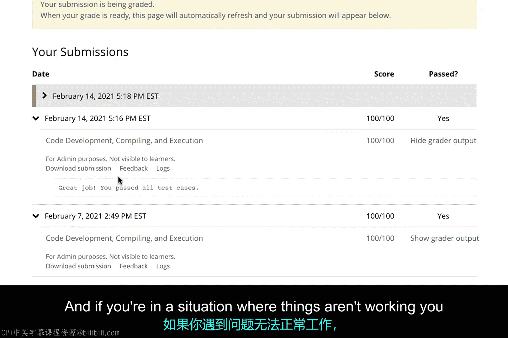
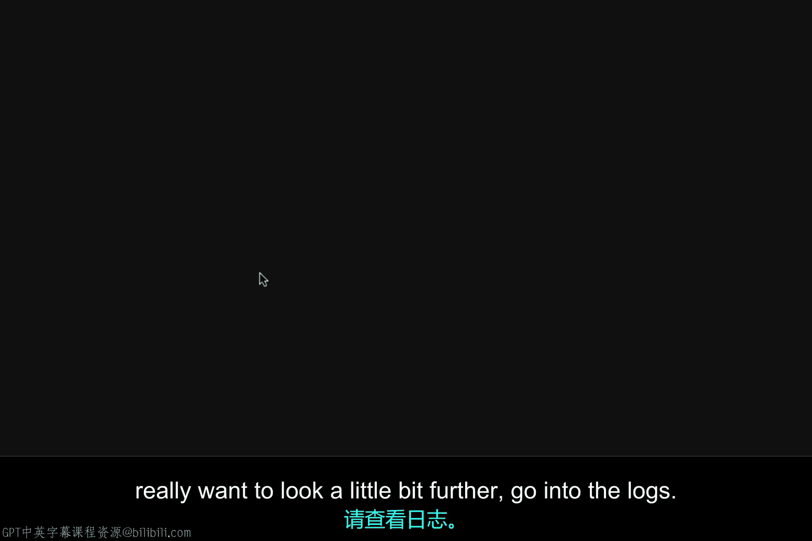

# 096：Coursera实验与作业概述 🚀

在本节课中，我们将学习如何完成约翰霍普金斯大学《GPU编程》课程在Coursera平台上的实验与作业。课程将详细介绍从打开环境到最终提交的完整流程。

---

开发Coursera实验与作业的流程包含六个步骤。

以下是具体步骤：

1.  **打开Coursera实验环境**：在浏览器中使用VS Code。
2.  **打开模块目录**：阅读 `modules` 目录下的 `README.md` 文本文件。
3.  **编辑代码文件**：可以编辑 `.cu`、`.cpp` 源文件或 `.h`、`.hpp` 头文件以及其他相关代码文件。
4.  **在终端执行命令**：使用 `make` 命令来清理、构建、运行你的代码。对于作业，可能需要多次迭代。
5.  **编辑用户文件（仅作业）**：编辑 `.user` 文件，并根据 `README.md` 中的说明修改相应的代码变量。
6.  **提交作业**：完成上述步骤后提交作业。

这是模块1编程作业的页面。我们将逐步讲解完成作业所需的所有步骤。

页面包含进度通知区域、启动实验活动的按钮、完成作业的说明以及提交结果。

现在，点击“在浏览器中工作”按钮开始我们的作业。

---

上一节我们启动了作业环境，本节中我们来看看如何在VS Code中打开正确的目录。

接下来，你需要在VS Code中打开与活动或作业关联的目录。

如果页面顶部附近没有显示模块编号和名称，你需要从菜单栏点击“文件”菜单选项，在下拉菜单中选择“打开”。这将在编辑器顶部附近弹出“打开文件或文件夹”对话框。

在对话框中，你可以通过点击“..”（双点号）向上导航目录结构。对于本项目，你需要导航到 `/home/coder/project/module1`。

在对话框中找到需要打开的文件夹或文件后，点击“确定”按钮。文件或文件夹将在编辑器左侧打开。

现在，你将拥有开始当前模块实验或作业所需的所有文件。

---

接下来你应该做的是阅读 `README.md` 文本文件，其中包含背景材料和一系列作业说明。

你可以查看 `run.sh` 文件，这是一个用于执行作业所有步骤的脚本。

`Makefile` 用于清理、构建和运行你的工作。你通常不需要修改这两个文件，而应该只修改代码和其他相关文件。

---

如果你正在处理作业，接下来应确保 `.user` 文件反映了你的用户名。用户名可以是任何名称或登录名，只要不包含特殊字符。

在开始编写作业其余部分的代码之前，另一个需要添加用户名的地方是你的主代码文件中。在本例中，即 `assignment.cpp`。你需要修改 `USER_NAME` 字符串常量，使其与你在 `.user` 文件中放置的名称一致。

通过编辑这两个文件，你将确保你的提交满足作业的第一个要求：用户名验证。

当你执行代码时，无论是直接执行还是通过 `run.sh` 或 `make` 命令，都需要传递相同的用户名。

---

提交代码的下一步是点击页面底部的“构建提交（步骤1）”按钮。

你将在页面底部看到一个终端窗口，它会清理、构建并执行你当前的代码，并将输出写入一个文件，该文件用于作业评分。请注意终端中的任何输出。

然后，点击同样位于页面底部的“提交作业（步骤2）”按钮，将该文件提交给评分系统。

---

之后，你可以在作业页面查看提交结果。在评分器完成运行之前，结果将显示为琥珀色。

打开提交结果后，你可以看到分数、是否通过以及任何反馈信息。

如果遇到问题，你真的需要进一步查看日志以获取详细信息。

---

本节课中我们一起学习了Coursera上《GPU编程》课程实验与作业的完整操作流程，从环境准备、文件编辑、代码执行到最终提交与结果查看。掌握这个流程是顺利完成后续编程任务的基础。