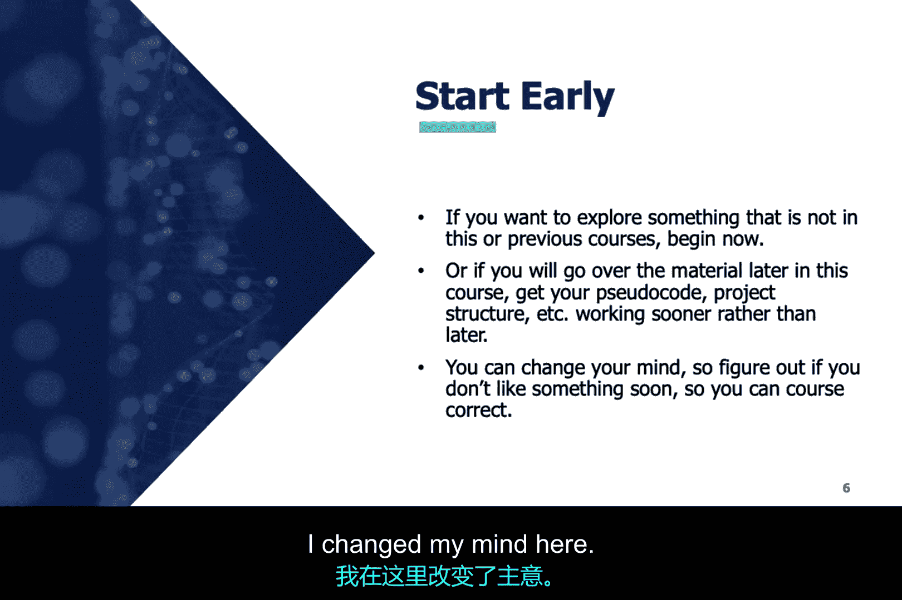
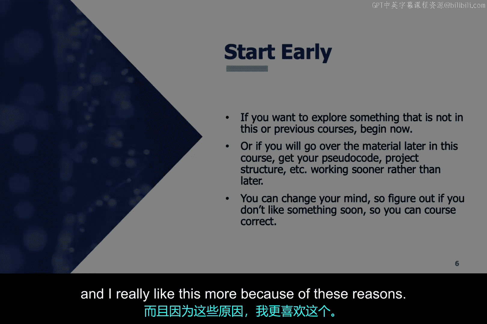

# 097：毕业项目指南 🎓

在本节课中，我们将介绍GPU编程专项课程的毕业项目要求。我们将详细说明项目的目标、需要提交的成果以及如何规划一个成功的项目。

毕业项目是本专项课程模块五结束时需要完成的核心任务。其目标是让你综合运用在四门课程中学到的知识，并以一种实质性的方式加以实践。

## 项目目标与范围 🎯

上一节我们介绍了毕业项目的总体要求，本节中我们来看看项目的具体目标和可选范围。

项目的核心是应用你所掌握的GPU知识，并探索你能实现什么。你可以选择深化课程中已涉及的任何主题，也可以探索全新的领域。

以下是你可以选择的项目方向：
*   **深化已知领域**：对课程中已学内容进行更深入的研究。
*   **探索新主题**：尝试新的技术、框架，甚至是编程语言，即使这些内容从未在课程中讨论过。

关键在于，你需要开发自己感兴趣、有经验或能在工作中应用的代码，并向你的同伴展示，同时帮助他们学习。

## 需要提交的成果 📦

了解了项目方向后，接下来我们明确需要提交的具体成果。你需要交付以下四样东西：

以下是项目必须包含的四个交付物：
1.  **代码仓库URL**：一个公开的代码仓库链接，例如Github、Gitlab、Bitbucket，或Google Drive、Dropbox等可供他人匿名访问的位置。
2.  **执行证明**：以各种形式呈现的执行结果，例如文本文件、CSV文件、图像等。
3.  **项目描述**：能够清晰描述你的项目是什么以及它实现了什么功能。
4.  **视频演示**：一个包含演示的视频展示，应展示你尝试实现的功能，并可以包含结果等内容。

## 项目演示要点 🎬

提交成果是基础，而项目演示则是评审的核心。你的同行评审将聚焦于一个演示。

演示应相对简短，大约5到10分钟，必要时可稍作延长。它可以包含幻灯片、代码展示以及功能演示的任意组合。

在演示中，你需要说明以下几点：
*   **项目起点与目标**：你的初始目标是什么。
*   **技术与背景**：涉及的任何算法、技术或语言，可以准备背景介绍的幻灯片或进行概述。
*   **最终成果与未来方向**：你最终实现了什么，以及你希望未来如何发展。
*   **可视化展示**：如果能有图形、图表、交互式演示或图像等视觉化内容会非常出色，但这不应是你追求的唯一目标。

## 项目选择与规划建议 💡

完成演示需要扎实的项目内容，因此项目的选择与规划至关重要。我认为毕业项目最重要的一点是，**做你关心的事情**。

这无关我或你同伴的兴趣或期望，而关乎你自己。我希望你感到在这四门课程上花费的时间是值得的，并完成了一些有成就感的事情。

以下是一些具体建议：
*   **勇于尝试**：尝试有风险、可能不会成功的事情完全没问题。尝试并解释为什么事情没有按预期工作，这本身对他人就是宝贵的经验。
*   **鼓励探索**：如果你想探索新事物，就选择一个新主题。不要担心结果，重点是学习新东西，无论是新算法、新框架还是新语言。
*   **尽早规划**：我鼓励学生现在就开始思考项目方向。你不需要立即开始编码，但可以浏览课程涉及的主题和即将介绍的库，思考自己的兴趣点。
*   **保持灵活**：如果你在项目进行到四分之一时发现不喜欢当前的方向，完全可以改变主题。请记录下改变想法的原因，这在演示中说明“我从此处开始，在此处改变了方向，原因是…，我更喜欢新方向因为…”是完全可行且有益的。

---

本节课中我们一起学习了GPU编程专项课程毕业项目的完整指南。我们明确了项目的目标是综合应用所学知识，需要提交代码、证明、描述和视频演示四项成果，并了解了演示的核心要点。最重要的是，我们强调了选择自己感兴趣的项目主题、勇于探索并尽早开始规划的重要性。祝你项目顺利！