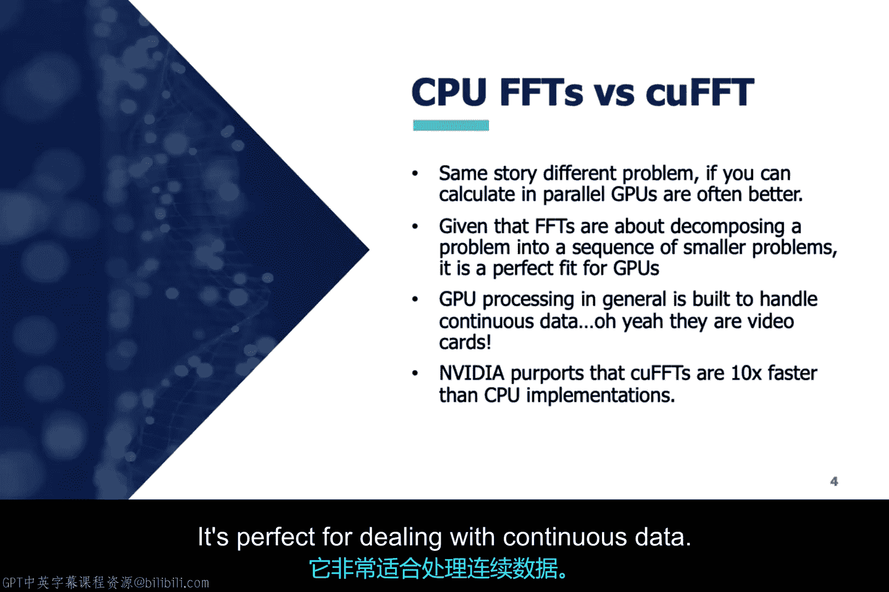
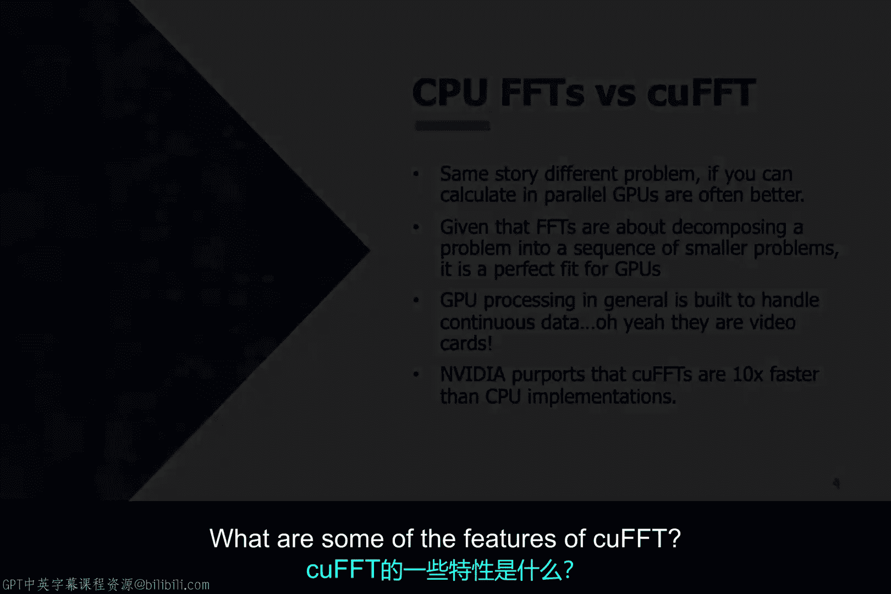
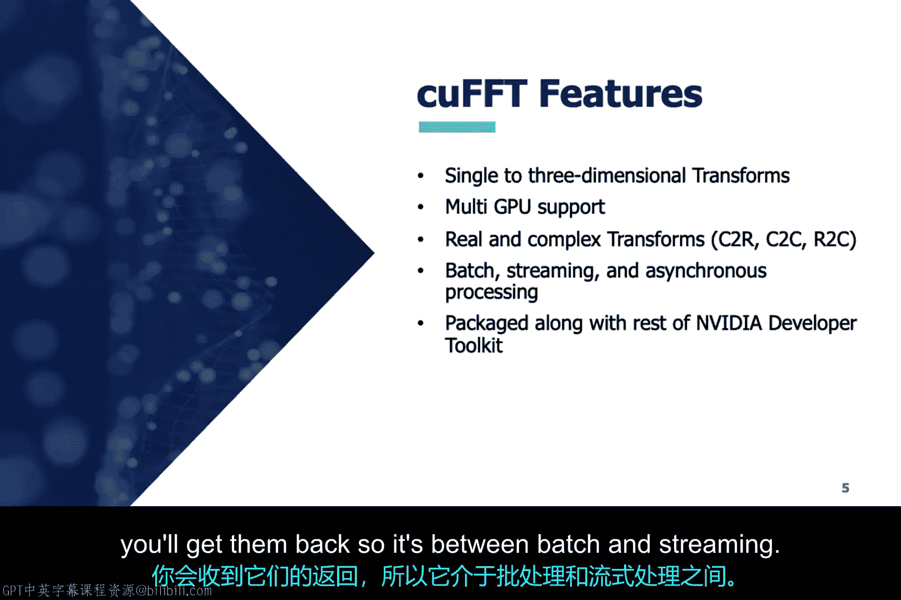

# 098：CUFFT库性能与特性 🚀

在本节课中，我们将学习快速傅里叶变换以及NVIDIA CUFFT库的核心概念、性能优势与主要特性。我们将探讨为何FFT如此重要，以及为何在GPU上使用CUFFT库进行计算能带来显著的性能提升。

## 快速傅里叶变换简介

上一节我们介绍了课程主题，本节中我们来看看快速傅里叶变换的基础。快速傅里叶变换由高斯发现，并由Cooley和Tukey在1965年正式发表论文。

观察左侧的图表，一个时域信号通过**正向变换**转换到频域。随后，它可以被分解为一组频域信号，这些信号再通过**逆向变换**组合并转换回时域，从而解决信号处理问题。

## 为何需要FFT？

了解FFT的重要性后，本节我们探讨其必要性。首先，除非数学功底深厚，否则微积分计算相当困难。

从解决问题的时间复杂度来看，传统方法通常是 **O(n²)** 的复杂度，这并非理想情况。我们使用FFT将问题复杂度降低到 **O(n log n)**，速度大幅提升。

这种提升看似微小，但在处理连续视频、音频等场景时差异显著。当需要在信号输入与输出之间实现极低延迟的实时计算时，FFT至关重要。因此，高质量硬件常采用此技术。

## 为何选择GPU而非CPU？

理解了FFT的优势后，我们自然会问：为何要在GPU上执行？据NVIDIA称，使用CUFFT库进行计算比CPU实现快**10倍**。

让我们思考单个信号需要被分解并计算为一系列信号的问题。使用GPU的主要原因是将大问题分解为小问题，这非常适合GPU的并行架构。

GPU的另一个优势在于其设计初衷。GPU为显卡构建，擅长快速渲染场景、视频和音频，因此完美适合处理连续数据流。

## CUFFT库特性 🛠️

在了解了GPU的优势后，本节我们详细探讨CUFFT库的具体特性。

以下是CUFFT库的一些核心特性：

*   **集成开发包**：CUFFT作为NVIDIA CUDA开发工具包的一部分，与其他库一同提供。
*   **支持多维变换**：它能处理从简单到非常复杂的多维变换。当然，维度越高，计算越复杂，速度也越慢。计算速度与维度数量存在关联。
*   **支持多GPU**：最新版本开始支持多GPU，这对于拥有计算集群或专为视频处理搭建、需要执行此类变换的系统非常有帮助。
*   **支持实数与复数变换**：它处理的变换包括实数域和复数域之间的转换，这一点非常重要，因为并非所有计算都在实数域进行。

## CUFFT处理模式

介绍了库的特性后，我们来看看它提供的几种主要处理模式。

CUFFT库提供三种主要处理模式：

*   **批处理模式**：适用于非实时数据处理，但希望高效处理大量数据的场景。
*   **流处理模式**：当需要接近实时地处理数据流时非常有用，存在许多应用用例。
*   **异步处理模式**：这意味着，如果你从文件或网络调用接收一批信号，可以将其发送出去进行处理，并在处理完成后获取结果。它介于批处理和流处理之间。

## 总结

本节课中我们一起学习了快速傅里叶变换的基础及其重要性。我们探讨了FFT如何将计算复杂度从O(n²)降低到O(n log n)。我们分析了在GPU上使用CUFFT库相比CPU实现的巨大性能优势。最后，我们详细介绍了CUFFT库的核心特性，包括其多维变换支持、多GPU功能以及三种关键的处理模式：批处理、流处理和异步处理。