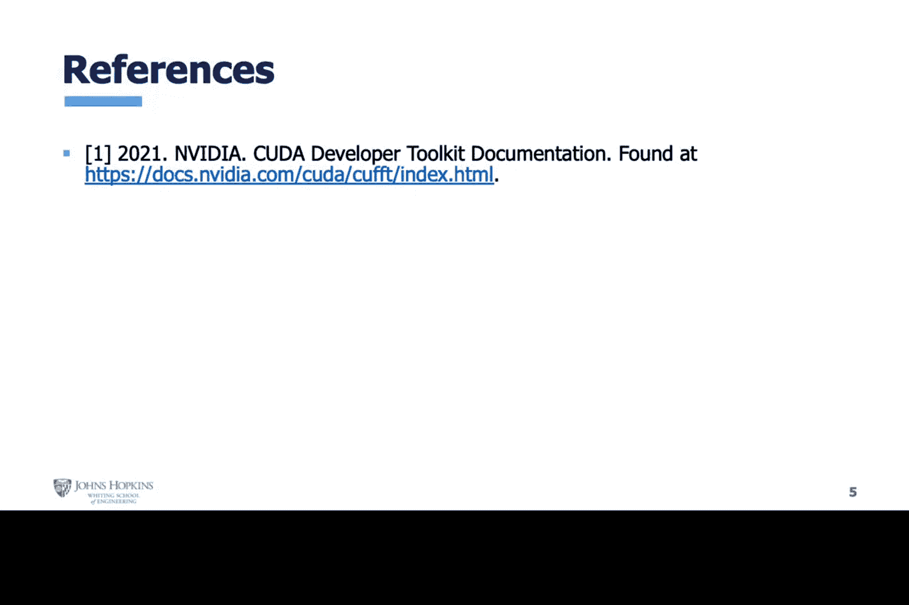

# 099：CUFFT库语法解析 🧮

在本节课中，我们将学习如何使用CUDA的CUFFT库进行快速傅里叶变换。我们将通过一个简单的示例，解析其核心语法和关键步骤，帮助你理解如何在CUDA应用程序中集成FFT计算。

## 定义数据维度 📏

首先，我们需要定义三维数据中每个维度的元素数量。为此，我们使用宏定义来指定X、Y和Z的大小。

```c
#define NX 128
#define NY 128
#define NZ 128
```

## 创建CUFFT句柄与分配内存 🧠

在CUDA高级库中，通常使用一个“句柄”或“计划”来管理库将要执行的操作。CUFFT中，我们称之为“plan”。

创建计划的第一步是为复数数据分配指针。我们使用`cufftComplex`数据类型作为指针类型。

与使用任何CUDA库一样，我们需要使用`cudaMalloc`这样的函数在设备上分配内存。我们需要告诉它在哪里分配内存（例如`data1`和`data2`），并计算所需的内存大小。

```c
cufftHandle plan;
cufftComplex *data1, *data2;
size_t data_size = NX * NY * NZ * sizeof(cufftComplex);
cudaMalloc((void**)&data1, data_size);
cudaMalloc((void**)&data2, data_size);
```

## 制定与执行FFT计划 ⚙️

下一步是创建FFT计划。对于三维变换，我们使用`cufftPlan3d`函数。如果是二维变换，则使用`cufftPlan2d`，依此类推。

你需要传入计划句柄、X、Y和Z方向的大小（如果是2D则只有X和Y），以及你想要创建的计划类型。在本例中，我们进行复数到复数的变换，因此类型是`CUFFT_C2C`。

```c
cufftPlan3d(&plan, NX, NY, NZ, CUFFT_C2C);
```

创建计划后，我们需要执行这个复数到复数的变换。这是通过`cufftExecC2C`函数完成的。请注意，如果是实数到复数变换，函数是`cufftExecR2C`；复数到实数则是`cufftExecC2R`。

你需要传入计划、输入和输出数据指针。在本例中，我们将对`data1`和`data2`执行正向变换（`CUFFT_FORWARD`）。在实际应用中，你可能会先计算正向变换，然后再执行逆向变换回到时域，但为了简化示例，我们只展示正向变换。

```c
cufftExecC2C(plan, data1, data1, CUFFT_FORWARD);
cufftExecC2C(plan, data2, data2, CUFFT_FORWARD);
```

## 清理资源 🧹

最后，非常重要的一步是销毁你的计划并释放内存。这会释放硬件上的所有资源。你肯定不希望造成内存泄漏或长期占用不必要的资源。


```c
cufftDestroy(plan);
cudaFree(data1);
cudaFree(data2);
```

## 理解数据尺寸变化 📊

上一节我们介绍了执行FFT的基本流程，本节中我们来看看一个关键细节：输入和输出数据尺寸的变化。根据CUFFT文档，不同变换类型的数据尺寸规则不同。

以下是不同维度下，复数到复数、复数到实数、实数到复数正向变换的输入和输出尺寸总结表：


需要注意的关键点是：
*   进行**复数到复数**变换时，输入和输出尺寸通常相同，没有问题。
*   进行**复数到实数**或**实数到复数**变换时，输入或输出的尺寸会发生变化。通常，在至少一个维度上，复数数据的尺寸是实数数据尺寸的一半。

因此，在分配内存时，你总是可以分配更大的空间，但里面可能包含空值。请务必仔细查阅文档，了解你的特定变换所需的数据尺寸。

## 高级功能：批处理与多GPU 🚀

CUFFT库还支持更高级的功能，以处理复杂场景。

**多维变换与批处理**
你可以执行1D到3D的变换，如上一张幻灯片所示。再次注意，输入和输出尺寸可能根据X、Y、Z维度和变换类型而变化。数据的总大小是各维度大小的乘积。

一个有趣的功能是，你可以指定只处理输入或输出数据的一部分。这允许你进行**批处理**，对于处理多维数据尤其有用。在并非所有数据都需要同时变换的情况下，这能帮助你解决更大规模的问题。

**多GPU支持**
那么，当使用多个GPU时，事情是如何工作的呢？你会注意到函数命名存在一个模式。

以下是多GPU函数命名示例：


函数名以`cufftXt`开头，后跟与单GPU版本类似的函数名。例如，`cufftXtMalloc`就相当于单GPU的`cufftMalloc`。

你可以基于ID（通常是从0开始的递增数字，如0,1,2,3）来设置GPU的数量，并通过ID来指定它们。实际上，ID就是一个递增的数字。

你仍然需要制定一个计划，在这种情况下，命令是`cufftXtMakePlan`。这个函数允许你创建一到多维的计划。


在这种多GPU环境下，**务必调用`cufftDestroy`**，因为它不仅会销毁计划，还会释放所有硬件资源，这些资源可能分布在多个GPU上。

---

**总结**




本节课中我们一起学习了CUFFT库的核心语法。我们从定义数据维度开始，逐步讲解了如何创建CUFFT句柄、在设备上分配内存、制定并执行FFT计划，以及最后如何清理资源。我们还深入探讨了不同变换类型下数据尺寸的变化规则，并简要介绍了批处理和多GPU支持等高级功能。掌握这些步骤和概念，是使用CUDA高效进行快速傅里叶变换计算的基础。