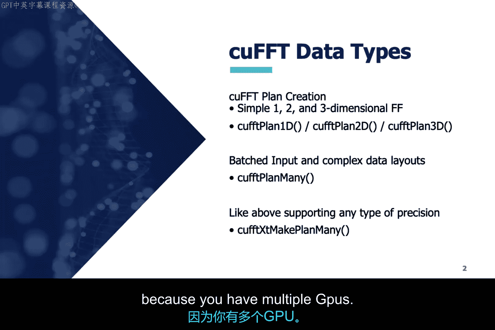
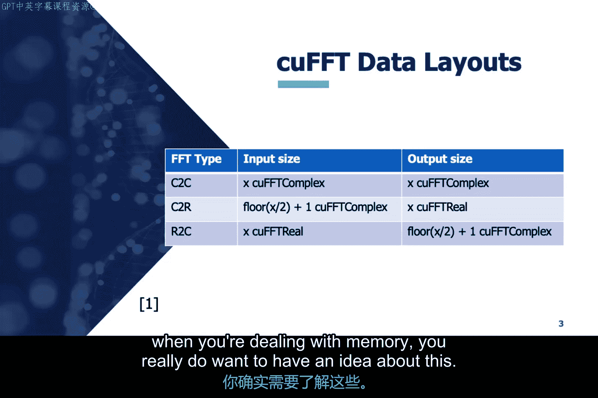

# 100：CUFFT数据类型详解 🧮

在本节课中，我们将学习CUFFT库中核心的数据类型及其用法。理解这些数据类型对于正确使用CUFFT进行快速傅里叶变换至关重要，因为它们定义了数据的布局和内存管理方式。

## 数据类型的重要性

CUFFT的操作并非简单的函数调用，因此拥有清晰的数据抽象非常有帮助。核心的数据类型是`cufftHandle`，它代表一个FFT计划。

## 创建FFT计划

如何创建一个计划？首先，你需要确定是进行一维、二维还是三维的快速傅里叶变换。根据这个决定，分别调用`cufftPlan1D`、`cufftPlan2D`或`cufftPlan3D`函数。

## 批处理与多GPU支持

如果你想将多个变换计划批量处理在一起，可以使用`cufftPlanMany`函数。它的优点在于能够同时处理实数和复数数据布局。

那么，如果你拥有多个GPU呢？我们之前已经有所涉及。所有支持多GPU的函数都以`cufftXt`开头。例如，`cufftXtMakePlanMany`函数，它允许你在多个GPU上进行批处理。这在多GPU环境中几乎是必须的。

## 输入输出数据布局

接下来，我们再次展示一个更简化的输入输出数据布局视图。

以下是不同变换类型对应的数据布局：

*   **复数到复数变换**：输入和输出的数据类型都是`cufftComplex`，数据大小均为`x`。
*   **复数到实数变换**：输入数据类型为`cufftComplex`，大小为`x`；输出数据类型为`cufftReal`，大小为`floor(x/2) + 1`。输出大小略大于输入大小的一半。
*   **实数到复数变换**：输入数据类型为`cufftReal`，大小为`x`；输出数据类型为`cufftComplex`，大小为`floor(x/2) + 1`。

初次接触时，这可能看起来需要考虑很多细节。但在处理内存时，确实需要对这些概念有清晰的了解。

## 总结

本节课我们一起学习了CUFFT库的核心数据类型`cufftHandle`，以及如何创建不同维度的FFT计划。我们还探讨了使用`cufftPlanMany`进行批处理以及利用`cufftXt`系列函数实现多GPU支持的方法。最后，我们详细分析了复数到复数、复数到实数、实数到复数三种变换场景下的输入输出数据布局和内存大小关系。掌握这些是高效、正确使用CUFFT进行GPU加速傅里叶变换的基础。