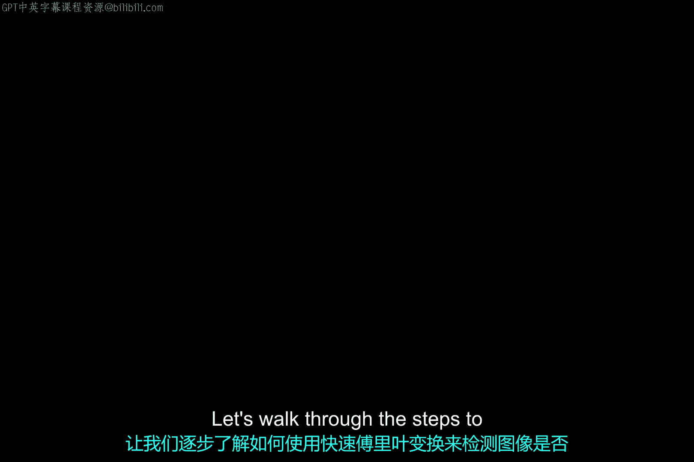
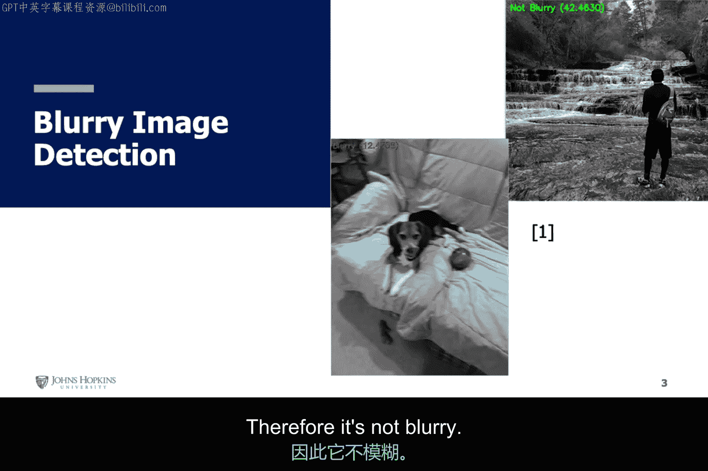
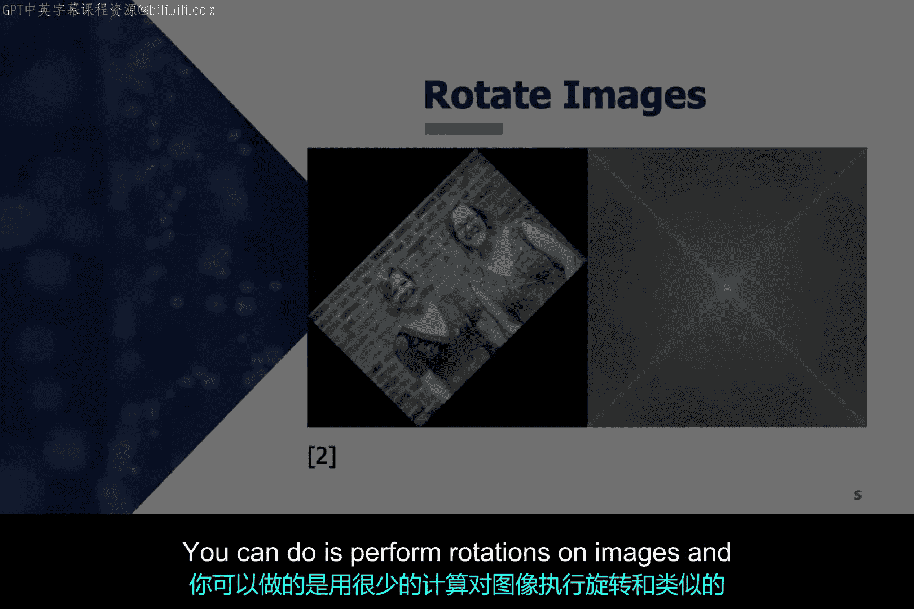
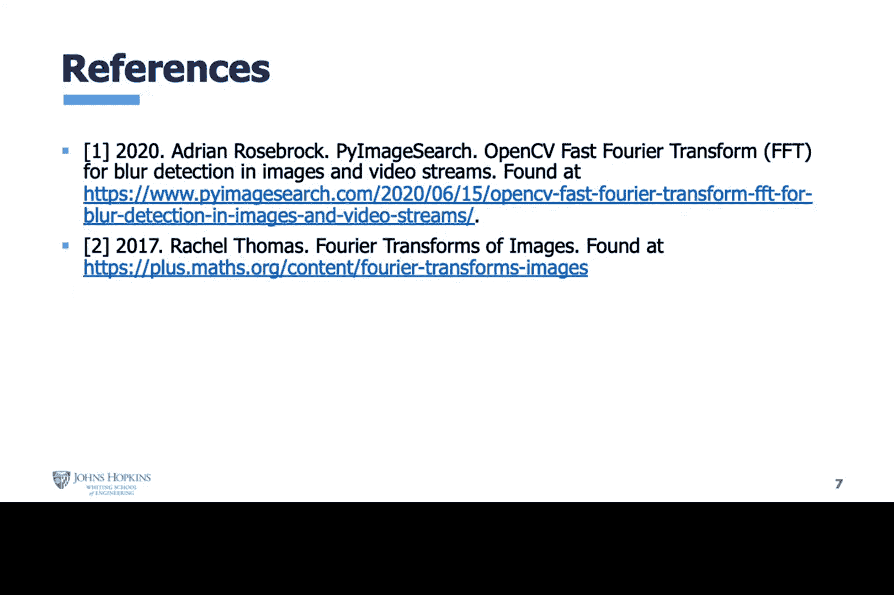

# 101：使用CUFFT进行图像处理 🖼️

在本节课中，我们将学习如何使用快速傅里叶变换（FFT）进行图像和视频处理。我们将重点介绍一个具体应用：检测图像是否模糊，并探讨FFT在图像旋转和3D重建等其他领域的应用。

## 概述：图像模糊检测原理

上一节我们介绍了CUFFT库的基础知识，本节中我们来看看如何将其应用于实际的图像处理任务。检测图像模糊的核心思想是将图像从空间域转换到频域进行分析。模糊的图像在频域中高频分量较少，而清晰的图像则包含丰富的高频信息。

以下是检测图像模糊的主要步骤：

1.  **获取数据**：导入需要处理的图像。
2.  **正向FFT变换**：对图像执行快速傅里叶变换，将其从空间域转换到频域。
3.  **频谱中心化**：将变换后的频谱零频分量移动到图像中心，便于观察。
4.  **滤除低频**：移除可能由噪声或均匀区域产生的低频信号。
5.  **逆向FFT变换**：将处理后的频谱通过逆FFT变换回空间域（左上角为原点）。
6.  **再次正向FFT**：对处理后的图像再次执行FFT变换。
7.  **计算频谱最大值与均值**：计算此次变换后频谱的幅度最大值和均值。
8.  **判断模糊**：如果频谱均值低于某个阈值，则判定图像为模糊。

这个过程看似复杂，但其本质是将图像转换到信号域进行分析。通过将频谱中心化，我们可以聚焦于图像通常最清晰的中心区域。滤除低频是为了消除噪声干扰。最终，我们通过比较整个图像的频谱幅度与其均值来判断清晰度：清晰图像的像素间差异大，频谱幅度高且分布广；模糊图像的色彩和细节变化小，其频谱幅度整体较低。

## 视觉案例解析

让我们通过两个例子直观理解上述原理。

*   **模糊图像（左图小狗）**：在灰度图像中，存在大量颜色相似的色块，缺乏鲜明的对比和细节。在这种情况下，图像的频谱幅度会非常低。计算出的均值虽然相对较高，但会明显高于整体的频谱幅度水平，符合模糊图像的特征。
*   **清晰图像（右图瀑布前的男士）**：该图像并不模糊，因为其整体频谱幅度较高，这表明像素与像素之间存在显著差异，图像包含丰富的颜色和细节变化。虽然人物本身的颜色对比可能不强，但图像其他部分（如瀑布、背景）的颜色变化剧烈，像素间的差值很大，因此整体频谱幅度高，判定为清晰。

## FFT的其他图像处理应用

除了模糊检测，快速傅里叶变换在图像处理中还有多种用途。

### 从单张图像进行3D重建 🏗️

上一节我们学习了频域分析，本节中我们来看看FFT如何帮助理解图像深度。

FFT可用于将左侧的灰度图像转换为右侧的3D渲染图。这是因为图像中信号的强度与物体的焦距有关。在重建出的第一个信号（砖墙）中，可以看到3D结构。同时，由于焦距不同，信号的幅度会有所衰减，这可以作为确定Z轴（深度）信息的依据。例如，这使得图中的两位女士在3D重建中看起来更近，这与现实情况相符。

### 高效图像旋转与变换 🔄

在频域中进行某些图像操作比在空间域中直接计算更为高效。

例如，对图像进行旋转等变换，在频域中可能只需要很少的计算量。这类似于我们处理音频信号时的情况，可以将图像“侧放”来观察频谱峰值，并进行平滑等处理。

## FFT在视频处理中的应用

了解了静态图像的处理后，我们自然会将思路延伸到动态视频上。

将FFT应用于视频，意味着对视频的每一帧进行上述处理，从而得到一个帧序列的频域表示。其优势在于，当处理与时间相关的变换时（例如让图像在一分钟内旋转360度），在频域中进行计算远比在空间域中逐像素移动和计算要容易得多。

这使得我们可以轻松实现一些效果，例如：
*   **独立模糊视频流的不同部分**。
*   **对每一帧进行3D重建**：结合前面提到的单图3D重建技术，对视频的每一帧进行处理，可以构建出更连贯、更精确的3D场景渲染。

## 总结

本节课中我们一起学习了使用CUFFT和快速傅里叶变换进行图像与视频处理的核心技术。我们详细探讨了利用频域分析检测图像模糊的完整流程，包括数据准备、正/逆FFT变换、频谱处理及阈值判断。此外，我们还了解了FFT在图像3D重建和高效几何变换（如旋转）中的应用，并初步探索了将这些技术扩展到视频处理领域的可能性。掌握这些知识，为利用GPU加速处理复杂的视觉任务奠定了坚实基础。