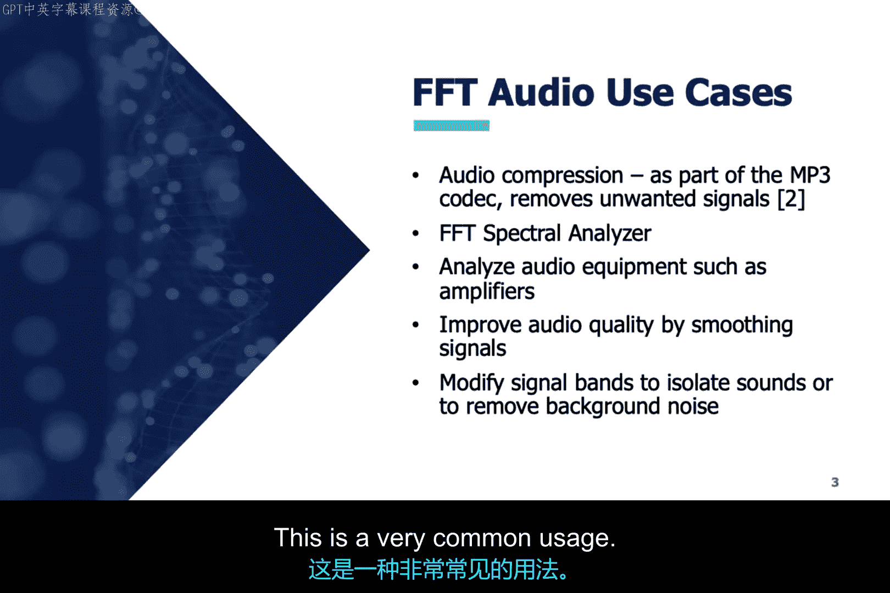

# 102：使用CUFFT进行音频信号处理 🎵

在本节课中，我们将学习如何使用CUDA快速傅里叶变换库（CUFFT）来处理音频或其他纯信号。我们将重点探讨一个具体应用案例：语音识别。

## 概述

快速傅里叶变换（FFT）是一种将信号从**时域**转换到**频域**的数学工具。在时域中，我们观察信号随时间变化的幅度。在频域中，我们则能看到构成该时域信号的一个或多个不同频率分量。这就像将信号旋转90度进行观察，你看到的不再是波形的高度，而是其频率成分的分布。

上一节我们介绍了FFT的基本概念，本节中我们来看看它在音频处理中的实际应用。

## 语音识别流程

以下是语音识别中利用FFT的典型步骤。

1.  **读取音频信号**：首先，将音频文件读入程序。此时，信号必然处于**时域**。
2.  **生成频谱图**：将通常表示为振幅的音频信号，转换为一种视觉媒介——**频谱图**。频谱图是多色的显示，能更清晰地展示频率成分随时间的变化。
3.  **分割音频**：在频谱图中，找到信号微弱或中断的区域。这些区域通常是说话者停止发音或词语之间的边界。沿着这些边界将音频切分成更小的片段。
4.  **执行快速傅里叶变换**：将这些较小的音频片段输入FFT，进行**前向变换**，将其转换到频域。变换后，信号会呈现一种可视化的峰值图案。
5.  **模式匹配与识别**：比较这些频域峰值图案。根据你设计的方案，可以计算置信度或匹配百分比，在已知的语音模式库中寻找匹配项。
6.  **结果判定**：根据匹配的置信度（例如90%或95%），判定被说出的词语。

这是一种常见模式，尤其在语音识别中，但也可以应用于其他音频或通用信号处理。

## 音频与信号领域的其他应用

除了语音识别，快速傅里叶变换在音频和信号处理领域还有许多重要用途。

*   **音频压缩**：例如**MP3编解码器**。它将高质量录音压缩成便于分享的文件格式。其原理之一是去除人耳无法感知或对音质贡献不大的信号分量，从而减小文件体积。这就是为什么黑胶唱片在某些方面听起来可能比从流媒体服务下载的MP3文件更好的原因之一。
*   **硬件频谱分析仪**：许多硬件设备使用FFT进行实时频谱分析。
*   **音频设备测试**：可以向音频设备输入已知信号，然后使用FFT比较其输入和输出信号。这能以更定性和定量的方式对比最佳和最差音频性能。
*   **信号平滑**：对于音乐等信号，平滑处理非常尖锐或锯齿状的信号，可以使其听起来更悦耳。
*   **降噪与音源分离**：在从时域转换到频域后，信号会分解到不同的频带。你可以提取或抑制特定频带，例如用于**去除背景噪音**，或者分离出人声部分，将伴奏作为独立音轨处理。这是一种非常常见的应用。

## 总结

本节课中我们一起学习了快速傅里叶变换（FFT）在音频信号处理中的核心应用。我们详细探讨了其在**语音识别**中的完整流程，从时域信号读取、频谱图生成、音频分割，到频域变换和模式匹配。此外，我们还了解了FFT在**音频压缩**、**设备测试**、**信号平滑**和**音源分离**等多个领域的重要作用。掌握这些概念是使用CUDA的CUFFT库进行高效并行信号处理的基础。