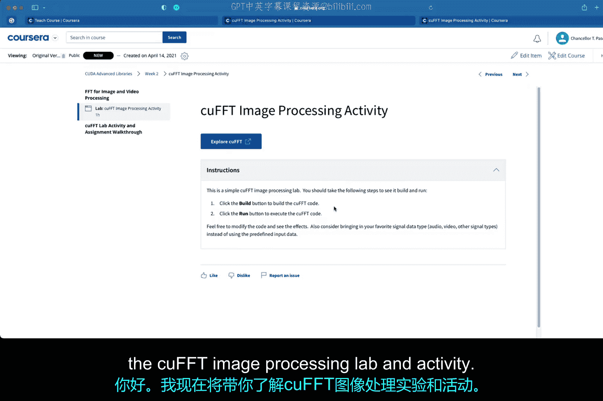
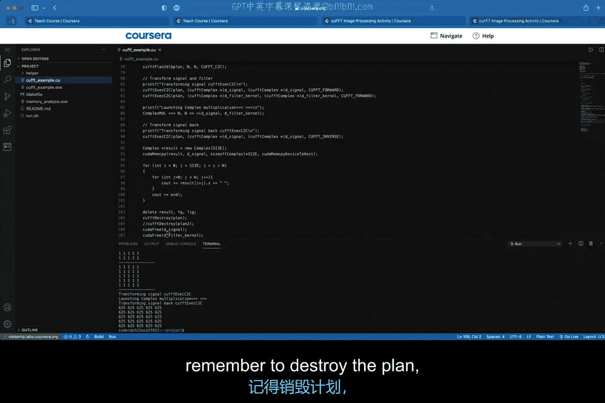
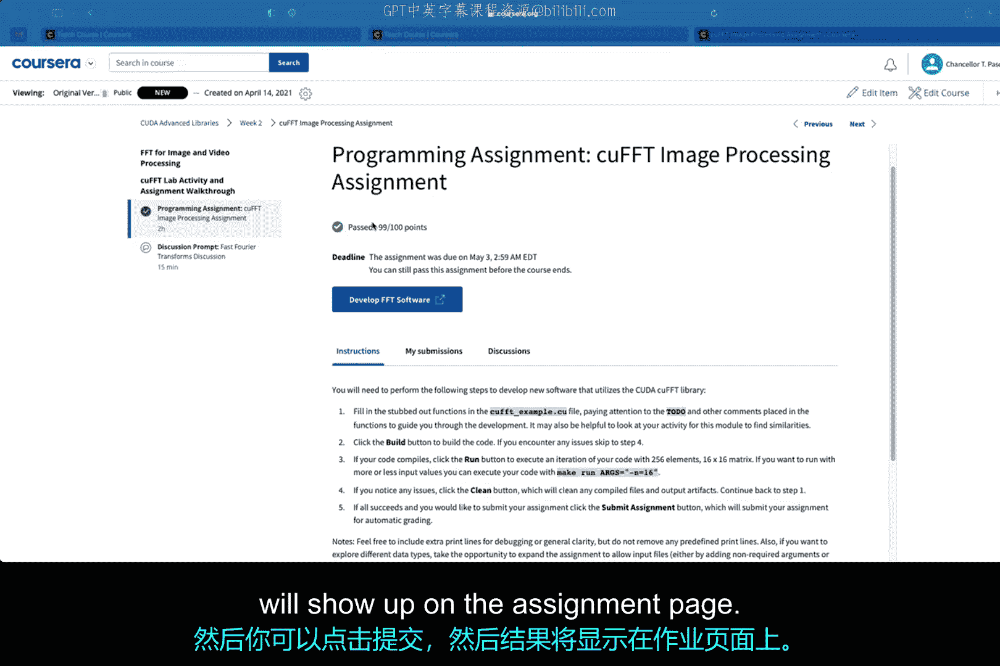
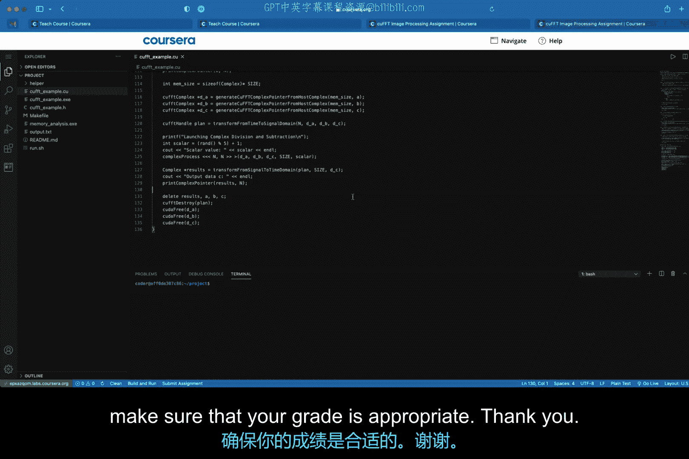

# 103：CUFFT库实验与作业总览 🚀

在本节课中，我们将学习如何使用CUDA的CUFFT库进行快速傅里叶变换（FFT）图像处理实验，并了解相关编程作业的结构与要求。

## 实验环境与操作 🛠️

上一节我们介绍了CUFFT库的基本概念，本节中我们来看看具体的实验环境与操作步骤。

Visual Studio Code服务器界面底部至少有两个按钮：“Build”和“Run”。工具提示说明，它们分别执行“make clean build”和“make run”命令。

以下是操作流程：
1.  点击“Build”按钮，终端窗口将出现并完成编译。
2.  编译成功的标志是生成名为 `QfftTex.exe` 的可执行文件。
3.  点击“Run”按钮执行程序。程序将创建两个矩阵，并对它们执行CUFFT的正向与反向复数变换操作。

## CUFFT示例代码解析 📖

了解了如何运行程序后，我们来看看示例代码的核心逻辑。我尽量保持了代码的简洁性。

代码执行的核心是一个矩阵乘法操作，该操作被置于CUFFT变换的中间过程。主要步骤如下：
1.  创建两个信号：输入信号和滤波器核。
2.  在设备上分配内存，并将数据从主机复制到设备。
3.  创建一个变换计划（plan），其大小为 `N x N`，对应于两个操作矩阵的大小，并指定为复数到复数的变换类型。
4.  对信号执行正向复数变换。
5.  对滤波器核执行同样的正向复数变换。
6.  在频域对上述两个变换结果执行乘法操作，并将乘积结果存入信号变量。
7.  对乘积结果执行反向变换。
8.  将结果内存复制到结果指针（复数类型）并打印输出。
9.  最后，务必销毁变换计划并释放所有已分配的内存。

## 编程作业概览 📝

现在让我们进入编程作业部分。你应该对此流程比较熟悉了。

你将获得一个CUDA文件和一些“待办事项”（`// TODO`）注释来指导你完成任务。我已将代码组织得易于理解。你需要构建并运行它。

需要注意以下几点：
*   你可以进入 `run.sh` 文件，通过修改 `-n` 参数来改变矩阵的边长。矩阵始终是方阵。
*   如果未得到预期结果，可以随时执行清理操作。
*   点击“submitit”后，结果将显示在作业提交页面上。

## 作业代码结构解析 💻

我们已经打开了作业的Visual Studio编辑器。现在来深入了解一些关键内容。

首先，理解 `Makefile` 文件很重要：
*   `CXX` 是编译器，在我们的环境中通常是 `nvcc`。
*   `CXXFLAGS` 和 `LDFLAGS` 用于编译器和链接动态库。
*   `all` 目标会依次执行 `clean` 和 `build`。
*   `build` 目标会查找 `qfft_example.cu` 的内容，并使用 `nvcc` 进行编译。
*   一个重要的细节是链接了CUFFT库以及CUDA本身，以确保包含的头文件能被正确链接。
*   随后，`run` 目标会使用参数执行 `qfft.exe` 并将输出重定向到 `.txt` 文件。

接下来，`qfft_example.cu` 文件包含多个预定义的函数和“待办事项”结构：
*   `complexScaleMult`：接收两个复数值，将它们分别与一个标量相乘后再彼此相乘。
*   `complexProd`：获取用于A和B的值，并将其与标量一同传递给 `complexScaleMult` 函数。
*   `makeCpx`：创建一个指向大小为 `size` 的复数数据类型集合的指针。
*   `printCpx`：打印该复数指针的内容。
*   `generateDeviceCpx`：基于主机指针生成设备上的复数指针。这是因为CUFFT的复数指针可以基于主机或设备内存创建。
*   `transformT2S`：执行正向变换（从时域到频域）。
*   `transformS2T`：执行反向变换（从频域到时域）。
*   `main` 函数：整合所有步骤，为主机和设备内存创建输入指针A和B，以及输出指针C，并指导你需要完成的操作。

最后，请始终注意：代码中任何包含 `print` 语句或 `cout` 输出的部分都应予以保留，切勿修改。这能确保你的作业得到正确的评分。

## 总结 🎯

本节课中，我们一起学习了CUFFT库的实验操作流程，分析了示例代码中FFT变换与矩阵乘法的结合应用，并详细剖析了编程作业的代码结构与完成要点。核心在于理解CUFFT计划的生命周期管理、主机与设备间的数据传递，以及在频域执行点乘操作后通过逆变换得到时域结果的完整流程。