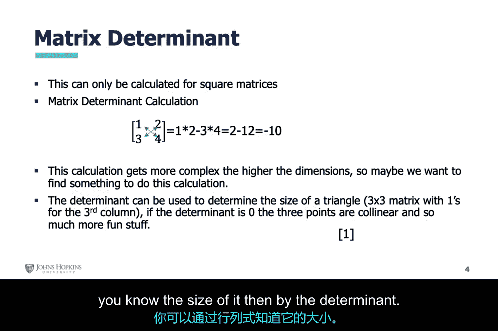

# 104：线性代数入门 🧮

在本节课中，我们将快速了解线性代数的基础知识。这并非一个完整的课程，而是一个简短的介绍，旨在帮助你理解核心概念，以便后续探索如cuBLAS、NVBLAS等CUDA线性代数库。建议你参考其他资源，例如Coursera课程、YouTube视频或Gilbert Strang的线性代数教材，以进行更深入的学习。

## 基本概念

上一节我们提到了学习线性代数的目的，本节中我们来看看其基本概念。考虑一个描述向量或直线的公式，其形式如下：

**a₁x₁ + a₂x₂ + ... + aₙxₙ = b**

其中，`x₁` 到 `xₙ` 是变量，`a₁` 到 `aₙ` 是标量值。

通常，你会遇到一系列这样的方程，并需要求解每个 `x` 变量。

## 矩阵构造

以下是构建矩阵以求解方程组的方法。

一个常见的方法是构造一个矩阵。将所有变量及其标量乘数放在左侧，并按 `x`、`y`、`z` 的顺序排列。在右侧，放置方程等于的常数。

矩阵的行数等于方程的数量，列数等于变量的数量加上一个常数项。如前所述，每一行代表一个方程，即描述一条直线或一个向量。这些值的集合就构成了一个多维矩阵。

## 矩阵运算

上一节我们介绍了矩阵的构造，本节中我们来看看两种常见的矩阵运算。

两种常见的矩阵运算是：矩阵与标量（常数）相乘，以及矩阵的点积（乘法）。

*   **标量乘法**：将一个矩阵乘以一个常数。例如，将矩阵乘以2，矩阵中的所有值都相应地被乘以2，结果放入一个相同大小的矩阵中。
*   **点积乘法**：取两个矩阵进行相乘。

我们通过行和列来描述矩阵的大小。在下面的例子中，一个 `2x3` 的矩阵与一个 `3x2` 的矩阵进行点积运算，结果得到一个 `2x2` 的矩阵。

矩阵点积乘法的运算规则是：取左侧矩阵的行，与右侧矩阵的列相乘。例如，在结果矩阵的第二个位置（第一行，第二列），其值是左侧矩阵第一行与右侧矩阵第二列的点积：`1*8 + 2*10 + 3*12 = 64`。依此类推，最终得到一个方阵。拥有方阵通常是有益的，因为某些运算只能在方阵上执行。

## 行列式

在单个矩阵上最常执行的操作之一是计算其行列式。此操作只能对方阵进行。这里展示的是一个 `2x2` 矩阵的例子，但实际上它可以是任何方阵，如 `3x3`、`4x4`。计算会变得更加复杂，但有方法可以求解。这也是人们喜欢用计算机计算这些值的原因之一，因为它可能非常复杂。

那么行列式有什么用呢？你可以用它来判断三条线是否共线。这意味着即使标量不同，它们实际上可能重叠。请记住几何学的基本知识：任何直线都可以用不同的方程表示，但可能具有相同的轨迹，起点和终点相同。

此外，行列式还可用于确定三角形的大小。如果行列式等于0，意味着至少两条线是共线的。如果行列式大于或小于0，意味着所有三条线不共线。它们起始和结束于不同的点，但会相交。因此在多维空间中，你得到了一个三角形，并且可以通过行列式知道它的大小。

## 总结

本节课中我们一起学习了线性代数的入门知识。我们介绍了描述直线的基本公式、如何构建矩阵来求解方程组，以及两种基本的矩阵运算：标量乘法和点积乘法。最后，我们探讨了方阵行列式的概念及其在判断线共线和计算三角形大小方面的应用。这些基础概念是理解更高级GPU线性代数库功能的基石。