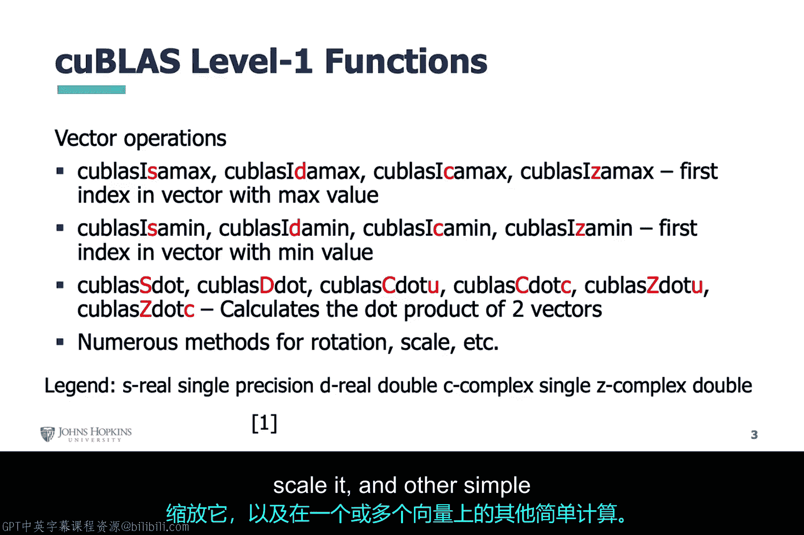
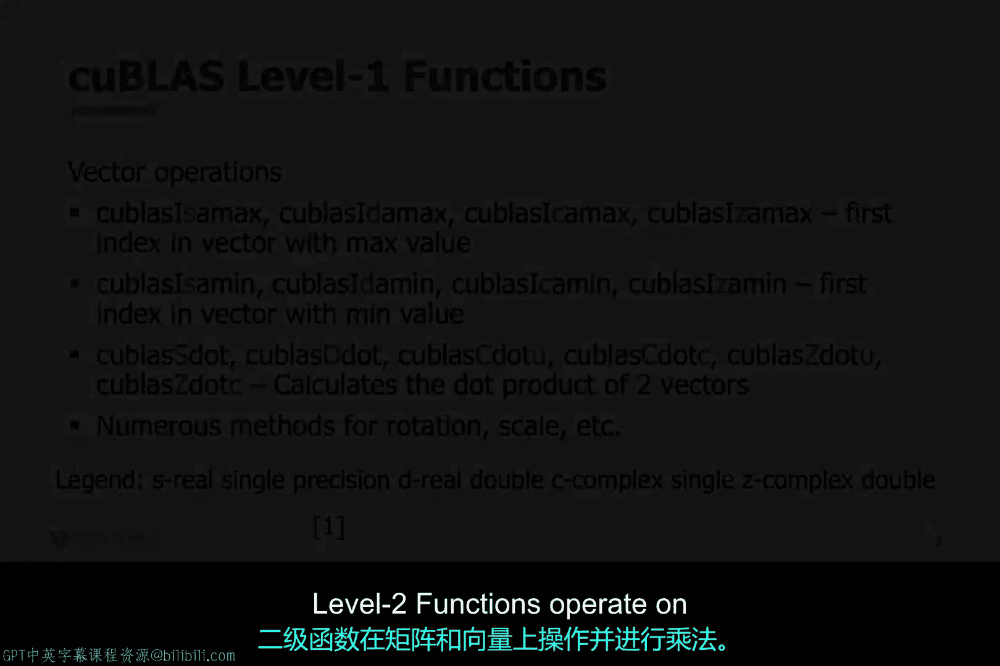
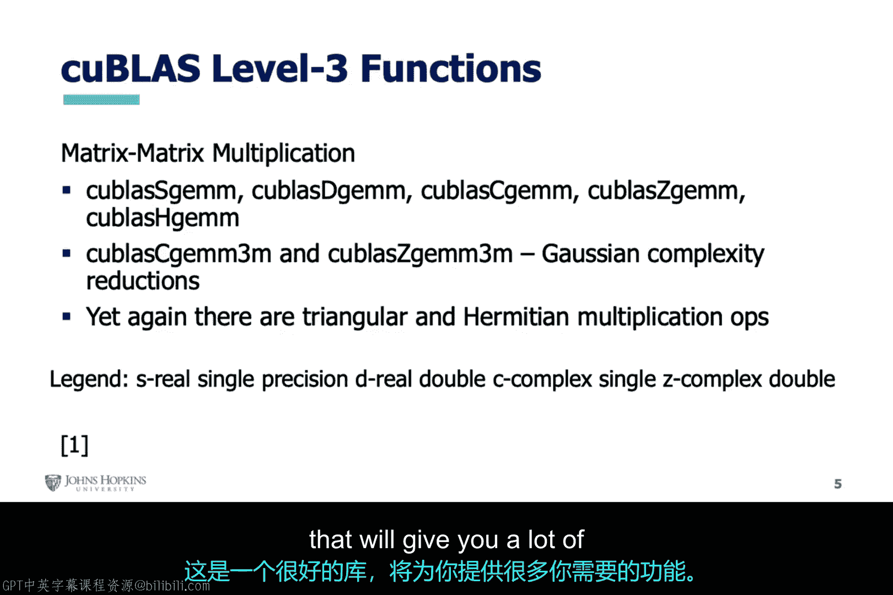
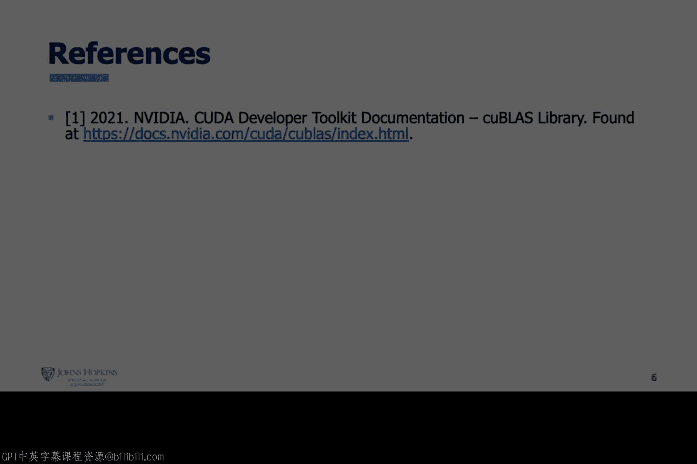

# 105：CUBLAS库语法详解 🧮

在本节课中，我们将深入学习CUDA高级库中一个最常用、最广泛的库——CUBLAS（CUDA Basic Linear Algebra Subprograms）的语法。我们将从初始化与销毁讲起，逐步深入到不同级别的函数操作。

## 初始化与销毁 🔧

在开始使用CUBLAS进行任何编程之前，必须首先初始化库。这是通过 `cublasCreate` 函数完成的。

*   **`cublasCreate`**：此函数接收一个指向 `cublasHandle_t` 类型句柄的指针，对其进行初始化，并返回该句柄。这意味着底层的CUBLAS库也同时被初始化。在执行任何后续函数之前，此步骤是必需的。

上一节我们介绍了如何初始化CUBLAS，相应地，在程序结束时，必须进行清理工作。

*   **`cublasDestroy`**：这是你需要调用的最后一个函数。它会释放任何可能被锁定的硬件或软件资源。

## 流管理 🌊

默认情况下，CUBLAS操作在默认流上执行。如果你想使用非默认流，需要进行设置。

以下是相关的流管理函数：

*   **`cublasSetStream`**：此函数用于指定一个句柄将在哪个非默认流上执行。
*   **`cublasGetStream`**：此函数用于获取之前为该句柄设置的流，以便将后续操作放入该流中。

## Level 1 函数：向量运算 📏

Level 1 函数是作用于一个或多个向量上的操作，处理的是单方程，而非矩阵。

你需要熟悉函数名中的前缀 `S`、`D`、`C`、`Z`，这在其他操作中也会出现。它们的含义如下：
*   **`S`**：单精度浮点数。
*   **`D`**：双精度浮点数。
*   **`C`**：单精度复数。
*   **`Z`**：双精度复数。

以下是Level 1函数的一些例子：

*   **最大值/最小值查找**：函数如 `cublasIsamax`、`cublasIdamax`、`cublasIcamax`、`cublasIzamax`。它们用于查找向量中最大值的索引。
*   **点积计算**：函数如 `cublasSdot`、`cublasDdot`。注意在 `dot` 之后可能有 `U`（无符号）和 `C`（复数）等变体。这些函数计算两个向量的点积。

此外，还有其他数值函数可以执行，例如旋转向量、缩放向量以及对一个或多个向量进行其他简单计算。

## Level 2 函数：矩阵-向量运算 ➗

Level 2 函数对矩阵和向量进行操作，执行乘法运算。

一个例子是 `cublas[S|D|C|Z]gbmv`，这是一个通用的带状矩阵与向量乘法函数。你需要传递以下参数：
*   **句柄 (`handle`)**：CUBLAS上下文。
*   **操作类型 (`trans`)**：指示矩阵是否转置、共轭转置等。
*   **矩阵维度 (`m`, `n`)**：矩阵 `A` 的行数和列数。
*   **带状矩阵参数 (`kl`, `ku`)**：矩阵的上下对角线数量，`kl` 是较小的那个。
*   **标量 (`alpha`)**：用于与 `A * x` 的乘积相乘的标量。
*   **矩阵 (`A`)**：要进行乘法的矩阵。
*   **主维度 (`lda`)**：矩阵 `A` 的主维度（leading dimension）。
*   **向量 (`x`)**：输入向量。
*   **向量步长 (`incx`)**：向量 `x` 中元素的存储步长。如果向量是稠密的（每个位置都有值），则通常为1；如果是稀疏的，则可能大于1。
*   **另一组参数 (`beta`, `y`, `incy`)**：参数 `beta`、`y` 和 `incy` 的作用与 `alpha`、`x` 和 `incx` 类似，用于处理输出向量 `y`。

这看起来相当复杂。如果你有相关经验，可以思考一下如何使用它。

## Level 3 函数：矩阵-矩阵运算 ✖️

Level 3 函数在CUBLAS中执行矩阵与矩阵的乘法。

一个更常见的例子是通用矩阵乘法函数 `GEMM`。它有五种变体：
*   前四种基于两个矩阵具有相同的精度（单精度、双精度、单精度复数或双精度复数）。
*   第五种是 `H` 表示埃尔米特（共轭转置）。
*   此外，还有 `3M` 变体，用于降低高斯复杂度。

除了使用 `GEMM` 的函数外，还有其他函数用于执行特定类型的三角矩阵和埃尔米特矩阵乘法。因此，务必查阅NVIDIA的CUDA CUBLAS文档。

这是一个功能强大的库，能为你提供所需的大部分线性代数功能。

---

本节课中，我们一起学习了CUBLAS库的核心语法。我们从**初始化 (`cublasCreate`)** 和**销毁 (`cublasDestroy`)** 开始，这是使用库的基础。接着，我们了解了如何通过 **`cublasSetStream`** 和 **`cublasGetStream`** 来管理计算流。然后，我们深入探讨了三个级别的函数：处理向量运算的 **Level 1 函数**（如点积 `cublasSdot`）、处理矩阵与向量乘法的 **Level 2 函数**（如 `cublasSgbmv`），以及处理矩阵与矩阵乘法的 **Level 3 函数**（尤其是通用的 `GEMM` 函数）。掌握这些语法是高效利用GPU进行线性代数计算的关键。