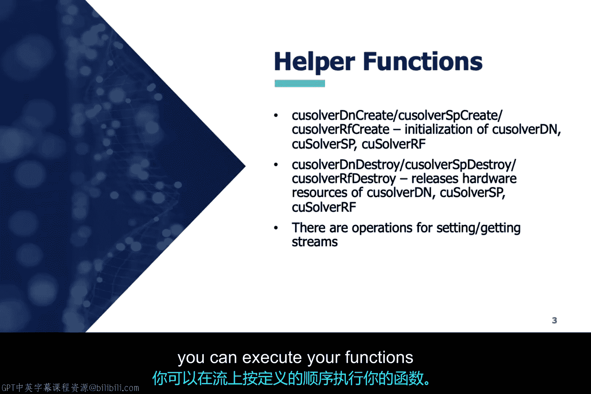
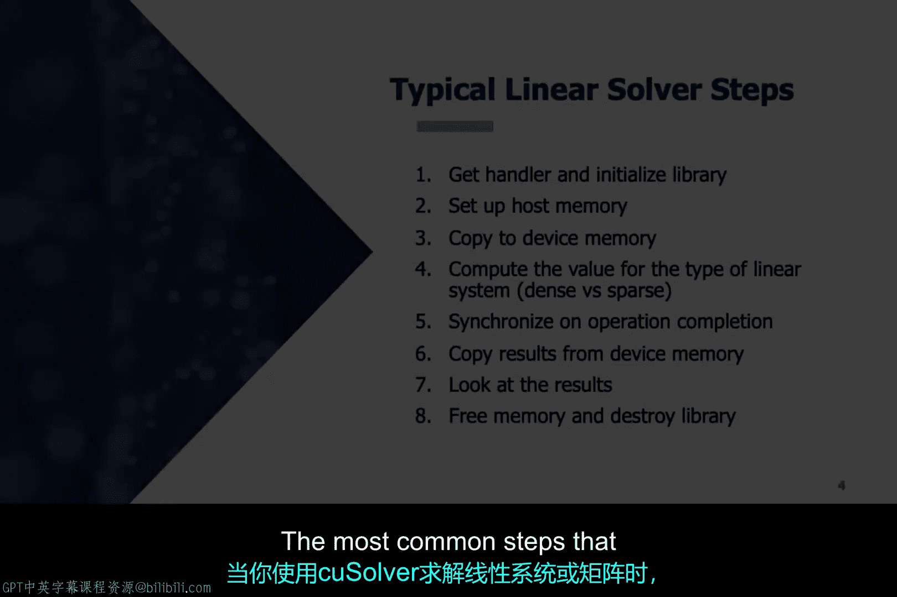
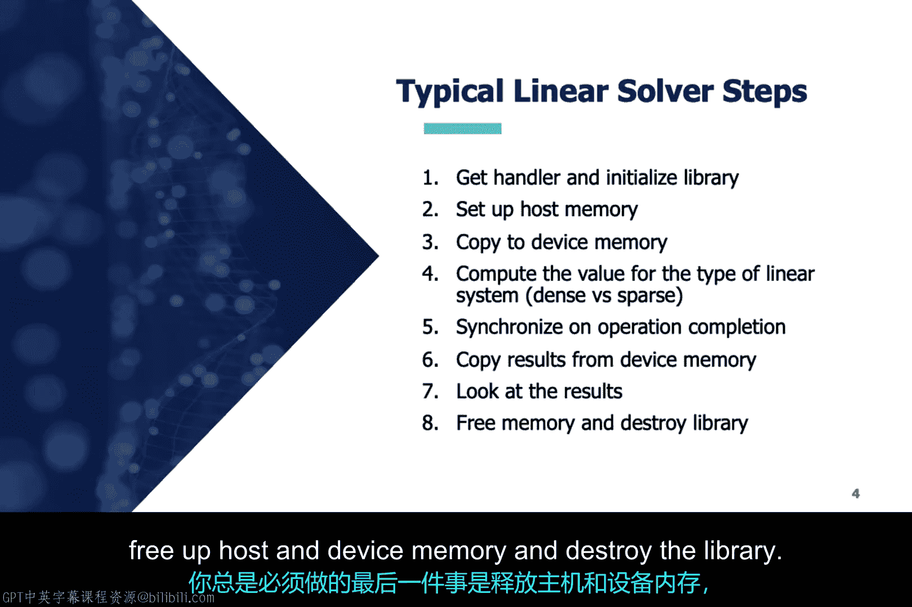

# 106：cuSOLVER库语法详解 🧮

在本节课中，我们将要学习CUDA高级库中的cuSOLVER库。cuSOLVER库主要用于解决线性代数问题，特别是针对矩阵和向量的方程求解，而不是进行矩阵乘法运算。

上一节我们介绍了CUDA高级库的概况，本节中我们来看看专门用于求解线性方程组的cuSOLVER库。

## cuSOLVER库概述

cuSOLVER库的设计理念源于广泛使用的线性代数包LAPACK。它具备两种核心能力：一是能够将矩阵分解为更小的、可独立求解的矩阵；二是能够直接求解矩阵。该库支持单GPU和多GPU模块。

cuSOLVER库主要包含三个功能模块：
*   **cuSOLVER DN**：用于求解稠密矩阵。
*   **cuSOLVER SP**：用于求解稀疏矩阵。稀疏矩阵是指其中超过一半的元素值为零的矩阵。
*   **cuSOLVER RF**：用于执行矩阵的重新分解或分解操作。

## 通用辅助函数

与其他CUDA高级库类似，cuSOLVER也提供了一系列辅助函数。

以下是使用cuSOLVER时常见的辅助函数：
*   总会有一个用于创建句柄的函数，其形式为 `cusolver[空白]Create`，其中 `[空白]` 可以是上一张幻灯片中描述的 `DN`、`SP` 或 `RF`。
*   与之匹配的销毁功能，称为 `cusolver[空白]Destroy`（`[空白]` 同样为 `DN`、`SP` 或 `RF`）。该函数用于释放创建和使用句柄过程中所申请的任何硬件资源。
*   与其他库一样，cuSOLVER也提供了通过设置和获取机制来使用流的方法。这样，如果你使用非默认的CUDA流，就可以在指定的流上按定义的顺序执行你的函数。

## 使用cuSOLVER的标准步骤

使用cuSOLVER求解线性系统或矩阵时，最常遵循的步骤如下。

以下是使用cuSOLVER的标准工作流程：
1.  首先，需要获取一个句柄并按照前一步骤的描述对其进行初始化。
2.  初始化主机和设备内存。
3.  将输入矩阵从主机内存复制到设备内存。
4.  根据需求（稀疏、稠密或重新分解），调用相应的cuSOLVER函数在设备内存上执行计算。
5.  在该操作上进行同步，以确保如果你的应用程序需要这些数据，不会在数据就绪前继续执行。
6.  将计算结果从设备复制回主机。
7.  查看结果。可以通过调试、打印输出或写入文件的方式。
8.  最后，必须始终释放主机和设备内存，并销毁库句柄。

---

本节课中我们一起学习了cuSOLVER库的核心概念、功能模块、通用辅助函数以及使用该库求解线性代数问题的标准步骤。掌握这些是高效利用GPU进行科学计算和工程问题求解的基础。