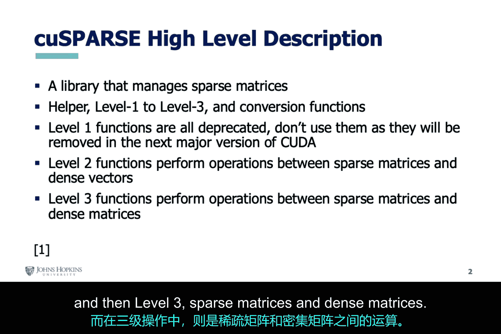
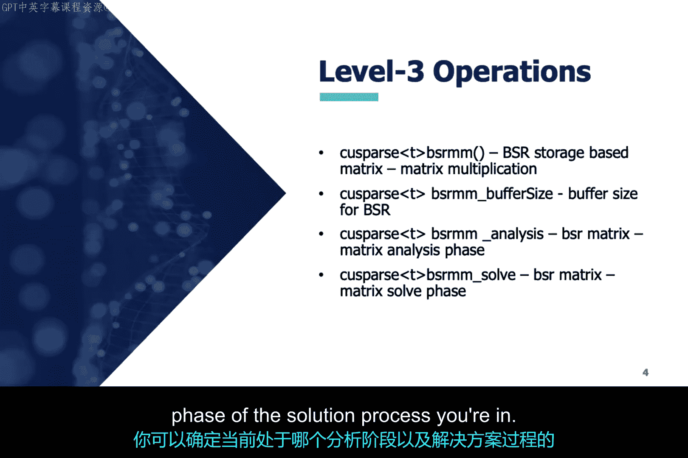
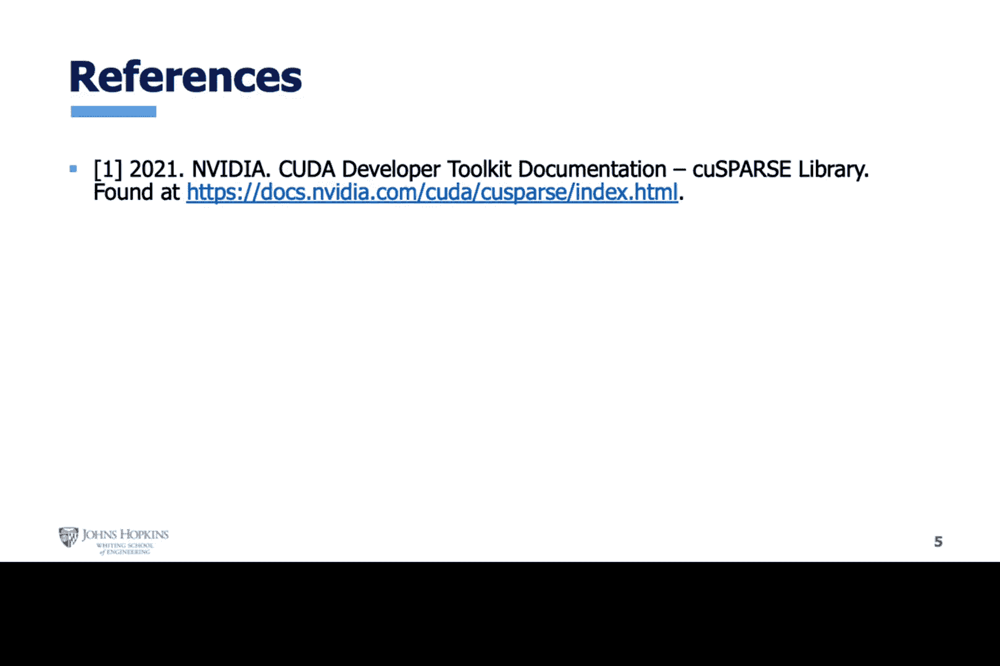

**GPU编程：13：CUSPARSE库语法详解** 🧮

在本节课中，我们将学习如何使用CUSPARSE库处理稀疏矩阵的线性代数运算。我们将重点介绍其核心语法、支持的运算级别以及关键函数的使用模式。

---

上一节我们介绍了GPU编程的通用概念，本节中我们来看看专门用于稀疏矩阵计算的CUSPARSE库。从高层次看，CUSPARSE是一个用于处理稀疏矩阵的库，它支持**Level 1**到**Level 3**的运算以及稀疏矩阵的转换函数。

关于**Level 1**运算，你应当停止使用或完全不要考虑使用它，因为它即将被弃用，并很快会从CUDA中移除。

**Level 2**和**Level 3**函数通常以一个稀疏矩阵作为主要操作对象。与之进行运算的始终是稠密对象。

*   在**Level 2**中，是稀疏矩阵与稠密向量之间的运算。
*   在**Level 3**中，是稀疏矩阵与稠密矩阵之间的运算。

接下来，我们将介绍一些主要的**Level 2**运算。请注意，所有这些运算都需要**BSR存储格式**，这是一种紧凑且能快速表示稀疏矩阵的方式。

以下是主要的Level 2运算函数：

*   `cusparseTbsrmv`：此函数用于执行稀疏矩阵与向量的乘法。其中`T`代表数据类型。
*   `cusparseTbsrmv_bufferSize`：此函数用于计算表示该矩阵所需的缓冲区大小。
*   `cusparseTbsrmv_analysis` 和 `cusparseTbsrmv_solve`：你可以使用这些函数分别确定分析阶段和求解这个矩阵向量应用的过程。

请注意，所有函数名都以`cusparse`开头，而`T`是我们之前见过的类型占位符，可替换为：`S`代表单精度，`D`代表双精度，`C`代表单精度复数，`Z`代表双精度复数。

---

正如我们之前描述的，**Level 3**运算是稀疏矩阵与稠密矩阵之间的乘法或其他运算。

其语法遵循相同的模式。以下是主要的Level 3运算函数：

*   `cusparseTbsrmm`：此函数用于执行矩阵乘法或矩阵-矩阵乘法。函数名中的`BSR`代表其使用的紧凑快速的BSR存储格式。
*   `cusparseTbsrmm_bufferSize`：此函数用于定义稀疏矩阵BSR格式所需的缓冲区大小。
*   `cusparseTbsrmm_analysis` 和 `cusparseTbsrmm_solve`：你可以使用这些函数确定当前所处的分析阶段以及求解过程的阶段。

---

本节课中，我们一起学习了CUSPARSE库的核心语法。我们了解到该库通过Level 2和Level 3函数高效处理稀疏矩阵与稠密向量/矩阵的运算，所有相关函数都遵循`cusparseT[运算名]`的命名约定，并使用BSR格式进行高性能存储和计算。