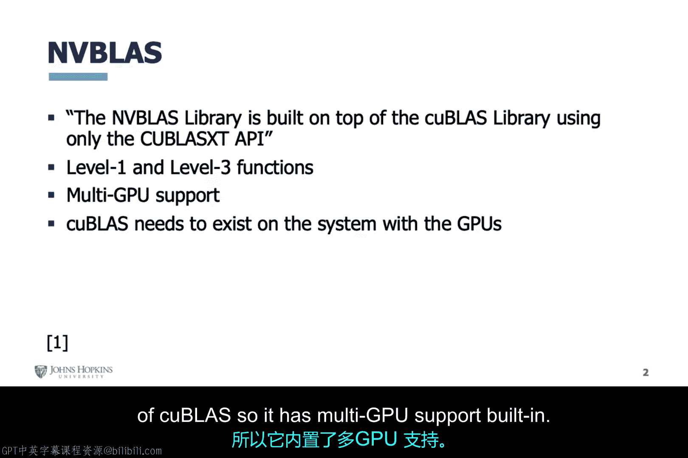
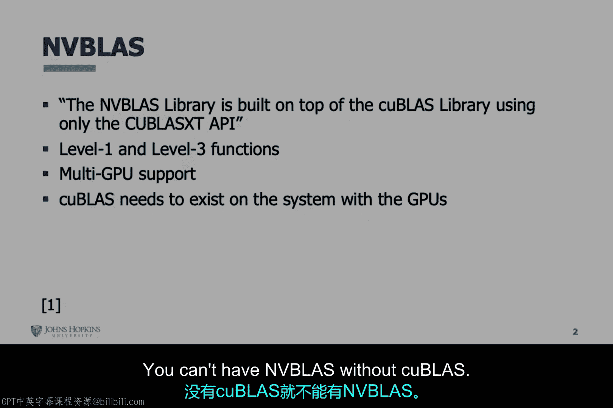
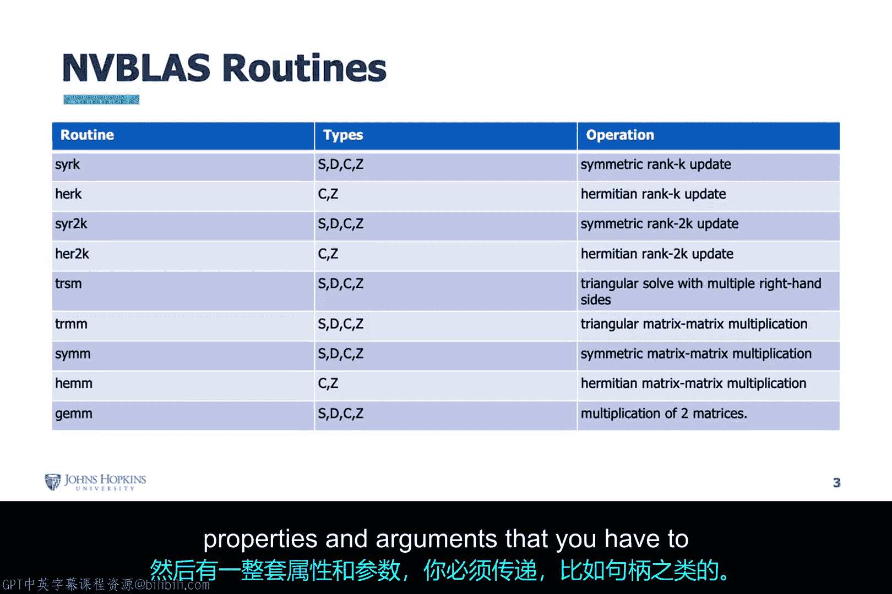
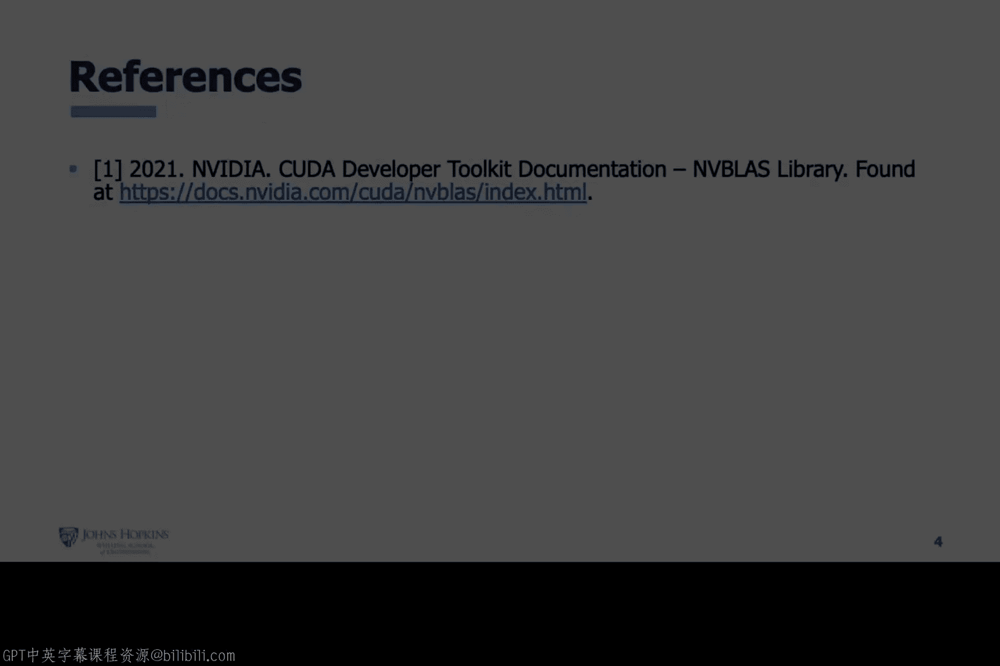

# 108：NVBLAS语法解析 🧠

在本节课中，我们将要学习NVBLAS的语法。NVBLAS是一个基于cuBLAS构建的库，它本身又建立在cuBLAS XT之上，后者是cuBLAS的多GPU版本。这意味着NVBLAS天然支持多GPU计算，并提供了与cuBLAS相同的1级到3级函数支持。

## NVBLAS的架构基础

上一节我们介绍了NVBLAS的基本概念，本节中我们来看看它的具体架构。NVBLAS建立在cuBLAS XT之上，而cuBLAS XT是cuBLAS的多GPU版本。因此，NVBLAS内置了多GPU支持。没有cuBLAS，就没有NVBLAS。

## 支持的函数类型

NVBLAS支持一系列线性代数运算。以下是可用的例程类型概述：

*   **秩更新（Rank Updates）**：这类函数用于对矩阵进行低秩更新。其中，“S”代表对称矩阵，“H”代表厄米特矩阵。“RK”代表秩K更新，“R2K”代表秩2K更新。具体使用哪种取决于输入和输出矩阵的维度。
*   **矩阵乘法（Matrix Multiplication）**：NVBLAS提供了多种矩阵乘法函数，主要分为四类：
    1.  **三角矩阵乘法**：仅使用矩阵的上三角或下三角部分进行计算。
    2.  **对称矩阵乘法**：用于两个相同大小的对称矩阵相乘。
    3.  **厄米特矩阵乘法**：专门处理复数或双精度复数类型的厄米特矩阵。
    4.  **通用矩阵乘法**：用于两个可能不同大小的通用矩阵相乘。
*   **三角矩阵求解（Triangular Solve）**：对应函数 `TRSM`，用于求解三角矩阵方程组。

需要注意的是，对于厄米特矩阵类型的更新或乘法运算，NVBLAS**仅支持复数（`cuComplex`）和双精度复数（`cuDoubleComplex`）**，不支持单精度或双精度实数类型。

## 函数调用与参数

NVBLAS提供了丰富的函数，你需要根据计算任务选择合适的一个。每个函数都有一系列属性和参数需要传递，例如用于管理上下文的句柄（handles）等。

## 总结

本节课中我们一起学习了NVBLAS的语法。我们了解到NVBLAS是一个基于cuBLAS XT的多GPU加速库，支持从1级到3级的BLAS函数。我们详细介绍了它支持的函数类型，包括各种秩更新、矩阵乘法和三角求解，并特别指出了其对复数数据类型的限制。最后，我们提到调用这些函数时需要传递正确的参数和句柄。