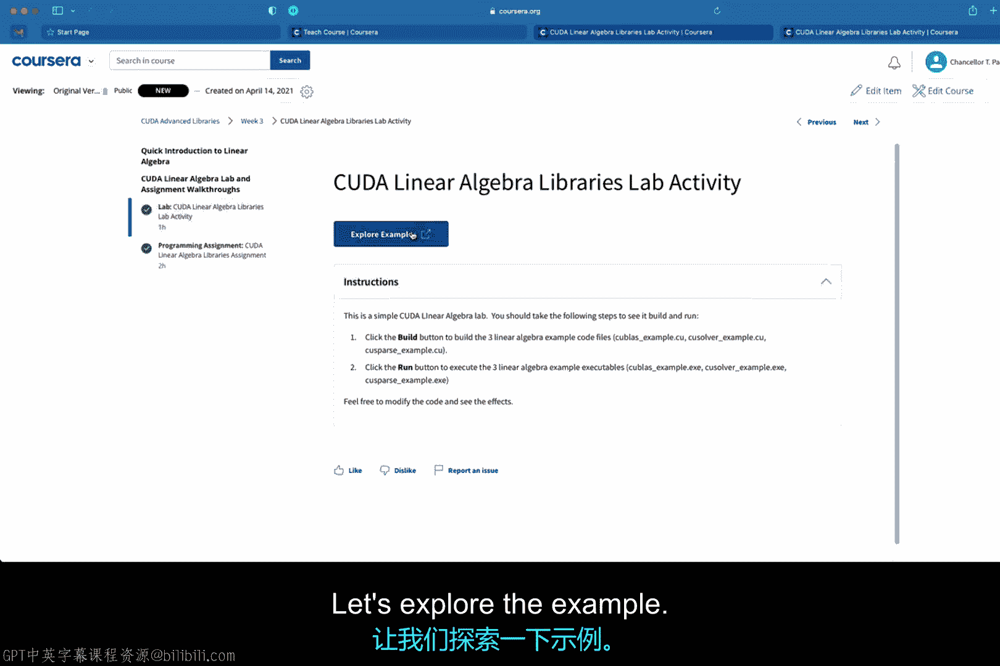
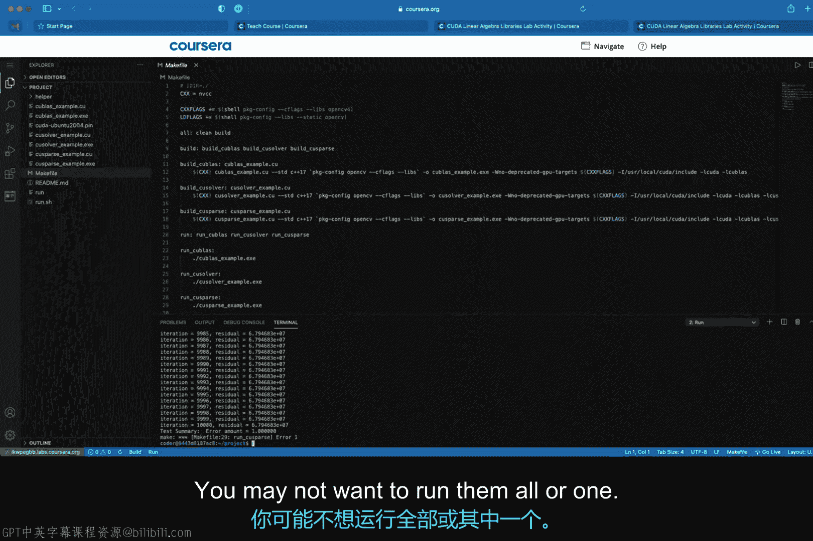
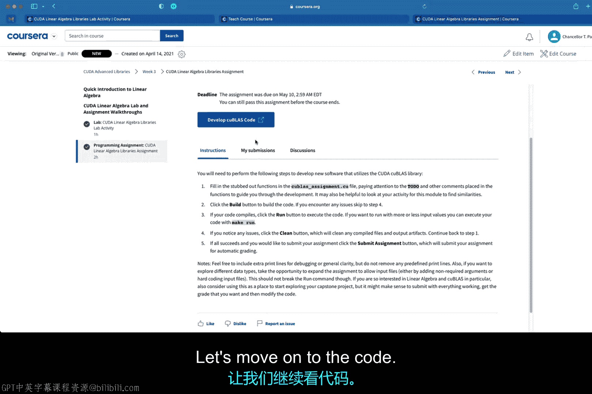
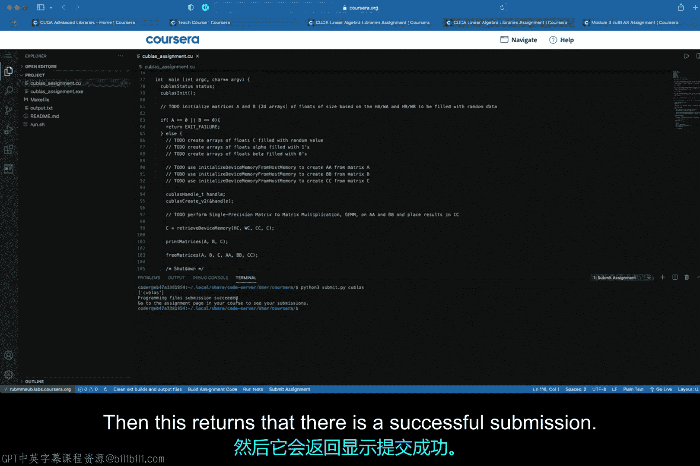

# 109：CUDA线性代数实验与作业综述 🧮

在本节课中，我们将快速浏览CUDA线性代数库的实验与作业。我们将了解实验内容的结构，并详细说明作业的要求与实现步骤。

---

## 实验部分概览

上一节我们介绍了CUDA编程的基础，本节中我们来看看如何使用CUDA提供的线性代数库进行实际计算。

实验部分包含了几个示例文件，用于演示不同的库功能。

以下是实验包含的核心文件列表：
*   `Parallel.c`
*   `Kla.c`
*   `Kusalver.c`
*   `KusSprse.c`

这些文件展示了相应库函数的运行示例。你可以快速浏览它们，了解每个操作的具体步骤。

关于Makefile，你需要知道：
*   执行 `make clean` 命令会清理之前的构建文件。
*   执行 `make build` 命令会编译所有示例程序。
*   执行 `make run` 命令会依次运行每个编译好的示例。

点击构建按钮后，程序会编译三次。编译过程中可能会出现一些警告，但不应有错误。之后可以点击运行按钮。

运行每个示例时，你可能需要按回车键来继续。程序会输出一些信息，例如卡格尔（可能指矩阵条件数）、迭代次数（最后一个示例进行了10,000次迭代计算）以及各种计算结果。你可以根据需要查看输出，也可以选择不运行全部迭代。

---

## 作业部分说明

现在让我们转到线性代数库的作业部分。在查看代码之前，请先阅读作业说明。

你需要修改的文件是 `cublas_assignment.cu`。文件中预留了多个需要你填充功能的函数，并有两条注释大致说明你需要完成的任务。

完成代码后，你应该点击构建按钮。如果构建顺利，接着点击运行按钮来执行 `make run` 命令。

如果遇到任何问题，可以点击清理按钮。设置两个独立按钮（清理和构建）的原因是，本作业涉及多个可执行文件，流程相对复杂。

建议你按顺序逐一完成第1至第4部分。完成后，点击提交作业按钮。

请注意，不要修改任何 `printf` 或 `cout` 输出语句。但你可以自由尝试不同的数据类型，并在此基础上扩展作业，特别是如果你对此领域感兴趣，并考虑在最终项目中使用cuBLAS等库。

---

## 代码结构解析

接下来，我们具体查看 `cublas_assignment.cu` 文件。文件中有些函数已被隐藏，因为它们不重要且无需修改。

这些无需修改的函数主要负责：
*   打印一个或多个矩阵。
*   释放矩阵内存。

你的责任是完成其他核心函数。主要函数包括：
*   `initialize_host_memory`：根据指定矩阵大小初始化主机内存。
*   `initialize_device_memory`：在设备上做同样的内存初始化。
*   `retrieve_from_device`：将数据从设备内存检索到主机内存。
*   `main`：主函数，它需要完成多项任务，包括初始化矩阵A和B、执行不同的运算、填充数值、创建设备内存、执行操作以及最后的清理工作。

这个作业并不非常复杂。这样设计是为了让你有更多时间进行探索，或者考虑是否在最终项目中使用cuBLAS库。请充分利用这一点。

请注意界面上的按钮功能：
*   **清理**：用于清除旧的构建文件和产物。
*   **构建**：用于编译你的代码并运行测试。
*   **提交作业**：当你确认完成后点击此按钮。

点击提交后，一个终端窗口会弹出并显示提交是否成功。我的提交是成功的，因为之前已经运行过并且有输出存在。你不需要手动在终端里输入输出，但必须确保有可用的输出写入 `output.txt` 文件，并且系统返回提交成功的提示。

---

## 课程总结

本节课我们一起学习了CUDA线性代数库实验与作业的完整流程。我们回顾了实验示例的结构和运行方式，详细解析了作业的代码框架、需要完成的任务以及提交流程。掌握这些内容，将帮助你更高效地利用GPU进行线性代数计算。