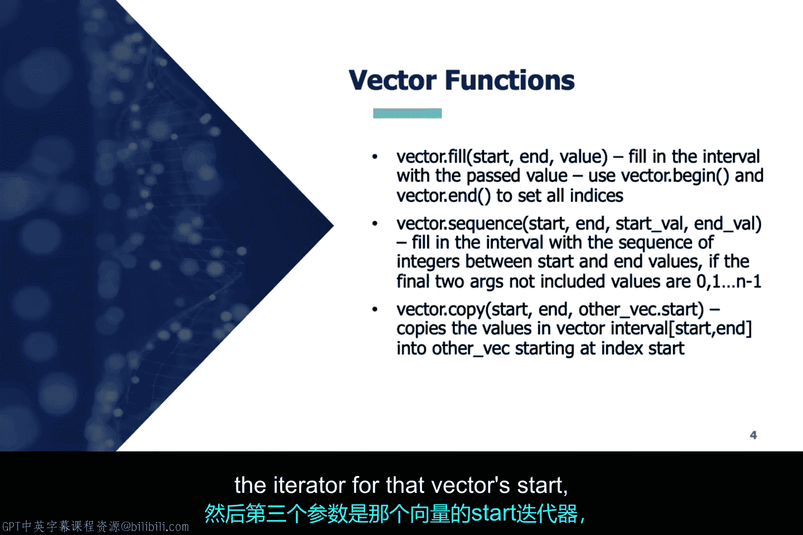
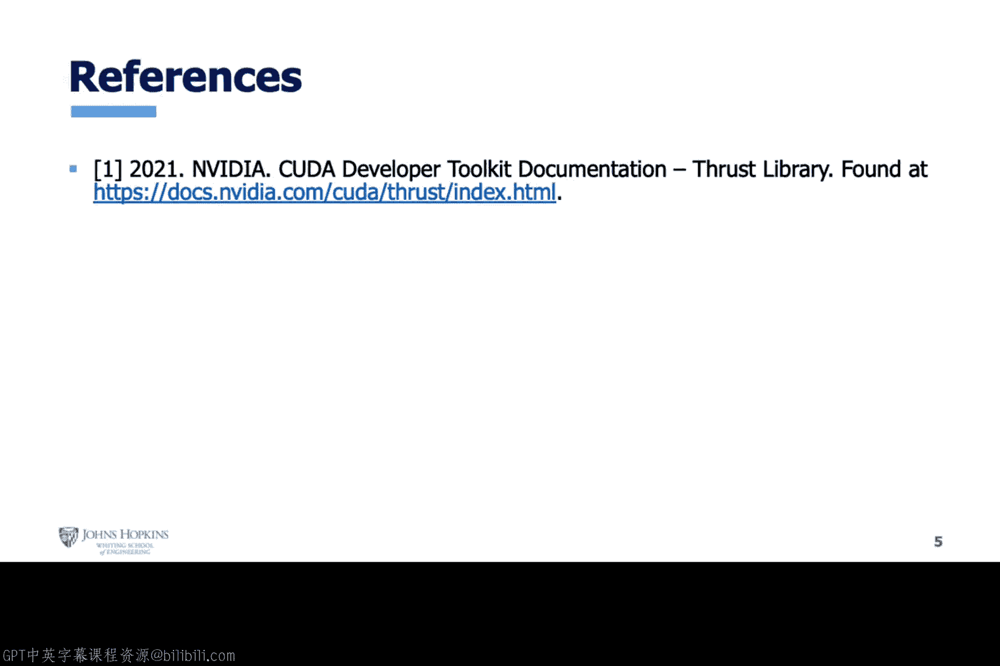

# 110：Thrust向量库语法 🚀

在本节课中，我们将学习Thrust库及其核心数据结构——向量的基本语法。Thrust是一个强大的C++库，旨在提供类似于C++标准模板库（STL）和Boost库的功能，同时简化GPU编程。通过抽象指针操作，它让开发者能更专注于算法逻辑。

## 什么是Thrust？

上一节我们介绍了本课程的目标，本节我们来具体看看Thrust是什么。Thrust库的设计模式旨在满足特定需求，即提供类似于C++ STL和Boost库的能力。它的核心优势在于**移除了开发者直接操作指针的需要**，将这些底层细节抽象化。

## 核心数据类型：向量

Thrust库中主要（但并非唯一）的数据类型是**向量**。向量分为两种：
*   **主机向量**：用于主机（CPU）内存。
*   **设备向量**：用于设备（GPU）内存。

向量使用**迭代器**的概念。迭代器允许应用程序函数遍历向量中的所有值。你可以将向量的部分，甚至通过指定起始和结束迭代器，作为参数传递给函数，特别是那些使用Thrust编写的函数。Thrust库本身内置了大量现成的算法。

## 如何创建向量？

了解了向量的概念后，我们来看看如何创建它。在所有Thrust函数中，你都会看到 `thrust::` 前缀。如果你使用C++的 `using` 语法和 `namespace thrust`，则可以省略此前缀，但保留命名空间前缀通常是个好习惯。

以下是创建向量的方法：
```cpp
thrust::host_vector<int> H(4); // 创建一个初始大小为4的主机int向量
H[0] = 14; // 使用数组表示法设置值
H[1] = 20;
H[2] = 38;
H[1] = 99; // 修改值
```
向量在创建时是静态大小的，但可以使用 `resize` 函数调整大小。
*   如果新尺寸大于当前尺寸，会在末尾添加空值。
*   如果新尺寸小于当前尺寸，则会截断超出部分。

例如，`H.resize(2)` 会将向量大小调整为2，超出部分的值将被丢弃。

## 向量操作函数

现在，我们重点介绍三个主要的向量操作函数。

### 1. 向量填充
`thrust::fill` 函数用指定的值填充向量中从起始到结束迭代器范围内的所有元素。你可以使用 `vector.begin()` 和 `vector.end()` 来填充整个向量。
```cpp
thrust::fill(H.begin(), H.end(), 7); // 将向量H的所有元素填充为7
```

### 2. 生成序列
`thrust::sequence` 函数在向量的指定范围内生成一个数字序列。序列基于起始值和步长生成。**请注意，范围是左闭右开的**。例如，指定范围0到10，实际会生成0到9。
```cpp
thrust::sequence(H.begin(), H.end(), 0, 2); // 生成序列: 0, 2, 4, 6, ...
```
如果目标向量小于指定的序列范围，函数只会填充向量能容纳的部分。

### 3. 向量复制
`thrust::copy` 函数将一个向量的内容复制到另一个向量。它从源向量的起始迭代器复制到结束迭代器，并将值填充到目标向量的起始迭代器位置。函数会尽可能多地复制值，直到填满目标范围或源数据用完。
```cpp
thrust::device_vector<int> D(5);
thrust::copy(H.begin(), H.end(), D.begin()); // 将主机向量H复制到设备向量D
```

## 总结





本节课我们一起学习了Thrust向量库的基本语法。我们了解了Thrust库的设计目标，认识了其核心数据类型——主机向量和设备向量，并掌握了如何创建向量以及使用 `fill`、`sequence` 和 `copy` 这三个关键函数进行操作。这些基础是使用Thrust进行高效GPU编程的第一步。