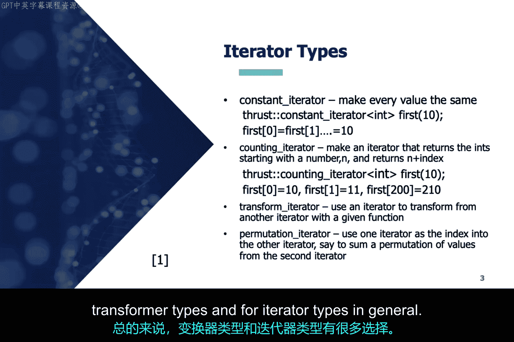
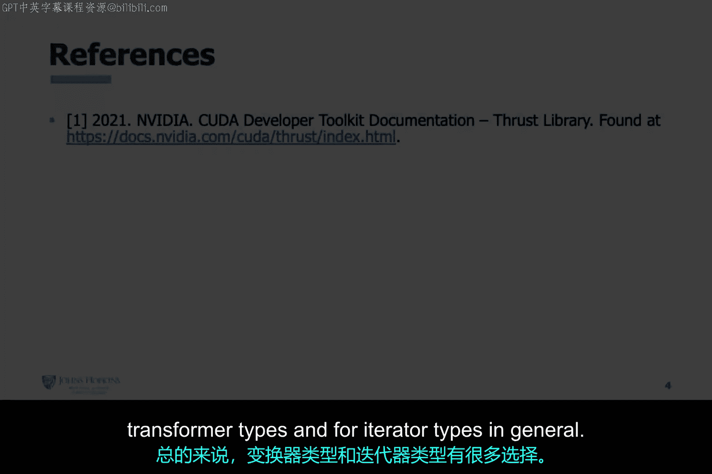

# 111：Thrust向量迭代器解析 🧠

在本节课中，我们将聚焦于Thrust库中的向量数据类型，并深入探讨其迭代器的语法与用法。

## 概述

迭代器是Thrust库中的一个核心概念，它抽象了指针和索引操作中的许多复杂细节。迭代器能够高效地处理循环等操作，尤其是在调用或使用它的函数中。我们最近在`copy`序列和`fill`函数中已经见过一些使用迭代器的例子。大多数Thrust向量操作都接受一个起始和一个结束迭代器作为参数。

## 迭代器基础

上一节我们概述了迭代器的概念，本节中我们来看看它的具体应用场景。

如果你出于某种原因，希望使用类似C/C++的指针索引方式，而不是迭代器，你可以使用`raw_pointer_cast`将向量转换为原始指针。

如果你习惯使用标准库容器，或者你的代码中使用了标准库，你可以在其中使用迭代器来创建Thrust向量，并且可以在标准库容器和Thrust向量之间进行数据拷贝。

## 迭代器类型

Thrust库提供了多种类型的迭代器，以满足不同的编程需求。以下是几种主要的迭代器类型：

**常量迭代器**：在构造时指定大小，它会创建一个无论你访问哪个索引（从`first[0]`到`first[10]`，甚至`first[1000000]`）都返回相同值的迭代器。它的一个典型用途是，当你需要将一个向量乘以一个常数标量时。因为大多数运算需要传入另一个向量作为参数，这时你可以使用常量迭代器来充当这个“向量”。例如，以下代码会将一个向量中的所有值乘以10：
```cpp
thrust::constant_iterator<int> const_iter(10);
// 假设 vec 是另一个 thrust::device_vector<int>
thrust::transform(vec.begin(), vec.end(), const_iter, vec.begin(), thrust::multiplies<int>());
```

**计数迭代器**：类似于一个序列生成器。你给定一个初始值，然后根据你访问该迭代器的索引，它会将该索引值加到初始值上。如下图所示，对于`counting_iterator`，第一个值（索引0）是10，第200个值则是210（10+200）。
```cpp
thrust::counting_iterator<int> count_iter(10);
// count_iter[0] == 10, count_iter[200] == 210
```

**变换迭代器**：你提供一个迭代器和一个变换函数（例如乘以2），它会应用该函数来生成新的值序列，从而创建出第二个迭代器。
```cpp
// 假设 input_iter 是某个输入迭代器
struct multiply_by_two {
    __host__ __device__ int operator()(int x) const { return x * 2; }
};
auto trans_iter = thrust::make_transform_iterator(input_iter, multiply_by_two());
```

**排列迭代器**：你向它提供两个迭代器。第一个迭代器是索引的集合，这些索引指向第二个迭代器中的位置。排列迭代器会根据你选择的索引，对第二个迭代器中相应位置的值进行求和（或其它操作）。
```cpp
// 假设 map_iter 是索引迭代器，value_iter 是值迭代器
auto perm_iter = thrust::make_permutation_iterator(value_iter, map_iter);
// perm_iter[i] 将返回 value_iter[map_iter[i]]
```




## 总结


本节课中，我们一起学习了Thrust库中向量迭代器的核心概念。我们了解了迭代器如何简化指针操作，探讨了在Thrust与标准库之间进行数据交互的方法，并详细介绍了常量迭代器、计数迭代器、变换迭代器和排列迭代器这几种主要类型及其用途。总的来说，Thrust提供了丰富多样的迭代器类型，为GPU上的数据变换和处理提供了强大的灵活性。