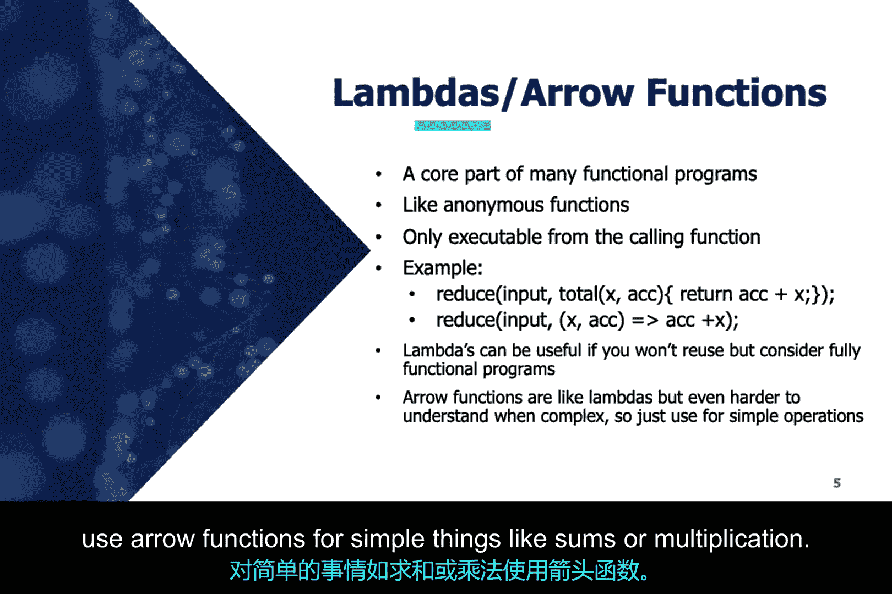
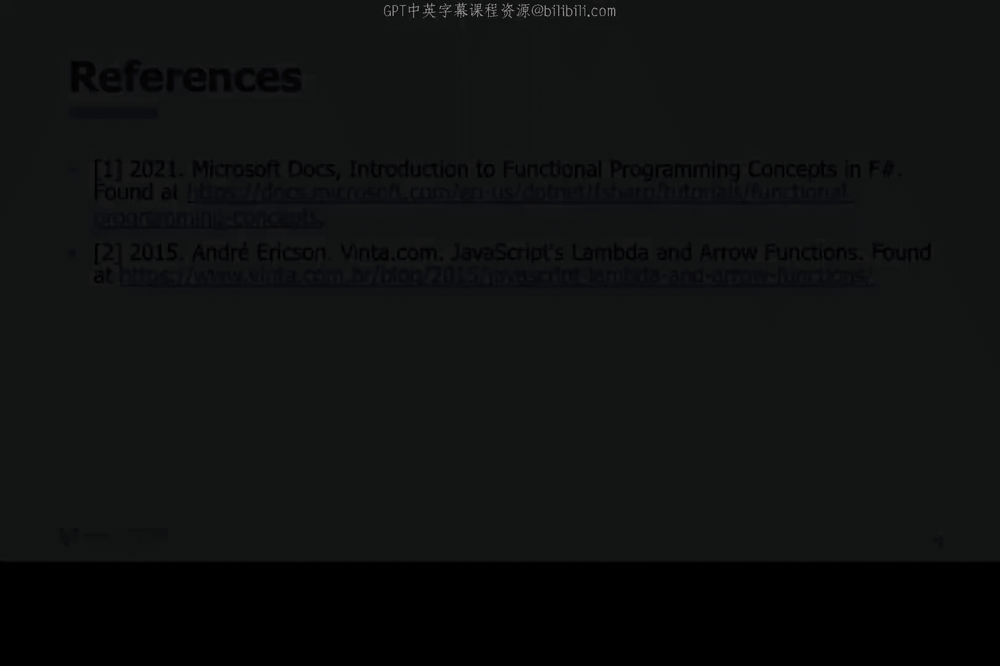

# 112：函数式编程范式 🧮

在本节课中，我们将学习函数式编程范式，这是一种在包括CUDA、C++在内的多种语言中，用于高效进行数据映射、归约和转换的方法。

## 概述

函数式编程的核心在于以声明式而非命令式的方式处理数据。它强调数据的不可变性，并通过一系列高阶函数（如 `map`、`reduce`）来操作数据，而非使用传统的循环结构。这种方法可以使代码更简洁、更易于推理，并且在某些情况下，通过库（如Thrust）的优化实现，还能获得更好的性能。

## 核心概念

### 不可变性

在函数式编程中，数据对象通常是**不可变的**。这意味着一旦一个对象被实例化并赋予值，你就不能直接修改这个值。任何操作都会基于原始数据**生成新的数据**，并将结果赋值给新的变量或指针，而不是改变底层数据本身。

### 递归迭代

函数式编程通常使用**递归**而非循环来进行迭代。一个函数会接收一个数据集合（如向量），并处理其“第一个”元素和“剩余”部分。函数会处理第一个元素，然后递归地调用自身来处理剩余部分，直到剩余部分为空。这种方式与我们在GPU编程中通常避免递归的思路有所不同，需要适应。

## 常见高阶函数

以下是函数式编程中一些非常常见的操作，它们在Thrust等库中也有实现。

*   **`each`**：对输入中的每个值执行一个操作。输出的大小不一定与输入相同，操作可能影响一个完全不同的外部状态。
*   **`map`**：对输入中的每个元素执行相同的操作，并生成一个大小相同的输出。公式可表示为：`output[i] = function(input[i])`。
*   **`reduce`**：接收一个输入，通过一个操作（如加法）将其归约为一个单一的值。它通常需要一个初始累加器值 `acc`。例如，求和：`result = acc + input[0] + input[1] + ... + input[n-1]`。
*   **`filter`**：根据一个判断函数（返回布尔值）来过滤输入。只有使判断函数返回 `true` 的元素才会被包含在输出中。
*   **`intersection`**、**`union`**、**`unique`**：这些是用于集合操作的函数，基于布尔逻辑处理两个向量，分别用于求交集、并集和去重后的唯一值集合。

## 匿名函数：Lambda与箭头函数

传递给上述高阶函数的操作（`op`）不一定是一个独立定义的函数。它通常可以是匿名函数。

*   **Lambda表达式**：一种可以捕获上下文中变量的匿名函数。它可以有多行逻辑，相对更强大。例如，在C++中：
    ```cpp
    auto total = [](int acc, int x) { return acc + x; };
    ```
*   **箭头函数**：一种语法更简洁的匿名函数，通常只适合单行简单操作。在支持的语言中（如JavaScript），它可能看起来像这样：
    ```javascript
    (acc, x) => acc + x
    ```

**使用建议**：对于中等复杂度的逻辑，使用Lambda表达式；对于非常复杂的逻辑，使用外部定义的普通函数；对于求和、乘法等简单操作，可以使用箭头函数以保持代码简洁。

## 总结





本节课我们一起学习了函数式编程范式。我们了解了其核心原则——数据不可变性和递归迭代，并认识了 `map`、`reduce`、`filter` 等关键的高阶函数。此外，我们还探讨了Lambda表达式和箭头函数这两种定义匿名操作的方式。掌握这些概念有助于你编写出更清晰、更模块化的代码，并能更好地利用像Thrust这样的高级库进行GPU编程。