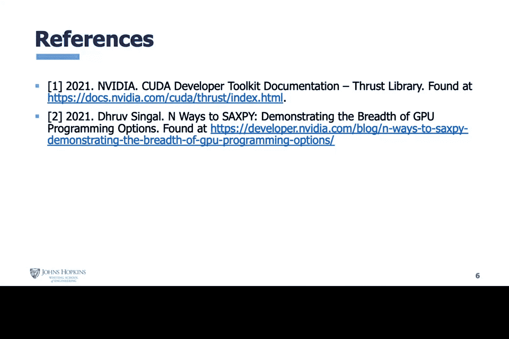

# 113：Thrust数据转换技术 🚀

在本节课中，我们将学习Thrust库的数据转换功能。Thrust提供了一系列强大的转换操作，允许我们对向量中的区间元素执行相同的运算。这些操作通常遵循相似的调用模式，理解其结构是掌握其用法的关键。

## 概述

Thrust的数据转换操作非常强大，它们允许你对向量内的一个区间执行相同的操作。这些操作的调用模式通常很相似：前两个参数总是区间的起始和结束迭代器，最后一个参数总是要执行的操作。在某些情况下，操作参数可能不是第三个参数，但位于最后一个参数之前的所有参数，都是用来支持你如何执行该操作的。

## 核心转换操作示例

以下是Thrust中几种常见的数据转换操作，它们展示了如何对向量元素进行批量处理。

### 取反操作

上一节我们介绍了Thrust转换操作的基本模式，本节中我们来看看一个简单的例子：取反操作。该操作接收一个输入数组或向量，并返回其元素的相反数。例如，`[-1, -2, -3]` 会变成 `[1, 2, 3]`。

以下是使用`thrust::negate`进行取反操作的步骤：
*   **输入**：源向量 `x`。
*   **输出**：目标向量 `y`。
*   **操作**：`thrust::negate<int>()`。
*   **代码示例**：`thrust::transform(x.begin(), x.end(), y.begin(), thrust::negate<int>());`
*   **解释**：你提供输入向量 `x` 的起始和结束迭代器，以及输出向量 `y` 的起始迭代器。转换操作会将 `x` 中每个元素的相反数依次放入 `y` 中。

### 模运算操作

了解了基本的单向量操作后，我们来看看如何处理两个向量。模运算操作就是一个典型的例子，它会对两个向量中相同索引的元素进行模运算，并将结果放入第三个向量。

以下是使用`thrust::modulus`进行模运算的步骤：
*   **输入**：两个源向量 `x` 和 `z`。
*   **输出**：目标向量 `y`。
*   **操作**：`thrust::modulus<int>()`。
*   **代码示例**：`thrust::transform(x.begin(), x.end(), z.begin(), y.begin(), thrust::modulus<int>());`
*   **解释**：模运算计算的是整数除法后的余数。例如，`4 % 2 = 0`，`3 % 2 = 1`。此调用从 `x` 和 `z` 的起始位置开始，对每一对元素执行模运算，并将结果依次放入 `y` 中。

### SAXPY 变换

最后，我们探讨一个在科学计算中非常常见的操作：SAXPY变换。SAXPY是“标量a乘向量x加向量y”的缩写，其公式为：**y = a * x + y**。这是一个原地操作，结果会存回向量 `y`。

以下是实现SAXPY变换的步骤：
1.  **创建临时向量**：首先，创建一个临时向量 `temp`，并用标量值 `a` 填充所有位置。代码为：`thrust::fill(temp.begin(), temp.end(), a);`
2.  **执行乘法**：然后，对临时向量 `temp` 和输入向量 `x` 执行逐元素乘法，结果存回 `temp`。代码为：`thrust::transform(temp.begin(), temp.end(), x.begin(), temp.begin(), thrust::multiplies<float>());` 此时，`temp` 中保存的是 `a * x` 的结果。
3.  **执行加法**：最后，将 `temp`（即 `a*x`）与向量 `y` 相加，结果存回 `y`。代码为：`thrust::transform(temp.begin(), temp.end(), y.begin(), y.begin(), thrust::plus<float>());`

这个例子可能看起来步骤稍多，但用三行代码完成在常规编程中至少需要两个循环的操作，已经非常简洁高效了。

## 总结

本节课中我们一起学习了Thrust库的核心数据转换技术。我们掌握了三种基本转换操作：使用 `thrust::negate` 进行取反，使用 `thrust::modulus` 对两个向量进行模运算，以及通过组合 `thrust::multiplies` 和 `thrust::plus` 来实现经典的SAXPY变换。理解这些操作的调用模式——即提供输入迭代器、输出迭代器和具体的转换函子——是灵活运用Thrust进行高效GPU编程的关键。