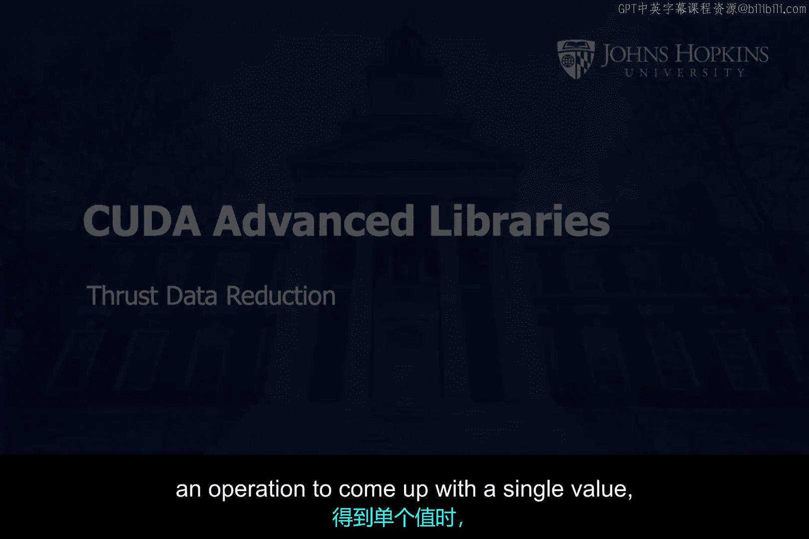
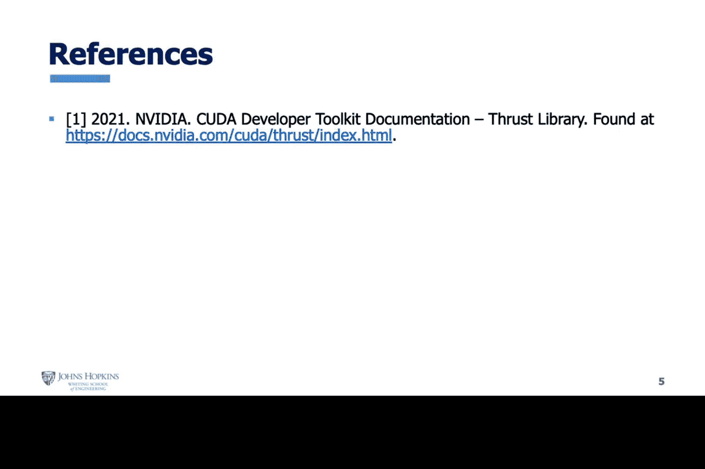

# 114：Thrust数据归约操作

在本节课中，我们将要学习Thrust库中用于执行数据归约操作的功能。归约操作是指对一个输入序列执行某种运算，最终得到一个单一值的过程。

上一节我们介绍了Thrust库的基本概念，本节中我们来看看如何使用它进行数据归约。

## 归约操作概述

数据归约操作作用于设备向量。对主机向量执行归约没有意义。归约操作在序列的值之间执行指定的运算。例如，如果你有一个向量 `V`，并对它执行加法归约，其过程类似于计算 `V[0] + V[1] + V[2] + ...`。如果向量包含值 `1` 和 `2`，那么结果将是 `3`。

## 归约语法

以下是归约函数的基本语法和参数说明。

归约函数的主要参数如下：
*   **参数0和1**：起始和结束索引（或迭代器）。通常传递向量的 `begin()` 和 `end()` 迭代器以处理整个序列，但你也可以指定一个子集。
*   **参数2**：初始值。计算从这个值开始，然后与输入序列中的值进行累加、相乘等操作。
*   **参数3**：要执行的运算操作符。

对于求和操作，有一个简化的用法。你可以使用完全指定的形式，也可以只提供起始和结束迭代器。默认情况下，这将执行求和操作，且初始值默认为零。这是专门为求和提供的简写形式。

## 特殊归约操作

Thrust库还提供了一些特殊的归约函数，你无需传递操作符。

以下是这些特殊归约函数的列表：
*   `count`
*   `min`
*   `max`
*   `min_element`
*   `max_element`
*   `is_sorted`
*   `inner_product`

对于这些函数，你只需传递起始和结束迭代器（以及可选的初始值），库会自动为你执行相应的操作。

本节课中我们一起学习了Thrust库的数据归约功能。我们了解了归约的基本概念，即从一组数据中计算出一个单一值；学习了通用归约函数的语法，包括如何指定范围、初始值和操作；最后，我们还认识了一些无需指定操作符的特殊归约函数，它们为常见操作提供了便捷的接口。掌握这些归约操作对于在GPU上高效处理和分析数据至关重要。