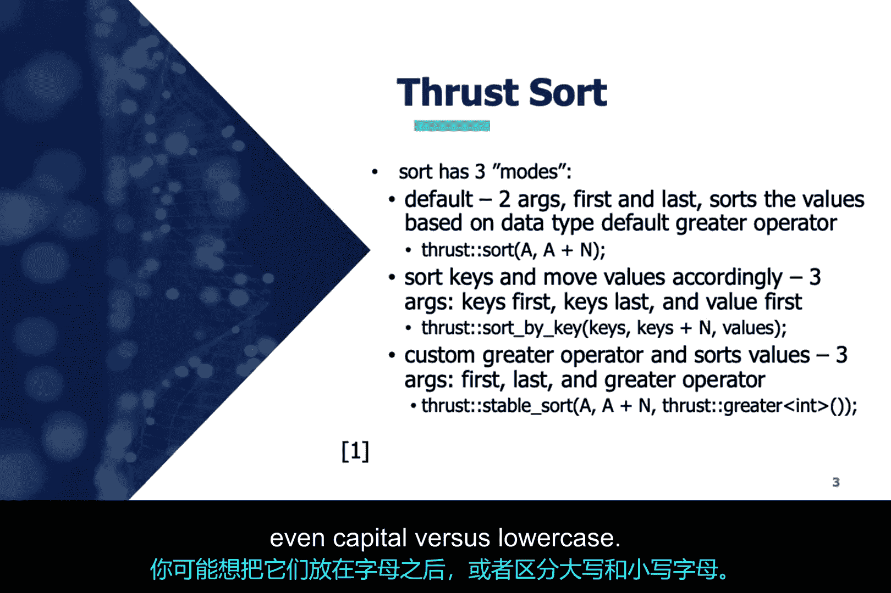

# 115：Thrust数据重构与排序 🧮

在本节课中，我们将学习如何使用Thrust库对数据进行重新排序和排序。这些操作对于高效地组织GPU上的数据至关重要，尤其是在为后续的并行计算（如内核执行）准备数据时。

## 数据分区

上一节我们介绍了Thrust库的基本概念，本节中我们来看看如何使用`partition`函数对数据进行分区。数据分区是指根据特定条件，将数据集合重新排列成两个部分。

`partition`函数需要以下参数：
*   **第一个和最后一个索引迭代器**：定义了要操作的向量数据范围。
*   **模板（Stencil）**：一个与数据向量大小相同的数组或向量，用于指定操作的执行顺序。
*   **谓词（Predicate）**：决定如何分区数据的实际条件。它可以是二元的（是/否），也可以是分类的（例如，0, 1, 2, 3, 4代表四个类别）。

使用模板`S`和谓词“是否为偶数”对向量`a`进行分区的结果是：所有非偶数值排在前面，所有偶数值排在后面。

你可以尝试调整参数以观察不同的分区效果。这个功能非常有用，可以快速将数据排列成特定顺序。结合内核使用，你可以让数据呈现出特定的模式，从而实现经线（warp）划分或块（block）划分。

以下是谓词的常见类型：
*   **二元测试**：条件为1或0，然后执行相应操作，以减少等待经线另一侧执行完毕而产生的停顿或中止。

## 数据排序

了解了数据分区后，我们接下来探讨Thrust中的排序功能。排序主要通过三种方式实现。

**默认排序**：你只需要提供两个参数，即第一个和最后一个索引的迭代器。请注意，在示例中，我传递的是指向向量`a`起始位置的指针。

**按键值对排序**：你可以提供两个向量。指定键（keys）向量的起始和结束位置，然后提供值（values）向量。函数会根据键的顺序（大于或序列）对值进行排序，同时键的顺序也会相应改变。这在支持映射（maps）或字典（dictionaries）的语言中非常常见，即存在键值对结构。

**稳定排序**：此功能允许你创建自定义的排序机制。同样，你需要提供向量的起始和结束迭代器，并传入比较运算符。在这个例子中，我们使用了Thrust内置的`greater`运算符来处理整数。

你也可以提供自己的运算符。例如，对于按字典序排序单词，你可能希望将数字（在字符值中较早出现）排在字母之后，或者区分大写和小写字母。

---

本节课中我们一起学习了Thrust库中数据重构与排序的核心操作。我们介绍了如何使用`partition`函数根据条件对数据进行分区，以及三种主要的排序方法：默认排序、按键值对排序和允许自定义比较规则的稳定排序。掌握这些工具能帮助你高效地组织GPU数据，为并行计算优化数据布局。