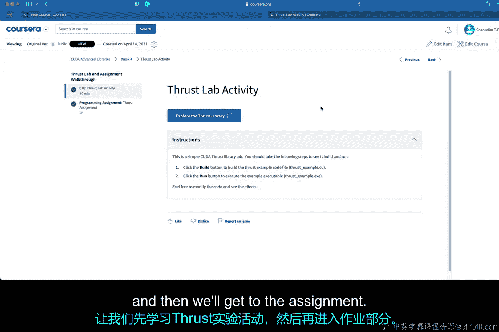
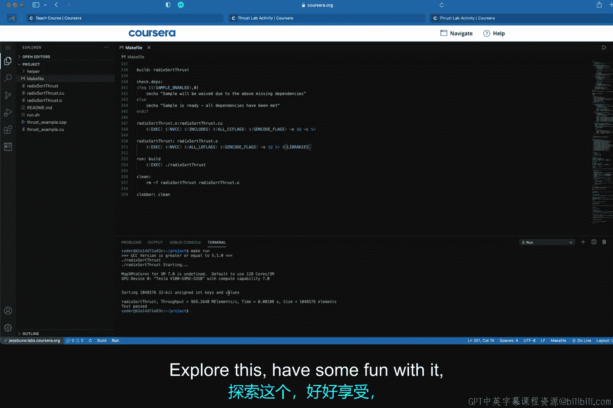
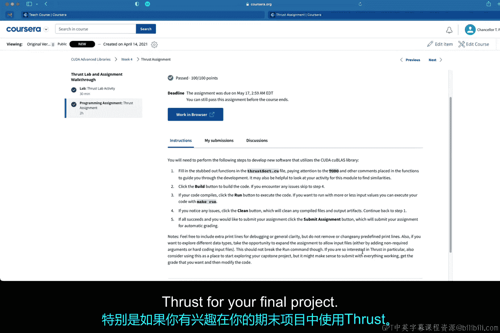
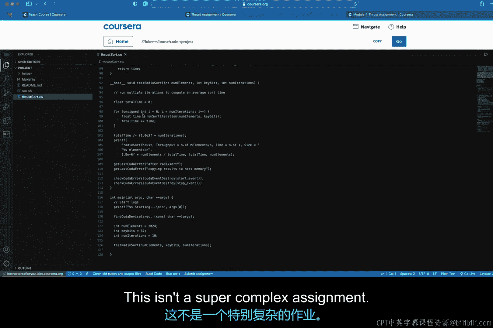

# 116：Thrust库实验与作业总览 🚀



在本节课中，我们将学习如何使用Thrust库进行GPU编程，具体包括一个实验活动和一个编程作业。我们将了解如何编译和运行Thrust代码，并完成一个基于基数排序的键值对排序任务。

---

## 实验活动概览

上一节我们介绍了Thrust库的基本概念，本节中我们来看看配套的实验活动。这个实验旨在帮助你熟悉Thrust的编译流程和一个具体的排序示例。

实验的核心是一个名为 `radix_sort_thrust.cu` 的CUDA文件。它实现的功能是：**对一组键（keys）和一组值（values）进行排序，排序的依据是键**。代码已经为你写好，你的主要任务是理解它并成功编译运行。

### 编译与运行步骤

以下是编译和运行该实验代码的关键步骤：

1.  **使用Makefile编译**：实验提供了一个Makefile。最重要的构建目标是 `radix_sort_thrust`，它会编译 `radix_sort_thrust.cu` 文件。
    ```bash
    make radix_sort_thrust
    ```
2.  **处理权限问题**：编译成功后，Makefile可能会尝试创建一个目录并复制可执行文件。如果你遇到“权限被拒绝”的错误，可以安全地忽略或删除Makefile中创建目录和复制文件的步骤，直接运行生成的可执行文件即可。
3.  **运行程序**：Thrust库的编译有时较慢。编译完成后，直接运行生成的可执行文件。程序会对超过一百万个元素进行排序，并输出排序的吞吐量和耗时，以此展示Thrust排序实现的效率。

请花时间探索这段代码，理解其如何组织和使用Thrust的排序函数，然后再进入作业部分。

---



## 编程作业详解

在熟悉了实验代码后，本节我们将深入分析本次的编程作业。作业要求你填充一个框架代码，实现特定的功能。

作业流程是标准的：你会拿到一个几乎为空的 `.cu` 文件，需要根据其中的 `// TODO` 注释填充代码，然后编译、运行并提交。

### 作业要求与注意事项

以下是完成作业时需要牢记的几点：

*   **不要修改输出语句**：框架中的 `printf` 或 `cout` 语句用于自动评分，请勿修改或删除。你可以添加自己的调试输出，但提交前建议清理。
*   **鼓励探索**：作业本身对Thrust的探索深度有限。在完成基本要求后，鼓励你尝试不同的数据类型和Thrust函数，这对你的期末项目可能大有裨益。
*   **定期提交**：你可以随时提交作业，系统会记录你的进度。

### 代码框架分析



让我们具体看一下作业的代码框架 `thrust_sort.cu`：

1.  **核心任务**：在 `generate_device_memory` 函数中，你需要完成一系列步骤，最终在设备上创建出键（`d_keys`）和值（`d_values`）的向量，并在主机上准备一个用于接收排序后键的向量（`h_sorted_keys`）。
2.  **排序迭代**：`run_sort_iteration` 函数是作业的核心。你会获得元素数量（`num_elements`）和键的位数（`key_bits`），你需要根据这些参数，使用Thrust库实现基数排序（radix sort）来对键值对进行排序。
3.  **测试验证**：代码中包含测试部分，用于比较排序后的键值顺序是否正确，并生成类似实验部分的性能输出。
4.  **主函数**：`main` 函数参数基本固定，会处理一个较大的数据量（例如 `1024 * 1024 * 32` 个元素），进行多次排序迭代并测试性能。

总的来说，这是一个结构清晰、目标明确的作业，重点在于实践Thrust中内存管理和排序算法的调用。

---

## 课程总结

本节课中，我们一起学习了Thrust库的实践应用。我们首先通过一个实验活动，熟悉了Thrust代码的编译流程和一个高效的键值对排序示例。接着，我们详细分析了编程作业的要求，你需要在一个给定的框架中，填充代码以实现基于Thrust的基数排序功能。



关键要点包括：理解Thrust的设备与主机向量操作，掌握使用Thrust算法（如排序）的流程，以及遵循作业的编译、测试和提交规范。希望你能通过动手实践，巩固对GPU并行编程中高级库使用的理解。