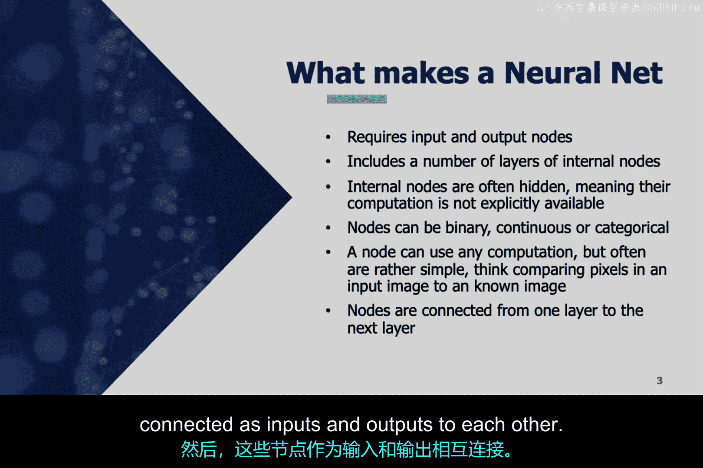
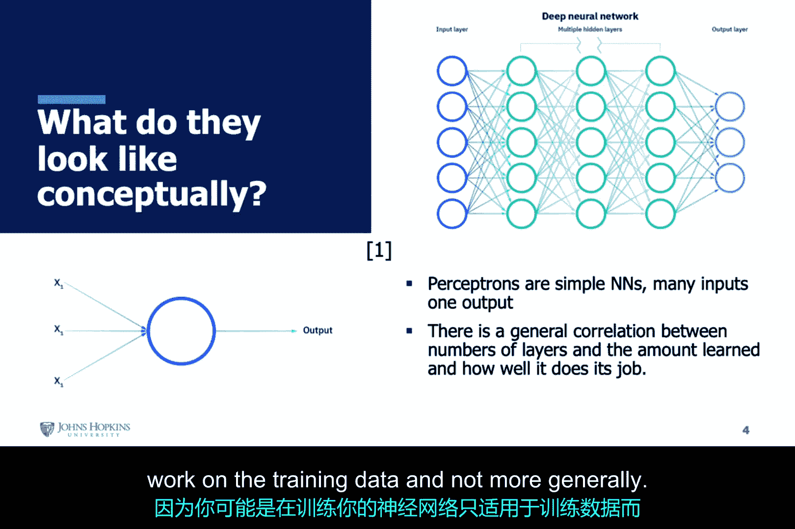
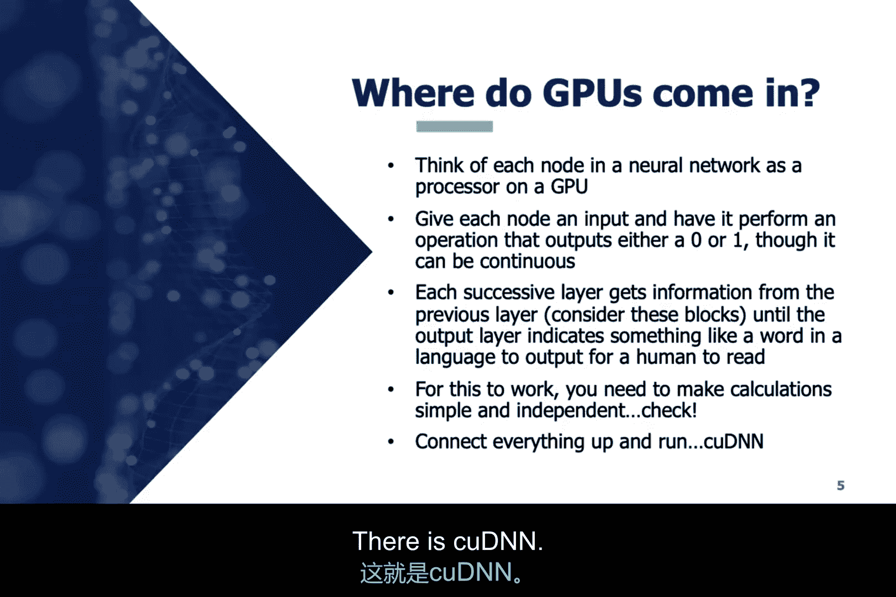

# 117：神经网络入门教程 🧠

在本节课中，我们将学习如何使用GPU进行机器学习，特别是聚焦于神经网络。我们将探讨神经网络的基本概念、结构，以及为何GPU是运行神经网络的理想硬件。

神经网络建立在模仿人脑工作方式的理念之上。它们使计算机能够通过识别模式来响应特定问题。神经网络在人工智能、机器学习和深度学习领域应用非常广泛。它们已存在一段时间，存在一些变体或类似技术，这些技术使用略有不同的数学运算或表示方法。

神经网络已被用于处理人类语言、分析图像和视频以识别物体、碰撞检测以及自动驾驶汽车等领域。神经网络并不适合在CPU上高效运行，因为CPU擅长处理少量核心上的大型问题，而神经网络需要持续计算大量小型运算，GPU是更合适的工具。

## 神经网络构成要素

上一节我们介绍了神经网络的应用背景，本节中我们来看看神经网络的具体构成。

神经网络必须包含一个或多个输入和输出节点。可以将神经网络视为一个从左到右布局的图，左侧是输入层，可以有一个或多个输入。例如，在处理图像时，每个像素都可以是神经网络的一个特定输入。输出通常是类似“某个特定像素或整张图像属于某个类别（例如，在自动驾驶场景中，识别出行人）”的置信度。

输入层和输出层之间还存在中间层。层是一组大致同时被“激活”的节点的集合，它们按照从左到右的顺序依次处理。有时，层或单个节点是“隐藏”的，这意味着我们并不明确指定它将执行的计算，其计算方式可以在深度学习过程中随时间改变。

以下是关于节点和连接的详细信息：

*   **节点值类型**：节点的输入和输出可以是二进制的（真/假，1/0），可以是连续的（例如0到100之间的数字），也可以是分类的（例如，识别图像中的物体类型，输出是一个带有相关值的类别）。
*   **节点计算**：理论上可以使用任何计算，但简单的计算运行效果更好（即更快）。有时为了获得更精确的输出，可能需要复杂的计算。
*   **节点连接**：节点之间通过输入和输出相互连接。

## 神经网络结构可视化

现在让我们从视觉上理解这个概念。如前所述，神经网络包含输入层和输出层。右上角展示的是一个复杂的深度神经网络，它包含多个用绿色表示的隐藏层，并且可以看到几乎每个节点都连接到其他节点（尽管这不是必须的）。

左下角展示的是最简单的神经网络示例——感知机。它接收多个输入，产生一个输出。它可以被视为更复杂神经网络的一部分，也可以独立工作。

通常，从定性角度看，节点越多，尤其是层数越多，性能可能越好。但层数越多，模型也越大，运行速度可能越慢。因此需要权衡，同时也要避免层数过多导致“过拟合”，即神经网络只在训练数据上表现良好，而缺乏泛化能力。

## GPU如何加速神经网络

上一节我们了解了神经网络的结构，本节中我们来看看GPU如何与之结合。

可以将GPU中的每个独立处理器视为神经网络中的一个节点。

这些处理器可以根据给定的输入输出一个0/1值或连续值。它们需要在连续的层中运行。这意味着，可能需要通过流或其它同步方式，使得特定的层只有在前一层计算完成后才会开始执行。

计算越简单越好，并且它们应该彼此独立。每个处理器接收输入并生成输出。这基本上就是我们一直在学习的GPU和CUDA编程的核心思想。

最棒的是，为了帮你完成所有这些连接和大量工作，已经有了现成的工具——**CUDA深度神经网络库**。

## 总结

本节课中我们一起学习了神经网络的基础知识。我们了解到神经网络是一种受大脑启发、用于模式识别的计算模型，广泛应用于AI领域。其核心结构包括输入层、输出层以及可能存在的隐藏层，节点之间相互连接。由于神经网络涉及大量并行的小型计算，GPU相比CPU更具优势。最后，我们介绍了如何将GPU处理器映射为网络节点，并提到了CUDA DNN库可以简化在GPU上实现神经网络的过程。