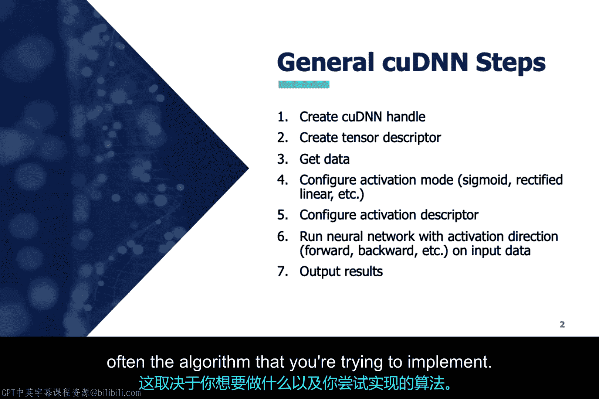
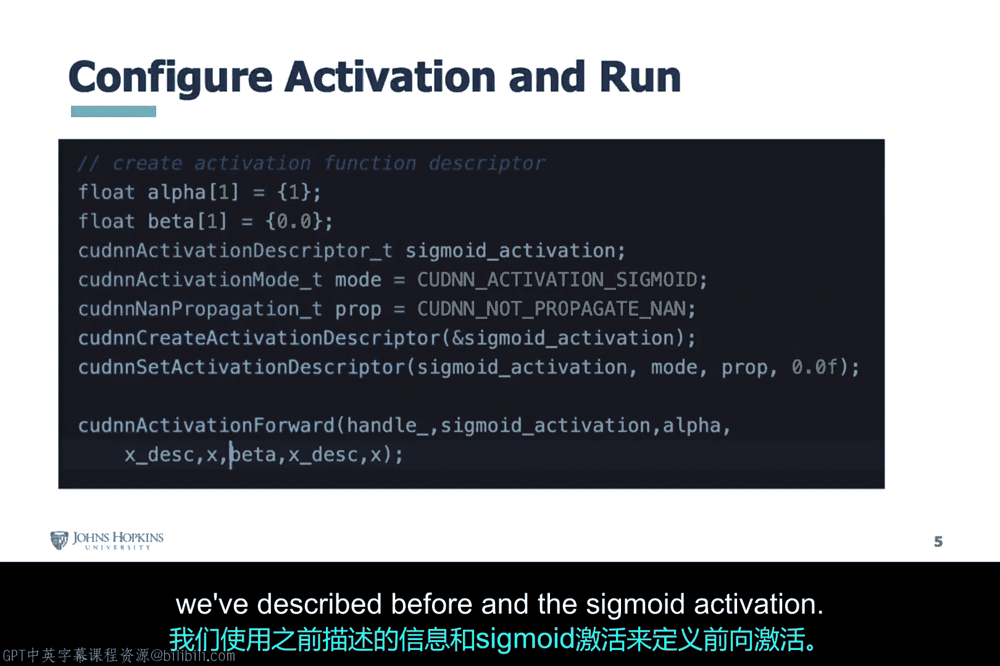
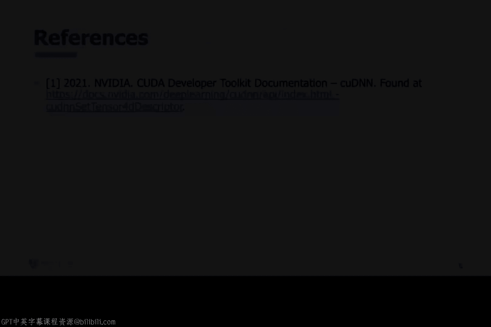

# 118：cuDNN语法详解 🧠

在本节课中，我们将详细学习NVIDIA cuDNN库的基本语法。cuDNN是一个用于深度神经网络的GPU加速库，许多主流框架（如TensorFlow和PyTorch）都在底层使用它。理解其核心步骤对于掌握GPU加速的深度学习至关重要。

## 创建句柄与描述符

首先，使用cuDNN需要创建一个句柄（handle）。这类似于在其他库中初始化一个工作环境。

```c
cudnnHandle_t handle;
cudnnCreate(&handle);
```

接着，需要为张量（Tensor）创建一个描述符。描述符定义了数据在内存中的布局和类型。

## 描述张量

以下是定义张量描述符的关键步骤。首先需要确定整个神经网络中将使用的数据类型，例如浮点数（float）。然后需要选择数据格式。



cuDNN支持多种数据格式。在本例中，我们选择`CUDNN_TENSOR_NCHW`格式。这个格式名称中的字母代表以下维度：
*   **N**: 输入图像的数量（批次大小）。
*   **C**: 特征图的数量或图像中待识别的特征通道数。
*   **H**: 特征图的高度或神经网络层中的节点数。
*   **W**: 特征图的宽度或神经网络中的层数。

张量的总元素数是N、C、H、W这四个维度的乘积。创建描述符后，需要设置其属性。

```c
cudnnTensorDescriptor_t tensorDesc;
cudnnCreateTensorDescriptor(&tensorDesc);
cudnnSetTensor4dDescriptor(tensorDesc, CUDNN_TENSOR_NCHW, CUDNN_DATA_FLOAT, N, C, H, W);
```

至此，我们便完成了一个四维张量描述符的创建。

## 定义激活函数与运行网络

上一节我们定义了数据的容器（张量），现在需要定义如何激活并运行这个神经网络。

我们需要创建激活描述符。激活函数定义了神经元何时被激活。cuDNN提供了多种开箱即用的函数，如Sigmoid和ReLU。

本例中，我们选择Sigmoid函数。它是一个连续激活函数（而非从0直接跳变到1的阶跃函数），适用于输出概率或置信度等需要在0到1范围内连续取值的情况。

我们设置激活模式为Sigmoid，并设置NaN（非数字）传播模式为不传播，这意味着如果计算中出现NaN，它不会向任何方向传递。

```c
cudnnActivationDescriptor_t activationDesc;
cudnnCreateActivationDescriptor(&activationDesc);
cudnnSetActivationDescriptor(activationDesc, CUDNN_ACTIVATION_SIGMOID, CUDNN_NOT_PROPAGATE_NAN, 0.0);
```

创建好激活描述符并定义了使用Sigmoid进行前向传播后，我们现在可以运行神经网络了。运行方向（前向或反向）取决于你的目标：前向传播用于计算输出，反向传播则常用于根据输出误差来更新前面层的参数。

```c
cudnnActivationForward(handle, activationDesc, &alpha, tensorDesc, inputData, &beta, tensorDesc, outputData);
```

最后，程序将输出计算结果。

## 总结





本节课我们一起学习了cuDNN的核心语法。我们了解了使用cuDNN的基本流程：首先创建句柄，然后定义描述数据布局的张量描述符，接着指定激活函数并创建相应的激活描述符，最后选择传播方向来执行神经网络操作。掌握这些基础步骤是使用GPU进行高效深度学习编程的关键。