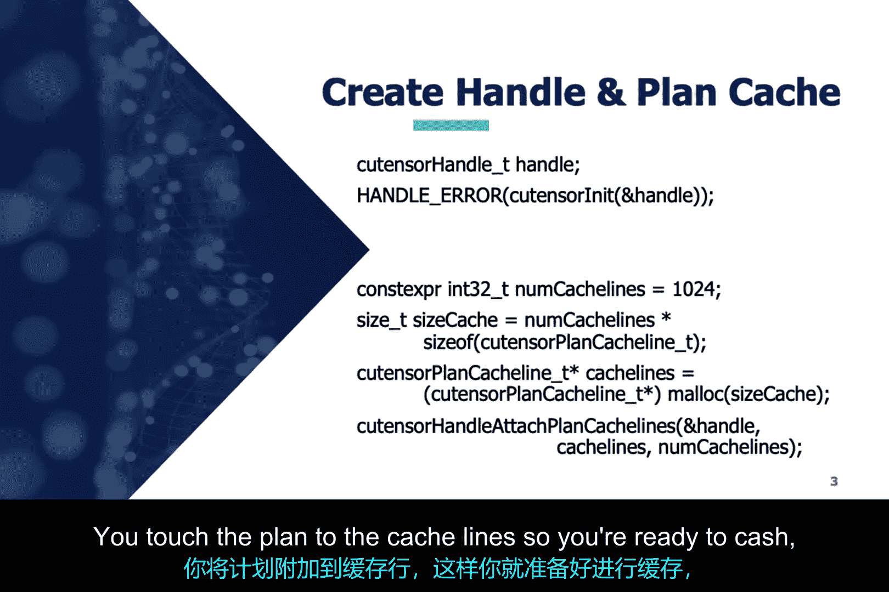
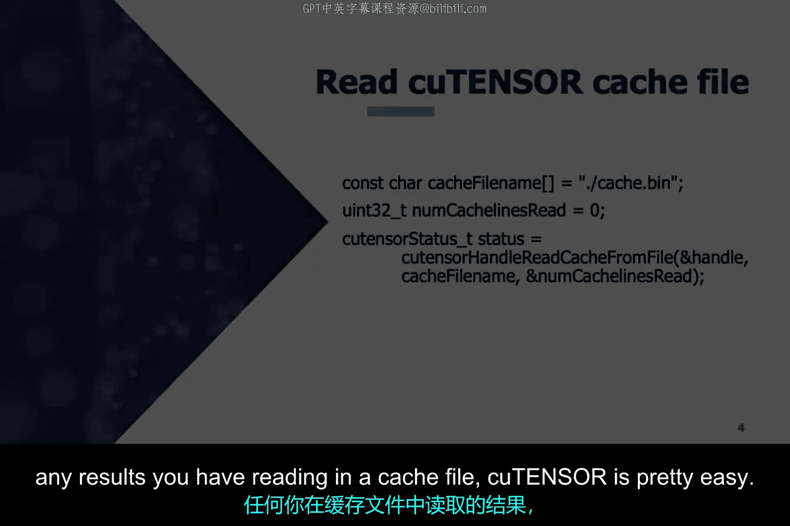
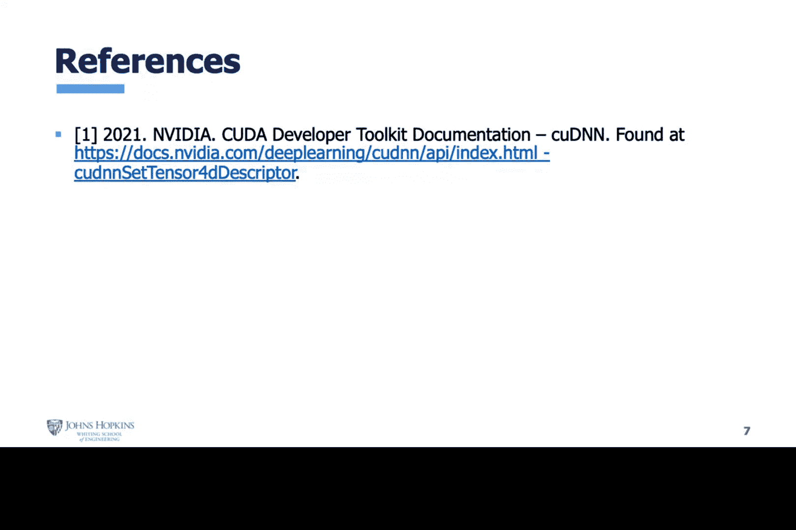

# 119：CUTENSOR语法详解（上） 🧮

在本节课中，我们将学习CUTENSOR库的基础语法和核心概念。CUTENSOR是用于在GPU上进行张量运算的高性能库。我们将从术语定义开始，逐步讲解使用CUTENSOR进行张量收缩运算的基本步骤。

## 术语定义

首先，我们来明确几个核心概念。

*   **张量**：一个N维数组或矩阵。
*   **模式**：张量中的一个维度，或者张量的一个子矩阵。
*   **范围**：某个模式的大小，例如 `X` 和 `Y` 方向上的尺寸。
*   **步长**：内存中从一个数据指针到下一个数据指针的距离。通常，这是所管理数据类型的大小，但数据**不一定**需要在内存中是连续的。

## 计划缓存

计划缓存用于封装算法执行过程中的状态。它处理诸如文件读写、线程安全以及最小化算法重新运行成本等事务。

## 使用CUTENSOR的基本步骤

以下是使用CUTENSOR开发程序时应遵循的步骤流程。

1.  **创建句柄**：类似于其他库，首先需要创建一个句柄。
2.  **创建计划缓存**。
3.  **读取缓存文件**：如果之前没有从头开始，可以读取已有的缓存文件。
4.  **创建张量描述符**：基于缓存和收缩运算，创建一个或多个CUTENSOR描述符。
5.  **确定算法**：根据CUTENSOR执行的多次迭代，确定要使用的算法。
6.  **查询工作空间**。
7.  **创建收缩计划**。
8.  **获取数据**。
9.  **执行收缩运算**。
10. **缓存结果或设置检查点**：这是一个进行结果缓存或设置检查点的好时机。
11. **输出结果**。

**注意**：由于拥有缓存文件，你可以从第3步开始重新启动程序。

## 核心操作详解

上一节我们介绍了使用CUTENSOR的整体流程，本节中我们来看看其中几个关键步骤的具体实现。

### 创建句柄

创建句柄相当简单。基本操作是调用 `cuTensorInit` 函数，并传入一个你预先初始化好的句柄引用。

### 创建与关联计划缓存

首先，你需要确定缓存的大小，例如设定为1024行。确定大小后，你需要完成所有设置，并将计划与这些缓存行关联起来，这样你就准备好缓存任何结果了。

### 读取缓存文件

在CUTENSOR中读取缓存文件非常简单。你传入一个包含文件相对或绝对路径的字符数组。将这个路径传入CUTENSOR句柄，调用 `readCacheFromFile` 函数，并传入句柄引用、文件名以及缓存行数即可。

### 创建张量描述符

在CUTENSOR中创建张量描述符比其他描述符稍复杂一些。你需要初始化张量描述符，传入句柄引用、将要创建的描述符、数据的模式和类型、数据的范围。你还可以定义一个步长。然后，指定你想要处理的操作标识类型。完成这些后，你可以为来自输入A的要求创建对齐方式。

### 创建收缩描述符

我们现在要做的重要事情是创建**收缩描述符**，这是整个过程中最关键的部分。收缩运算实际上是完成计算工作的地方。

这个过程类似于CUDA中的初始化激活。收缩运算接受三个输入：A、B和C，并将结果输出到C中。

---

本节课中我们一起学习了CUTENSOR的基础语法。我们从核心术语定义开始，了解了计划缓存的作用，并详细梳理了使用CUTENSOR库进行张量收缩运算的标准步骤流程，包括创建句柄、管理缓存、创建描述符等关键操作。理解这些基础是后续进行高效GPU张量计算的前提。