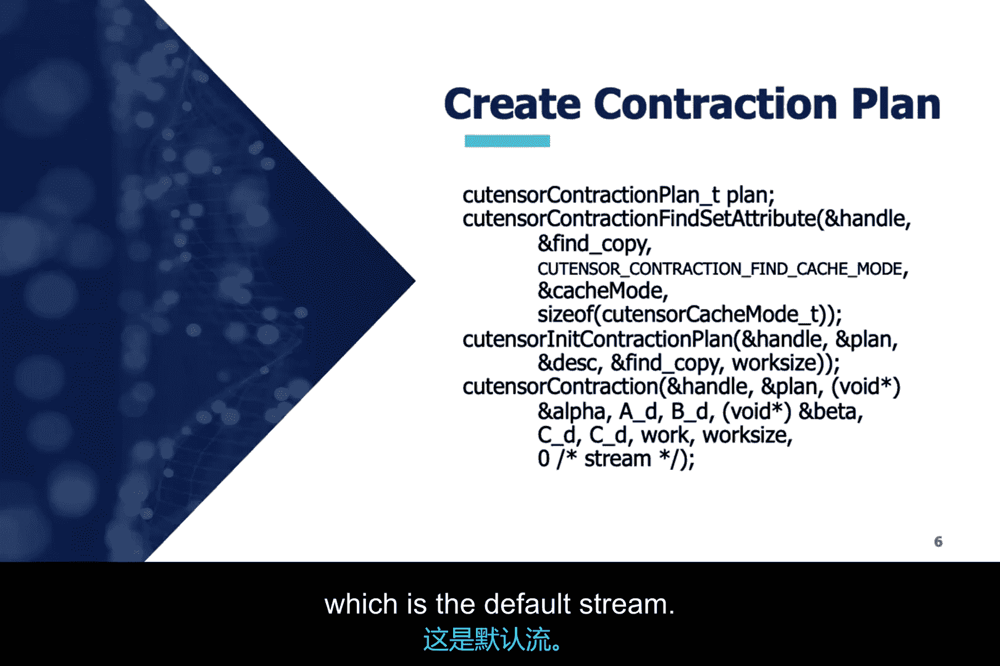

# 120：CUTENSOR语法详解(下) 🧮

在本节课中，我们将继续学习CUTENSOR库的典型应用流程。我们将从确定算法开始，逐步讲解到输出结果，涵盖工作空间管理、计划创建以及张量收缩的实际执行等核心步骤。

上一节我们介绍了CUTENSOR应用流程的前半部分，本节中我们来看看构成典型CUTENSOR应用的后半部分步骤。

## 步骤五：确定算法与属性设置

此步骤的核心是定义张量收缩运算并配置其执行属性。张量收缩是CUTENSOR执行的主要计算任务，其输出结果通常被称为激活。

以下是执行此步骤的关键操作：

1.  **获取句柄并定义收缩运算**：首先获取操作句柄，然后定义具体的张量收缩运算。
2.  **指定算法类型**：告知库你所寻找的默认算法类型。
3.  **设置缓存模式**：在此特定示例中，我们使用 `CUTENSOR_CACHE_MODE_PEDANTIC` 模式。该模式要求所有属性必须与缓存中的记录完全匹配。
4.  **应用属性设置**：将缓存模式属性设置到操作句柄。库将根据现有缓存或创建一个新的缓存来寻找可用的算法。

这些步骤实现两个功能：首先，张量库在每次收缩运算后将进行自动调优；其次，计划（Plan）的每次迭代结果都能被保存和后续检索。其中涉及的 `incremental count` 属性，用于指定同时执行的内核数量，以确定最佳结果，这是自动调优步骤的一部分。

## 步骤六：管理工作空间

此步骤非常简单，主要目的是确定并获取所需工作空间的最大尺寸。

在示例中，我们并未设置一个最大尺寸限制。如果你需要的工作空间尺寸大于当前数据结构所能表示的，可以在此进行调整，但本例中我们暂时未做处理。

## 步骤七：执行张量收缩

现在，我们实际执行张量收缩运算，可以将其视为张量计算的一次迭代。

以下是执行流程：

1.  **配置缓存模式**：为此次运算设置缓存模式。
2.  **创建执行计划**：基于确定的工作空间大小创建执行计划。
3.  **执行收缩运算**：调用执行函数，传入计划句柄、所有设备内存指针以及其他必要参数（例如执行流）。在示例中，最后一个参数设置为0，代表使用默认流（default stream）。

本节课中我们一起学习了CUTENSOR应用流程的后半部分，包括如何确定算法并设置属性、如何管理工作空间内存，以及最终如何创建计划并执行张量收缩运算。理解这些步骤对于高效利用CUTENSOR进行GPU张量计算至关重要。