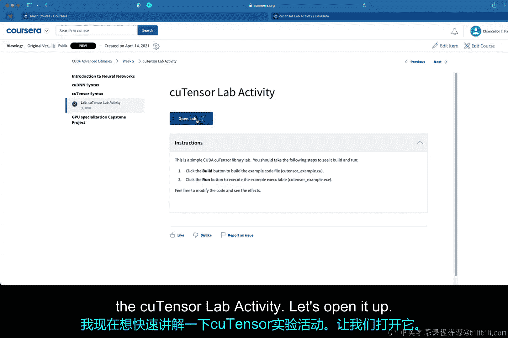
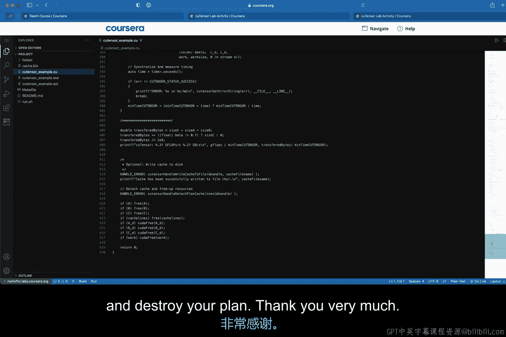

# 121：实验活动总览 🧪

在本节中，我们将快速浏览一个关于cuTensor的实验活动。cuTensor是CUDA生态系统中的一个高级库，专门用于高效执行张量收缩运算。我们将通过分析一段示例代码，了解使用cuTensor进行GPU编程的基本流程和关键步骤。

---

上一节我们介绍了cuTensor库的基本概念，本节中我们来看看一个具体的实验活动代码。

代码位于 `cuTensor_example.c` 文件中。它基于cuTensor官方文档提供的一个示例代码构建。

以下是代码中包含的主要部分：

*   **错误处理宏**：代码定义了一些宏，用于处理常规错误以及特定于CUDA和cuTensor的错误。请注意，cuTensor并非CUDA部署或安装的一部分，需要单独安装，因此错误处理需要涵盖两者。
*   **计时结构体**：定义了一个用于GPU计时的结构体。
*   **主函数**：一个较大的主函数，它遵循了我们之前讨论过的所有步骤。

主函数的执行流程如下：

1.  **定义模式和尺寸**：定义张量运算所涉及的模式（如索引字符）以及各张量的大小。
2.  **分配与初始化数据**：在主机（CPU）和设备（GPU）上为输入输出张量分配内存，并用随机值初始化输入数据。
3.  **设置cuTensor环境**：
    *   创建一个cuTensor句柄（`handle`）。
    *   设置计划缓存（`plan cache`），这需要几个步骤来完成。
    *   创建各个张量的描述符（`tensor descriptors`）。
    *   为每个张量（输入A、B和输出C）对齐内存。
4.  **规划收缩运算**：
    *   考虑具体的收缩（`contraction`）操作。
    *   选择算法（`algorithms`）。
    *   获取查询空间（`query workspace`）。示例中将其设置为零，但你可以尝试设置一个较大的值来探索是否为工作区分配更多内存能提升性能。注意，有时cuTensor或cuDNN等库使用更大的工作区可能性能更好，但也可能更慢。
5.  **执行运算**：
    *   创建收缩计划（`contraction plan`）。
    *   实际运行代码。
6.  **迭代与优化**：代码会运行多次迭代。示例中包含四个增量步骤，这确保了每个子迭代都能找到最佳结果，完成其他调优，然后将结果保存到缓存中。
7.  **缓存与检查点**：如果你熟悉TensorFlow或其他机器学习框架，可以将此计划缓存视为存储检查点（`checkpoint`）的一种方式。你可以在任何时候重新启动程序并利用缓存。
8.  **资源释放**：最后，务必释放所有分配的GPU内存，并销毁创建的计划和描述符，这是良好的编程实践。

---

本节课中我们一起学习了cuTensor实验活动的代码结构。我们回顾了从定义问题、初始化环境、规划并执行张量收缩，到利用缓存进行优化和最终清理资源的完整流程。理解这个流程对于高效使用cuTensor库进行GPU加速的张量计算至关重要。