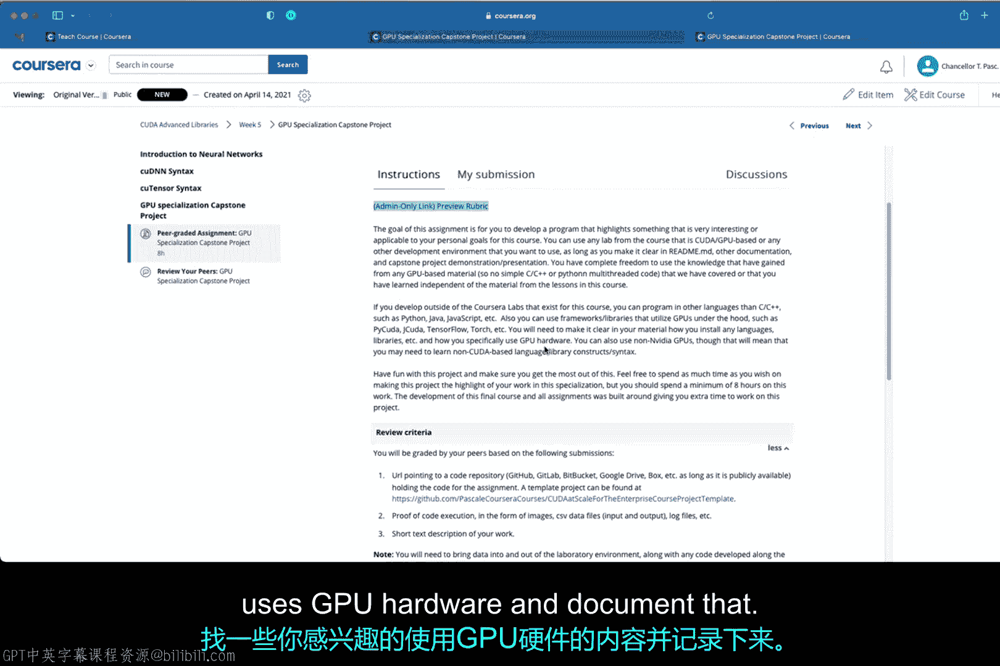

# 122：毕业项目介绍 🎓

在本节课中，我们将要学习关于GPU编程专项课程的毕业项目要求。这个项目是课程的重要组成部分，旨在让你综合运用所学知识，完成一个实际的应用。

## 项目概述

首先，我们来谈谈你的GPU编程专项课程的毕业项目。这将是你的第二个由同伴评审（peer reviewed）或同伴评分（peer graded）的作业。

关于你可以做什么，有一份通用的指导说明。

## 项目要求与灵活性

上一节我们介绍了项目的基本性质，本节中我们来看看项目的具体要求。

我对使用其他库或语言持非常开放的态度，但前提是，你必须明确指出它们底层必须使用GPU硬件。

一个典型的例子是，像Torch和TensorFlow这样的框架可以在CPU上运行，但它们的性能会差很多。

老实说，这门课程的目的不仅仅是作为一门机器学习课程。因此，你应该找到自己感兴趣的方向。

你需要使用GPU硬件，并对此进行文档记录。

## 总结

本节课中我们一起学习了毕业项目的基本框架。我们了解到，项目是一个同伴评审的作业，核心要求是必须利用GPU硬件进行计算，并且对使用的技术栈有很高的灵活性。关键在于选择一个你感兴趣的主题，并确保你的实现能够有效利用GPU的并行计算能力。