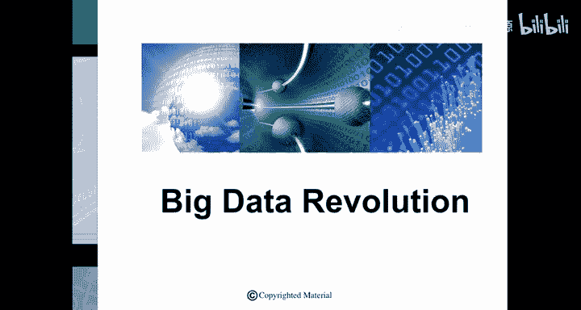
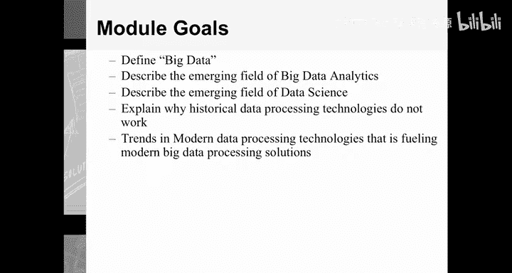
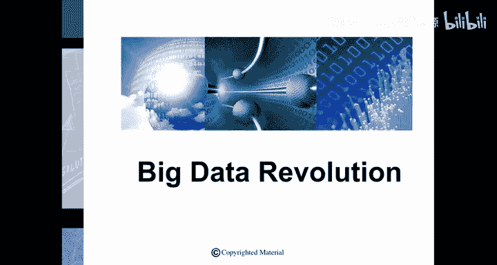

# 001：大数据革命导论 🚀


在本节课中，我们将学习大数据革命背后的核心趋势与概念。我们将探讨数据爆炸的原因、数据经济的重要性、大数据分析与传统分析的区别，以及数据科学这一新兴领域。同时，我们也会了解传统数据处理技术的局限性，以及以Hadoop为代表的现代数据处理技术如何使大数据解决方案成为可能。

## 数据爆炸 💥

上一节我们介绍了课程概述，本节中我们来看看数据爆炸现象。

为什么市场上会产生如此多的数据？以下是主要原因：

*   **数字化**：几乎所有事物都在被数字化，从书籍、音乐到商业交易和社交互动。
*   **物联网**：传感器和设备持续生成海量数据。
*   **社交媒体**：数十亿用户每天都在创造内容、发布更新和进行互动。
*   **移动计算**：智能手机和平板电脑无处不在，成为重要的数据生成器。



## 数据经济 💰

理解了数据爆炸的现象后，本节我们将探讨数据经济。

理解这种新经济形态至关重要，因为它代表了信息技术的未来。数据已成为一种关键的战略资产和新的“石油”，能够驱动创新、创造价值并形成竞争优势。

## 大数据分析 📊

认识了数据经济的重要性，接下来我们看看大数据分析。

大数据分析与传统数据分析有何不同？以下是关键区别：

*   **数据规模**：传统分析处理GB/TB级数据，而大数据分析处理PB/EB级数据。
*   **数据类型**：传统分析主要处理结构化数据（如数据库表格），大数据分析则处理**结构化、半结构化和非结构化数据**（如文本、图像、日志）。
*   **处理速度**：大数据分析通常要求实时或近实时处理，而传统分析多为批量处理。
*   **价值密度**：大数据中蕴含价值的密度往往较低，需要从海量数据中挖掘洞察。

## 数据科学 🔬

了解了大数据分析的特点，本节我们进入数据科学这一新兴领域。

数据科学是什么？成为一名数据科学家意味着什么？数据科学是一个跨学科领域，它结合了统计学、计算机科学和领域专业知识，旨在从数据中提取知识和洞察。数据科学家的核心工作流程通常遵循一个循环：

```python
# 数据科学工作流程示例（概念性描述）
1. 问题定义与数据收集
2. 数据清洗与预处理
3. 探索性数据分析与可视化
4. 模型构建与机器学习
5. 模型评估与解释
6. 部署与沟通结果
```

## 传统数据处理技术的局限 ⚠️

在探讨了数据科学之后，我们需要理解为什么需要新的技术。本节我们审视历史数据处理技术。

为什么传统的数据处理技术（如关系型数据库管理系统）无法有效处理大数据？主要局限如下：

*   **可扩展性**：传统系统难以在成本可控的情况下横向扩展（增加更多机器）。
*   **架构**：它们通常采用**共享一切**的架构，存在单点故障和性能瓶颈。
*   **成本**：商用硬件和软件许可成本高昂。
*   **数据类型**：不擅长处理非结构化和半结构化数据。

## 现代数据处理技术与趋势 🛠️

认识到传统技术的不足，本节我们来看看使大数据解决方案成为可能的现代技术与趋势。

以Hadoop为代表的现代数据处理技术有哪些关键趋势？以下是主要驱动力：

*   **横向扩展架构**：采用**无共享**架构，通过增加廉价商用服务器来扩展，而非升级单一昂贵机器。其核心思想可概括为：`处理能力 ∝ 节点数量`
*   **开源软件**：如Hadoop生态系统，降低了技术采用成本。
*   **商用硬件**：使用低成本、标准化的硬件。
*   **容错性**：软件层设计能够处理节点故障，确保系统高可用。
*   **数据本地化计算**：将计算任务移至数据所在节点，减少网络传输开销。

---



**本节课总结**



在本节课中，我们一起学习了大数据革命的导论。我们探讨了数据爆炸的成因，认识了数据作为新经济驱动力的重要性，区分了大数据分析与传统分析，了解了数据科学家的角色与工作。更重要的是，我们分析了传统数据处理技术在面对大数据挑战时的局限性，并深入了解了以横向扩展、开源和容错为特征的现代数据处理技术趋势，这些趋势正是Hadoop等大数据解决方案得以实现的基础。