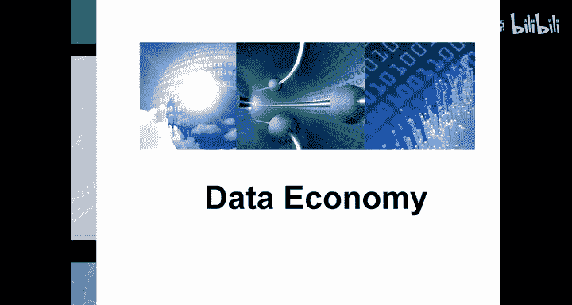
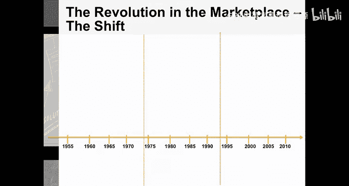
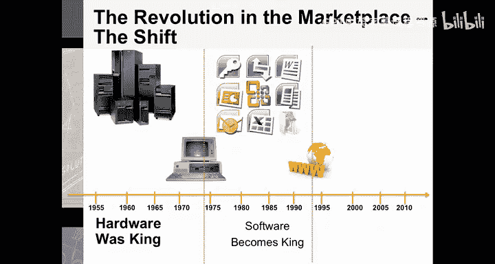
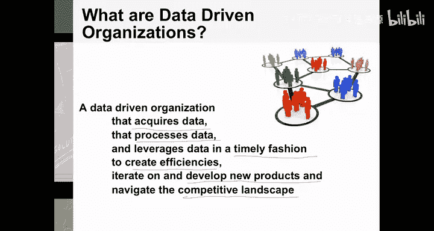
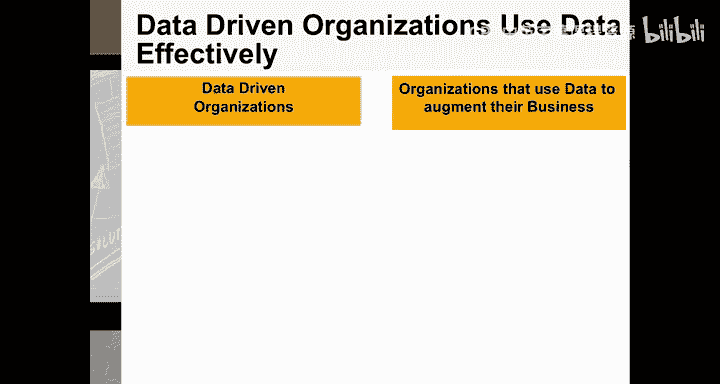
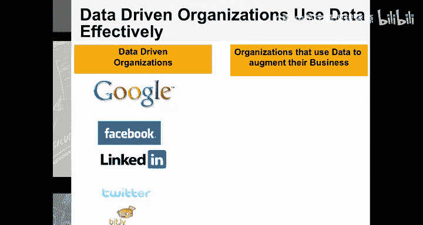
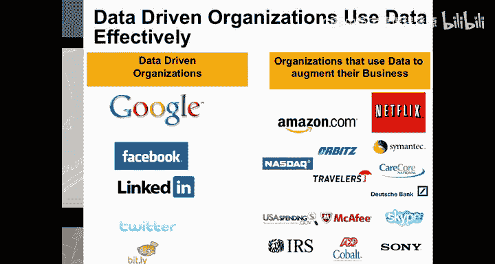
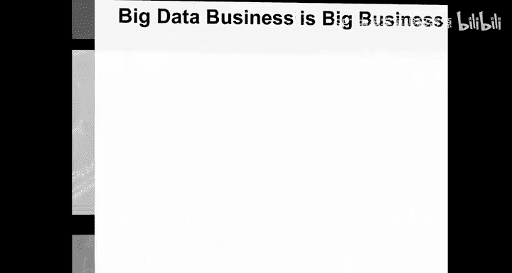
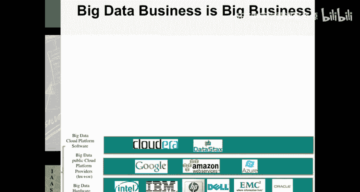
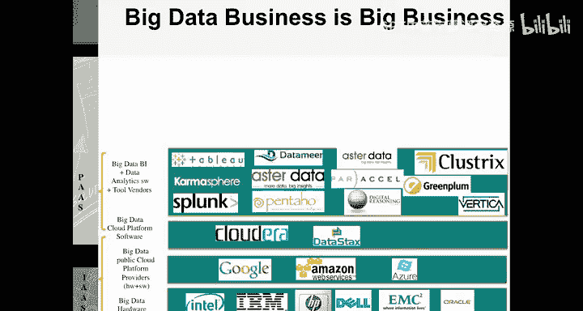

# 003：数据经济 📈

在本节课中，我们将探讨计算行业的发展历程，理解“数据经济”的兴起，并认识数据驱动型组织如何运作。我们将看到，数据已成为当今商业世界的核心驱动力。

## 计算行业的三个时代

为了解释数据经济的概念，我们可以将计算行业的时间线划分为三个主要时代。

### 硬件为王时代（1950s-1960s）

在20世纪50年代和60年代，硬件是市场的核心。像IBM、惠普（H）、数字设备公司（DEC）这样的企业是当时的王者。它们制造并销售大型机给AT&T、MCI等大型企业，以及INS、IRS等政府机构，并因此获得了巨额利润。对于IBM这样的公司而言，硬件至关重要，以至于在最初构建IBM个人电脑时，他们并未投入太多精力，甚至没有为其构建操作系统。对他们来说，软件只是销售硬件的一种手段。

### 软件为王时代（1980s）

随后，市场发生了转变。当时一位名不见经传的年轻人比尔·盖茨为IBM PC构建了操作系统，这彻底改变了市场格局。进入80年代，软件成为了新的王者。每个人都开始为IBM PC及其兼容机、为微软Windows平台开发应用程序。许多创业者开始创建初创公司，开发能在PC平台上销售的小型应用软件。大学也开始设立并发展一个全新的领域——计算机科学。

### 数据为王时代（1990s至今）

90年代，有趣的事情发生了，那就是万维网的出现。很快，每个人都开始转向网络。大量的产品和服务开始通过网络提供。突然间，数据成为了新的王者。尤其是进入21世纪初，像谷歌、Facebook、Twitter这样的公司开始崛起并取得巨大成功，而它们成功的基石正是数据。**数据是新的王者**。

## 什么是数据驱动型组织？

上一节我们回顾了计算行业的演变，本节中我们来看看数据驱动型组织的定义。

一个数据驱动型组织，是指能够及时地**获取数据**、**处理数据**并**利用数据**，以创造效率、迭代并开发新产品和服务，从而在商业竞争中导航的组织。

我可以举一个亚马逊的例子。Amazon.com是一个互联网零售商店，但实际上它在获取数据。当你在亚马逊浏览不同商品时，它会记录你查看了哪些产品、购买了哪些产品。基于这些数据，它能够向你推荐商品。它知道购买了某件商品的人也可能购买另一件商品，因此会向你推荐该商品。你可能将某物加入了愿望清单，或浏览了某个产品，这都让亚马逊知道你对这些产品感兴趣。因此，他们会不时地给你发送电子邮件、优惠券，采取各种措施吸引你在线购物。他们实际上是在有效地利用数据来改善业务。

## 数据驱动型组织的分类

理解了数据驱动型组织的定义后，我们可以将其进一步分类。

数据驱动型组织可以分为两类：纯粹的数据驱动型组织，以及利用数据增强业务的组织。

以下是纯粹的数据驱动型组织：
*   像谷歌、Facebook、LinkedIn、Twitter、百利（Biley）这样的公司，它们的产品完全围绕数据构建。

以下是利用数据增强业务的组织：
*   如前所述的Amazon.com。
*   Netflix是另一个例子。Netflix从事流媒体视频业务，但它也记录你观看了哪些视频、浏览了哪些视频。它知道谁看了什么，以及可能向你推荐什么视频。它拥有推荐引擎，目的是与你保持互动，使你持续成为其客户。
*   同样，Orbitz（旅游预订）、Travelers（保险）、NASA等不同组织，都在尝试利用数据来改善它们自身及客户的业务。

## 大数据是大生意

既然数据如此重要，处理海量数据的大数据自然成为了大生意，每个人都为此感到兴奋。

在基础设施即服务层面：
*   英特尔、IBM、惠普、戴尔、甲骨文等大数据硬件制造商非常兴奋，因为他们可以销售CPU、存储等硬件。
*   大数据公共云平台供应商也很兴奋，因为你可以按需使用这些云服务处理数据，例如每六个月或每月处理一次，完成后即可离开。像谷歌、亚马逊云服务、微软Azure等公司对此都非常感兴趣。
*   Cloudera、Hortonworks、DataStax等云平台软件公司也很兴奋。Cloudera为Hadoop提供支持，DataStax为Cassandra等NoSQL解决方案提供支持。处理大数据需要大数据解决方案，而这些公司正为此提供支持平台。

在平台即服务层面：
*   许多大数据商业智能软件供应商、数据分析软件供应商对此感到兴奋，例如Tableau、Aster Data、Datameer、Cloudera、Splunk，他们都希望销售自己的产品。

在数据即服务层面：
*   邓白氏公司对此感到兴奋。邓白氏拥有市场上每家公司的信息，他们可以出售这些信息。
*   Infochimps（出售Twitter流数据）、Gov 2.0（开放政府数据的社区）、路透社、SimpleGeo等众多数据聚合公司也对大数据感到兴奋，因为它们可以在此过程中获利。

## 信息科学影响各行各业

大数据和信息科学正在影响每一个行业。

以下是受影响的行业示例：
*   生物技术行业。
*   语言学行业。
*   采矿业。
*   金融业。
*   新闻业（出现了非常流行的数据新闻学）。
*   甚至教育行业也受到影响。可以说，几乎每个行业都受到信息科学的影响。

我想花几分钟谈谈语言学行业。麻省理工学院有一位教授正在进行语言学研究。他记录了自己孩子从出生第5天带回家直到5岁期间的每一秒生活。这大约是每天18小时的视频。然后，他通过大数据处理平台处理这些数据来研究语言学。他弄清了孩子是如何学习语言的，例如如何从最初说“baba”逐渐变化到说“wawa”，最终说出“water”这个词。通过记录孩子生活的每一分钟并进行视频和音频处理，他能够进行纯粹的语言学分析。研究人员不可能坐下来观看所有视频并进行分析。他正是通过大数据处理技术做到了这一点。这就是语言学行业如何受到大数据处理影响的例证。

## 总结：我们身处数据经济时代

本节课中，我们一起学习了计算行业从硬件、软件到数据的演变历程，定义了数据驱动型组织并了解了其分类，认识到了大数据带来的巨大商业机遇，以及信息科学对各行业的深远影响。

醒来吧，这就是数据经济。我们实际上正处在信息科学形成的进程中。不久前，数据还难以捕获且存储成本高昂，但现在情况已不再如此。那时数据量不大，而现在数据量巨大。数据曾是人类许多努力的瓶颈，但现在我们收集和处理有价值数据的能力已没有限制。我们不再受限于数据，而是受限于洞察力。因此，那些能够处理数据、分析数据的人将会创造大量财富。我们正身处数据经济时代。