# 005：数据科学 🧠

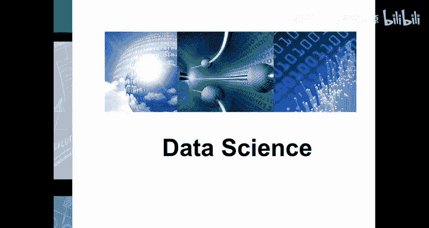

在本节课程中，我们将探讨新兴的数据科学领域。我们将了解数据科学家需要具备哪些特质，以及他们完成工作所使用的工具和技术。虽然这不是一门专门的数据科学课程，但作为Hadoop开发者，你可能会与数据科学家紧密合作，甚至可能自己立志成为一名数据科学家。

---

## 什么是数据科学？

上一节我们介绍了课程背景，本节中我们来看看数据科学的定义。

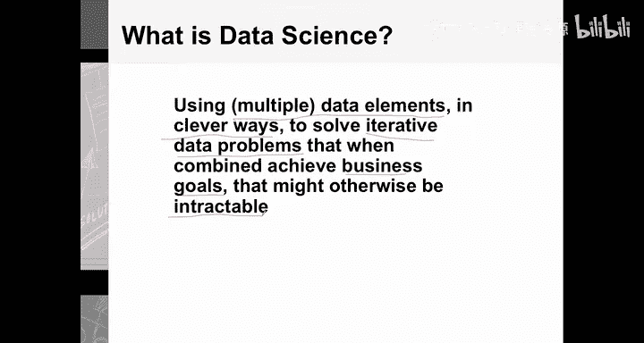

数据科学有一个正式的定义：**“巧妙地运用多种数据元素，以迭代方式解决数据问题，从而共同实现原本难以达成的商业目标。”** 这个定义有些复杂，让我们来分解一下：
*   **运用多种数据元素**：数据科学家在数据科学领域，运用直觉巧妙地处理多种数据元素。
*   **以迭代方式解决数据问题**：他们以迭代的方式解决数据问题。
*   **实现商业目标**：他们与业务部门紧密合作，以实现共同的商业目标。
*   **解决棘手问题**：这正是数据科学洞察力发挥作用的地方。

这是数据科学的正式定义。我再给你另一个定义，一个我喜欢的、来自德鲁·康威的定义。

德鲁·康威认为，数据科学领域实际上是三件事的结合：
1.  **黑客技能**：即编程能力。
2.  **领域专业知识**：在特定行业（如生物学、金融、教育、制造业）的专业知识。
3.  **数学和统计学知识**。

这里的观点是：
*   如果你拥有数学统计知识，并能将其与领域专业知识结合，你得到的是**传统研究**。人们一直在这样做。
*   如果你能将黑客技能（编程技能）与领域专业知识结合，德鲁·康威称之为**危险区**。换句话说，仅仅因为你会编程并且拥有特定领域的专业知识，并不真正使你成为数据科学家。
*   如果你能将黑客技能（编程技能）与数学和统计学知识结合，那么你可以进行**机器学习**。
*   根据德鲁·康威的说法，如果你能结合所有这三种技能——编程技能、领域专业知识，再加上数学和统计学知识——那才是**数据科学**领域。

---

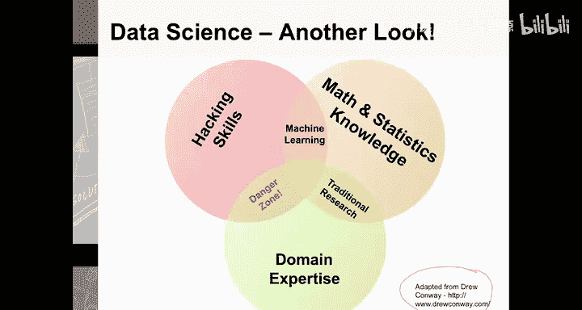

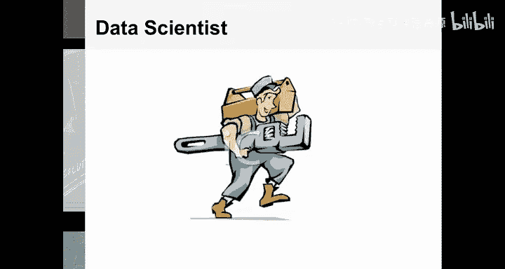

## 数据科学家需要什么？

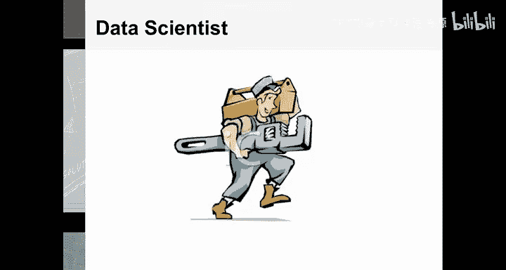

了解了数据科学的定义后，我们来看看成为一名数据科学家需要掌握哪些工具和技能。

我想从数据科学家所使用的工具角度来定义数据科学家。

数据科学家应该是一个能使用多种语言工作的人。他们懂很多语言，可能不精通所有语言，但懂很多，比如可以用Java、Python编程，懂一点Shell脚本编程，一点Perl编程。

他们还需要理解分布式计算，如Hadoop、HDFS、MapReduce（这是你将在本课程中学到的技能）。

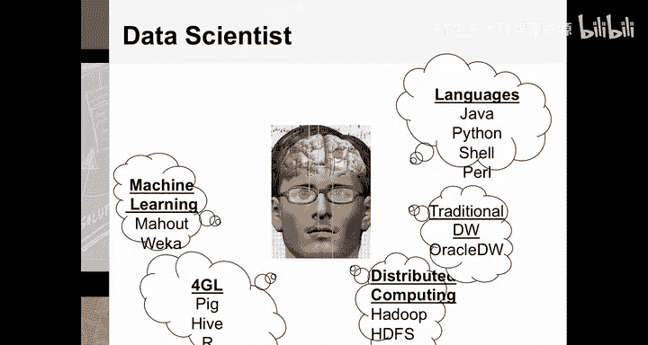

他们还应该能够使用像Pig和Hive这样的4GL语言（这也是你将在本课程中学到的，它们是Hadoop相关产品）。R是另一种数据科学语言（我们不会在本课程中学习它），还有SQL（你们很多人可能已经知道）。

他们还应该能够进行机器学习，至少学会使用像Mahout和Weka这样的机器学习算法。

他们还应该理解传统的数据仓库和传统分析，如Oracle数据仓库。

他们还应该能够通过视觉讲故事，因此应该学会使用可视化工具，如Gephi、Highcharts、D3.js，甚至是Matplotlib。

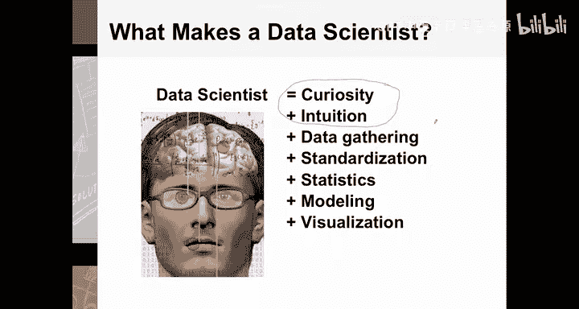

如果你能结合所有这些不同的技能，那么你就可以成为一名数据科学家。完成本课程后，你将至少掌握其中50%的技能，所以你实际上正在向数据科学领域迈进。如果你想，未来可以成为一名数据科学家。

那么，是什么造就了数据科学家？数据科学家应该是充满好奇心的人，拥有直觉。这是两种非技术技能，它们非常关键。其余的技能，如数据收集与标准化、统计学、建模、可视化，则更多是技术技能。当你结合所有这些技能时，你就成为了一名数据科学家。

---

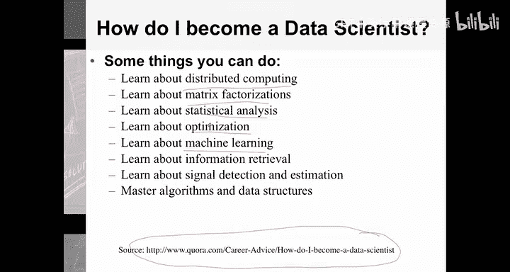

## 如何成为数据科学家？

你可能会问，我如何成为一名数据科学家？这里有一个非常好的网站资源，你可能想去看看。但我已经从那篇文章中总结了一些要点。

如果你想成为一名数据科学家，你需要了解分布式计算（你将在本课程中学到）。你还需要理解矩阵分解、统计分析、优化、机器学习（这些内容我们不会在本课程中讨论，但约翰霍普金斯大学有其他课程涵盖这些主题）。此外，还有信息检索、信号检测、掌握算法和数据结构。你需要了解所有这些不同的事情，才能称自己为数据科学家。

---

## 数据科学家的关键任务

明确了所需技能后，我们来看看数据科学家必须完成的一些关键任务。

数据科学家为自己和他人必须做的最重要的任务之一是**记录数据集**。

数据科学家经常处理数据，而且经常处理他人的数据。因此，作为数据科学家，记录数据集非常重要。每个数据集都应该有：
*   **标题**
*   **摘要**
*   **数据来源**：这些数据的原始所有者是谁
*   **数据类型**：它是什么类型的数据？是多变量数据、关系数据、时间序列数据吗？
*   **数据格式**
*   **数据结构**：它是如何存储的？
*   **数据特征**：例如，数据是如何收集的？何时收集的？是否存在与此数据相关的系统性偏差？
*   **数据访问**：它是敏感数据吗？数据访问政策是什么？

所有这些都需要为你自己和他人记录下来。在本课程中，我们将使用MovieLens数据，这些数据记录得非常完善，你在做作业时会查看这些文档来理解MovieLens数据。

数据科学家的另一个重要任务是**记录数据科学测试**。

因为一旦你记录下来，其他人就可以利用你所做的结果在此基础上继续工作，或者可能希望以略有不同的方式进行实验。因此，有很多理由需要你记录数据科学任务。对于你做的每一个数据科学任务，你必须记录：
*   **使用的数据**（可能不止一个）
*   **执行的任务**
*   **问题描述**
*   **结果**

将这些内容写入文档，以便他人使用。

---

## 从数据到智慧

数据科学的一个关键方面是从数据走向智慧。

假设你有一个网站，用户与这个网站互动，你获得了点击流数据。然后你解析这些数据以获得规范化数据，这就是我们所说的**信息**。你可以利用这些信息，运行报告来生成**知识**或获取知识。

但是，如果你能利用这些知识，获得**洞察**，并据此采取行动呢？这就是我们所说的**智慧**。

所以我想说的是，通过数据科学，你经常从原始数据开始，一路走向智慧。

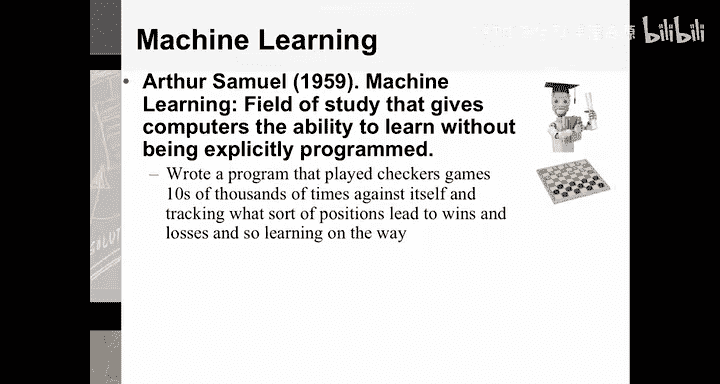

让我用一个真实场景来解释这一点。在Netflix，客户来到网站，浏览电影，观看电影，所有这些互动数据都被收集起来，这就是规范化数据。Netflix利用这些数据生成报告，从而获得了知识：哪些用户在观看电影，他们看什么电影，哪些电影受欢迎等等。

在查看这些数据时，他们获得了一个洞察：观看电影的用户是良好的长期客户。于是他们将这一洞察付诸实践，改变了网站，使得每次你浏览电影时，都会看到一个按钮，上面写着“添加到队列”或“添加到流媒体观看列表”。他们发现，当他们在网站上做出这个改变后，越来越多的人开始将电影添加到他们的队列中，并开始成为长期客户。

你在这里看到的是Netflix如何获取数据，从中生成报告（即知识），从中获得洞察，并改变其产品以长期留住客户。这就是一个从数据到智慧的例子，为此，你需要做大量的数据科学工作。

---

## 机器学习简介

数据科学的另一个重要方面是机器学习。这不是一门关于机器学习的课程，但我想给你一个快速的介绍。

根据亚瑟·塞缪尔的说法，机器学习是**一个研究领域，它赋予计算机学习能力，而无需进行明确编程**。亚瑟·塞缪尔写了一个跳棋程序，该程序与自己进行了数万次对弈，记录导致胜利的位置和导致失败的位置，从而学会了跳棋游戏，最终甚至击败了亚瑟·塞缪尔。

汤姆·米切尔在1998年给出了一个更正式的定义：**一个计算机程序被认为从经验E中学习某项任务T，并用性能度量P来衡量，如果它在任务T上的性能（由P度量）随着经验E的增加而提高**。这是一个非常复杂的教科书式定义。

我想说的是，机器学习是一门科学学科，真正关注算法的设计和开发，这些算法允许计算机基于某种经验数据（如来自传感器的数据，甚至来自数据库的数据）来学习行为。这是一个独立的领域。正如我所说，本课程不侧重于机器学习，但你可以在Hadoop上实现机器学习算法。从这个意义上说，你可能会与机器学习专家合作，在大数据上实现算法。未来你可能想选修一门机器学习课程。

机器学习用在哪些地方呢？它用于互联网搜索聚类、知识管理系统、社交网络映射和社交网络分析、数据分类、营销分析。推荐系统是使用机器学习的另一个重要领域。此外还有日志分析、垃圾邮件过滤、欺诈检测等。有一大批领域使用机器学习。如果你感兴趣，斯坦福大学的教授在这个特定网站上提供免费的机器学习课程，你可能想去看看。

关于机器学习，有一个警示。让我读给你听：
> 一位父亲决定教他的儿子什么是跑车。发现用语言解释很困难，他决定举一些例子。他们站在一条高速公路桥上，每辆汽车从下面经过时，父亲就喊：“那是跑车！”当一辆跑车经过时。10分钟后，父亲问儿子是否明白了什么是跑车，儿子说：“是的，当然，这很容易。”一辆旧的红色大众甲壳虫经过，儿子喊道：“那是跑车！”父亲沮丧地问：“你为什么这么说？”儿子回答：“因为所有跑车都是红色的。”

这是机器学习出错的经典例子。很多时候，当你进行机器学习时，你可能会陷入一种情况，即算法根据数据得出错误的结论。因此，需要进行大量的训练和验证。为了做到这一点，你可以使用另一个领域，称为**众包**。亚马逊网络服务有一个叫做“亚马逊土耳其机器人”的服务，提供众包服务。

基本思想是，你定义所谓的“HITs”（人类智能任务），这些任务可以分发给世界各地的人，世界各地的人会为了几美分为你分类数据，识别某物是否是正面评价等等。所以你实际上是在利用人类来进行学习、分类或归类。

因此，人们将机器学习与亚马逊土耳其机器人结合使用，以证明机器学习算法是可行或有效的。所以，当涉及到大数据和推荐系统时，你可能想尝试一下。

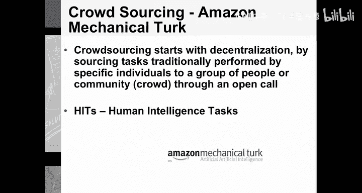

---

## 总结

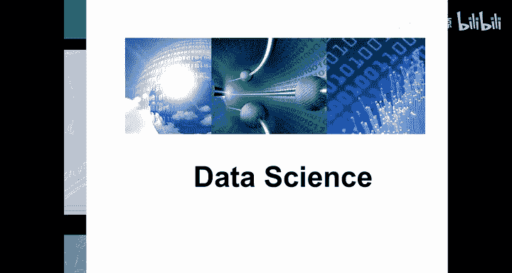

在本节课程中，我们一起探讨了新兴的数据科学领域，了解了数据科学家需要具备哪些特质，以及他们完成工作所使用的一些工具和技术。虽然这不是一门专门的数据科学课程，但作为开发者，在编写Hadoop程序时，你可能会与数据科学家合作来实现他们的算法，或者你自己可能立志成为一名数据科学家，因为你已经在本课程中学会了其中50%的技能——即使用Hadoop进行大数据处理。