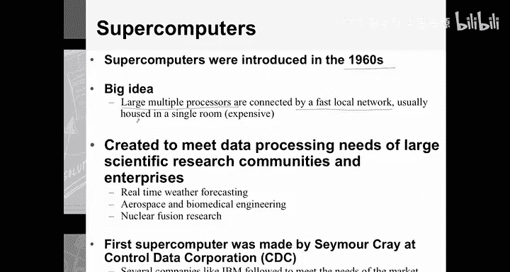
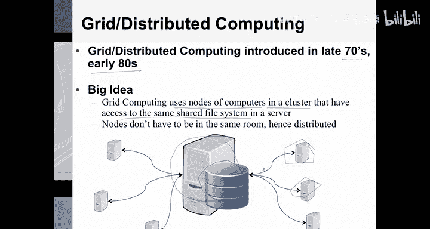
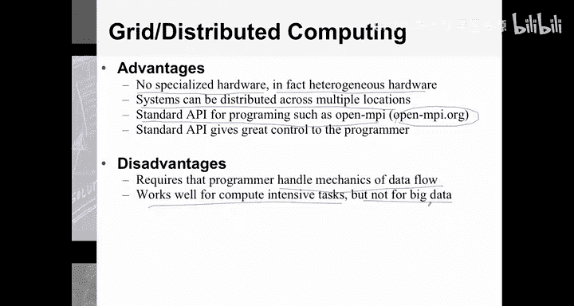
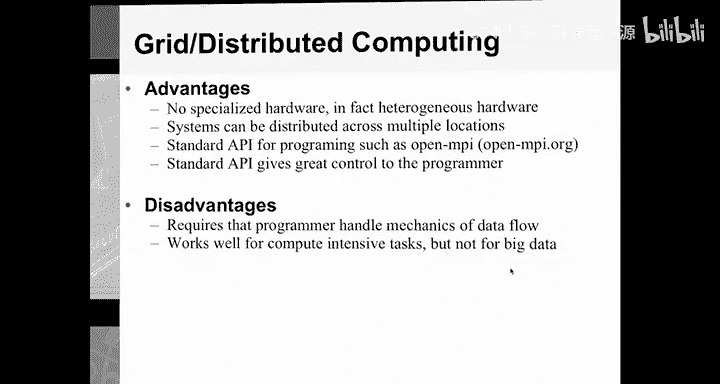
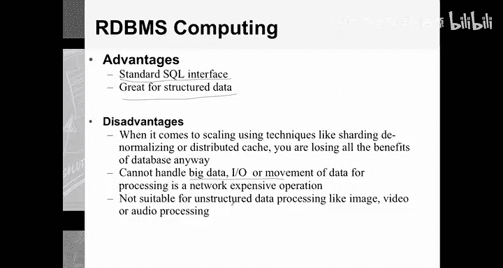
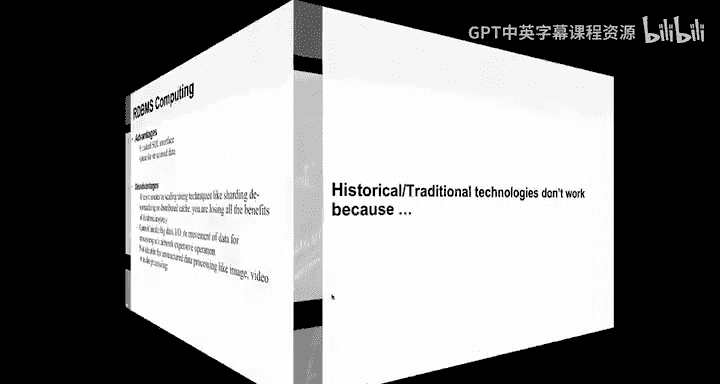
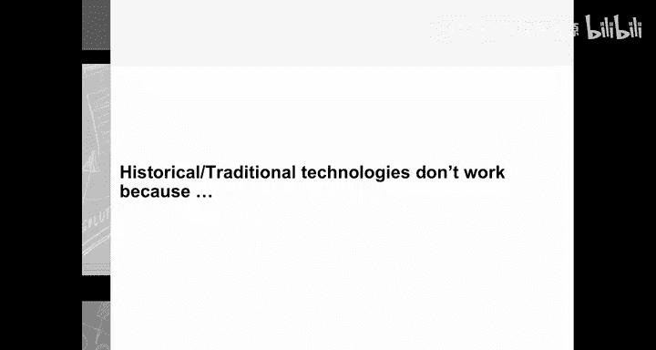
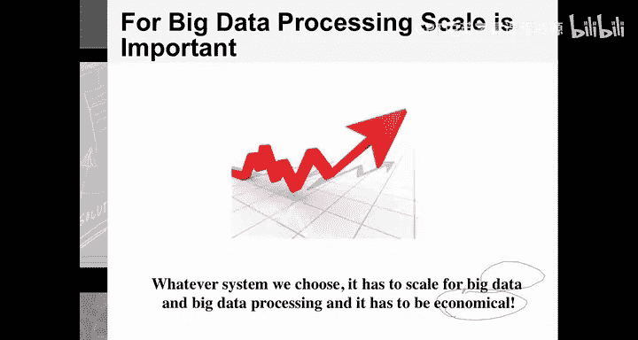

# 006：历史数据处理技术 📜

在本节课中，我们将学习历史上如何处理大数据问题，以及这些解决方案的不足之处。我们将特别深入了解超级计算（超级计算机）、分布式或网格计算，以及关系型数据库管理系统计算，并分析它们各自的缺点。

## 超级计算机 💻

上一节我们介绍了大数据处理的挑战，本节中我们首先来看看超级计算机。超级计算机于20世纪60年代问世。其核心思想是：**使用大量通过高速局域网连接的多处理器，以便更快地计算数据，并在CPU之间更快地移动数据**。

这些系统通常放置在一个房间内，速度非常快，但造价相当昂贵。

它们是为满足科学研究社区的数据处理需求而专门创建的，例如实时天气预报系统、航空航天工业以及核聚变研究实验室。第一台超级计算机由Control Data Corporation公司的Seymour Cray制造，并在60年代后的几十年里主导了市场。随后，IBM等公司也进入市场以满足需求。

以下是1977年的一台超级计算机，这是国家大气研究中心（NCAR）使用的Cray-1A，用于满足其计算需求。这台计算机如今已不再使用，据说今天的iPhone比这台特定计算机拥有更强的计算和存储能力。

但这并不意味着超级计算机已不再使用。下图是阿贡国家实验室使用的IBM Blue Gene P超级计算机。

那么，超级计算机有哪些优点和缺点呢？

以下是其优点和缺点的总结：

*   **优点**：由于数据可以在进程间快速移动，所有处理器可以协同处理同一任务。这意味着它非常适用于**CPU密集型任务**，以及高度复杂的实时应用和模拟。
*   **缺点**：构建和维护成本非常高。以1970年代的Cray计算机为例，其成本约为200万至300万美元。可以想象今天的超级计算机会有多昂贵。它们使用**非常专业的硬件**，这意味着无法将Cray超级计算机的RAM用于IBM超级计算机。它们也使用**专业软件**，每台机器都有自己的编程语言和方法论，导致开发人员难以在不同平台间迁移，若需迁移则必须重新学习新系统。此外，还存在**有限的垂直扩展性**。公司或组织通常购买具有四分之一或一半计算能力的超级计算机，随着需求增长再购买更多。但一旦达到上限，就无法添加第二台机器来平衡两台计算机间的负载。因此，这里没有**水平扩展**的概念。

## 网格或分布式计算 🌐

了解了超级计算机的局限性后，我们来看看网格或分布式计算。网格或分布式计算于70年代末和80年代初引入。其基本思想是：**使用集群中的计算机节点，并让这些节点访问集中式服务器上的同一共享文件系统。这些节点不必在同一房间内，可以分布式部署**。

因此，你在这里看到的是一个带有共享存储的集中式服务器，以及许多连接到该服务器的计算机。

这些计算机连接到集中式服务器，下载数据，处理数据，然后将处理后的数据上传回集中式服务器。

SETI@home项目是网格或分布式计算成功的经典范例。SETI代表“搜寻地外文明”。该项目获取射电望远镜数据，将其分解为0.35兆字节的单位，并发送到世界各地的计算机进行处理。这些计算机安装了屏幕保护程序，即SETI屏幕保护程序。当计算机空闲时，它会下载数据、处理数据并将数据上传回集中式服务器。

那么，网格或分布式计算有哪些优点和缺点呢？

以下是其优点和缺点的总结：

*   **优点**：显然不需要专业硬件。事实上，异构硬件也可以工作，正如SETI项目所示。系统可以分布在多个位置，不必都在同一房间内。此外，还开发了标准API，例如来自opennpi.org的OpenMPI。这个标准API为程序员提供了更大的控制权来进行操作。
*   **缺点**：它要求程序员处理数据流的机制，这可能变得相当复杂。所有的线程、锁定和同步都必须由程序员完成。稍后我们将学习Hadoop，在Hadoop中，这些工作都由框架为我们处理。此外，它们适用于**数据量小的计算密集型任务**，但当涉及大数据时，由于网络瓶颈，它们的效果不佳。

## 关系型数据库管理系统计算 🗃️

接下来，我们探讨关系型数据库管理系统计算。这在80年代开始流行，我相信你们许多人都使用过RDBMS。其基本思想是：**使用带有附加存储的单一服务器来存储和处理数据，因为我们希望保持数据的ACID属性**。

这类系统的经典例子当然包括Oracle数据库、MySQL数据库、SQL Server、PostgreSQL等等。你通常进行**纵向扩展**，而不是进行太多横向扩展。因为如果进行横向扩展，你必须进行分片、反规范化甚至引入分布式缓存等操作。当你开始这样做时，会带来一些弊端。例如，如果进行分片，需要在每个服务器实例上创建和维护模式，这是额外的开销。如果进行反规范化，则会失去关系模型的一些优势。如果进行分布式缓存，则会遭受缓存一致性问题。如果数据在缓存中，效果很好；但如果不在，性能就会下降。

因此，对于RDBMS计算，有一些优点。当然，你有标准的SQL接口。它也非常适合处理结构化数据。

但也有一些缺点。当涉及到像我们讨论过的分片、反规范化或分布式缓存等扩展技术时，你无论如何都会失去RDBMS的一些优势，那么为什么还要进行RDBMS计算呢？此外，它们无法处理大数据，因为I/O（从磁盘到内存或从集中式存储到其他客户端服务器的数据移动）成本高昂。它们也不适合非结构化数据处理，如图像处理或视频处理，尽管它们在文本处理方面表现相当好。

## 总结与启示 🎯

我们已经看到，历史或传统技术效果不佳。

因为所有数据无法装入单台机器，所有处理也无法在单台机器上完成。即使你将数据放在单台机器上，将数据从该机器传输到各种分布式系统（如网格计算示例中）也是一项昂贵的提议，因为受限于网络带宽。

关于分布式计算，Grace Hopper有一句名言：“在拓荒时代，他们用牛来拉重物。当一头牛拉不动一根木头时，他们不会试图养一头更大的牛。我们不应该追求更大的计算机，而应该追求更多的计算机系统。”这是一句至理名言。这实际上成为了大数据处理的基础。

对于大数据处理，扩展性显然很重要。在这一点上很清楚，无论我们选择什么系统，它都必须能够为大数据进行扩展。同时，大数据处理必须具有经济性。因此，**可扩展性和经济性**是我们进行大数据处理真正需要的两个关键因素。

在本节课中，我们一起学习了历史或传统的大数据处理方法或技术，如超级计算机、分布式网格计算和关系型数据库管理系统计算，并了解了这些解决方案的优点和不足之处。这些历史背景为我们理解现代大数据框架（如Hadoop）为何以及如何出现奠定了重要基础。