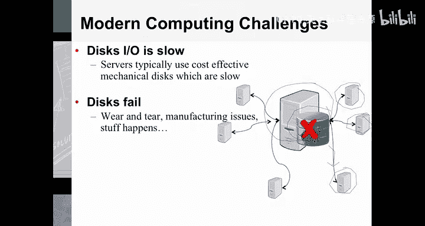
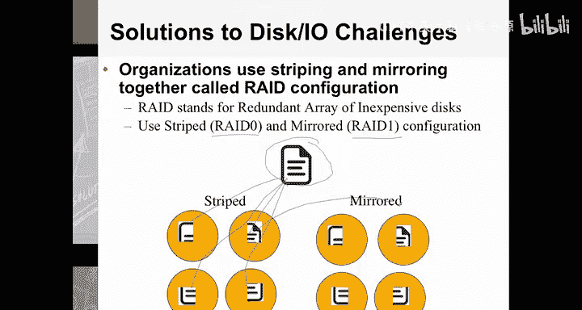
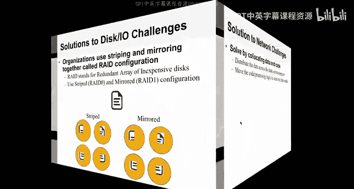
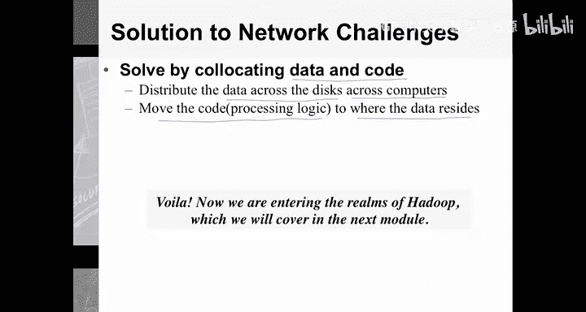

# 007：现代大数据计算技术 💻

在本节课中，我们将学习支撑现代大数据处理的关键计算趋势与挑战。我们会探讨当前的计算优势、面临的问题，以及相应的解决方案，并了解这些方案如何为Hadoop等大数据技术铺平道路。

---

## 现代计算的优势与趋势 🚀

上一节我们了解了大数据的基本概念，本节中我们来看看推动其发展的技术趋势。得益于以下几个关键因素，大规模数据处理在今天成为可能。

以下是当前主要的计算发展趋势：

*   **更快的处理器与更大的内存**：根据**摩尔定律**，大约每两年，CPU的处理能力和RAM的容量就会翻倍。这为复杂计算提供了强大的硬件基础。
*   **更廉价的存储**：存储成本持续下降，使得组织机构能够收集并存储前所未有的海量数据，并期望对这些数据进行处理分析。
*   **成熟的分布式系统设计**：过去20年间，分布式系统设计日趋成熟。例如，Hadoop运动以及NoSQL（分布式数据库）运动已变得非常流行。
*   **开源软件的普及**：开源运动始于约20年前，并催生了许多甚至优于专有或商业软件的优秀产品，极大地降低了技术门槛和创新成本。
*   **商品硬件的广泛使用**：人们越来越多地使用廉价的商用硬件来构建计算集群，而非依赖昂贵的超级计算机。
*   **公共云计算的兴起**：亚马逊、谷歌等公司提供了云计算解决方案。组织机构无需自行购买所有硬件，可以将数据上传至云端进行处理，获取所需信息后再传回本地。

## 现代计算面临的挑战 ⚠️

尽管计算能力在增长，但在处理大数据时，传统的分布式或网格计算架构仍面临显著挑战。

在这种架构中，通常存在一个带共享存储的中央服务器，其他计算机通过网络连接到它，获取数据并进行处理。

以下是该架构面临的主要问题：

*   **磁盘I/O速度慢**：许多服务器为了成本效益使用机械硬盘，其读写速度非常慢，容易成为性能瓶颈。
*   **硬件故障**：磁盘存在磨损、制造缺陷等问题，可能导致故障和数据丢失。
*   **网络带宽不足**：数据中心内部的网络带宽有限，难以支持所有计算节点同时从中央存储高速传输海量数据。当大量计算机都需要访问中央服务器的数据时，网络极易拥堵。

## 应对磁盘I/O挑战的解决方案 💾

针对磁盘速度慢和可靠性问题，业界通常采用两种基础技术：条带化与镜像。

**条带化** 的核心思想是，将一个文件分割成多个块，并将这些块分布存储在不同的磁盘上。

例如，一个文件被分成4块，分别存储在4个磁盘上。当需要读取文件时，可以并行地从多个磁盘同时读取，从而显著提升I/O速度。其过程可以简化为：
`文件 -> 分割为块 [A1, A2, A3, A4] -> 并行存储于磁盘 [Disk1, Disk2, Disk3, Disk4]`

**镜像** 则是指将同一份文件复制到两个或更多磁盘上。

例如，同一文件被复制了4份，分别存储在4个磁盘上。镜像提供了数据冗余，当某个磁盘发生故障时，数据仍然可以从其他磁盘恢复，保障了可用性。

为了同时获得速度提升和可靠性，人们将条带化和镜像结合起来使用，这被称为 **RAID 0+1** 配置。

RAID代表“廉价磁盘冗余阵列”。RAID 0+1 的做法是：先将文件条带化分割并分布到一组磁盘上（RAID 0），然后将这整组条带化磁盘再完整地镜像到另一组磁盘上（RAID 1）。

下图展示了这一概念：文件被分成4块并存储在4个磁盘上，同时，这4个磁盘的内容又被整体镜像到另外4个磁盘上。

因此，RAID 0+1 同时实现了条带化和镜像。

## 应对网络挑战的解决方案 🌐

解决网络带宽瓶颈的思路是 **将数据与计算代码放在一起**。

具体方法是：先将数据分布式地存储在网络中多台计算机的本地磁盘上，然后将计算任务（处理逻辑）发送到数据所在的节点上去执行。

这是一个非常新颖且关键的理念。有趣的是，这正引领我们进入 **Hadoop** 的领域。“将代码移至数据”是Hadoop架构的基石。

---

## 总结 📝

本节课中，我们一起学习了现代大数据计算的技术全景。我们首先探讨了使大数据处理成为可能的几大计算趋势，包括硬件性能提升、分布式系统成熟以及云计算兴起等。接着，我们分析了传统集中式存储架构在处理大数据时面临的磁盘I/O和网络带宽挑战。最后，我们介绍了通过**条带化**和**镜像**（如RAID 0+1）来优化磁盘性能与可靠性，以及通过 **“将代码移至数据”** 这一核心范式来解决网络瓶颈。这些解决方案为Hadoop等分布式计算框架的出现和发展奠定了重要基础。