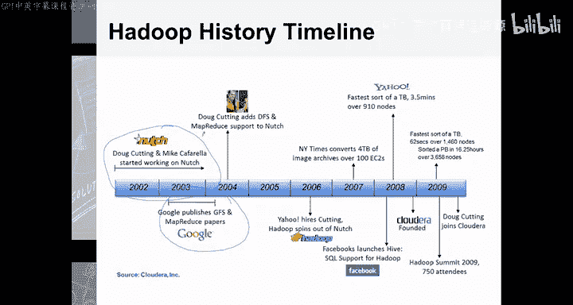
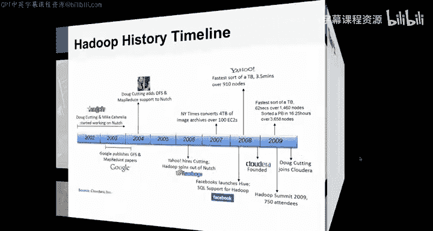
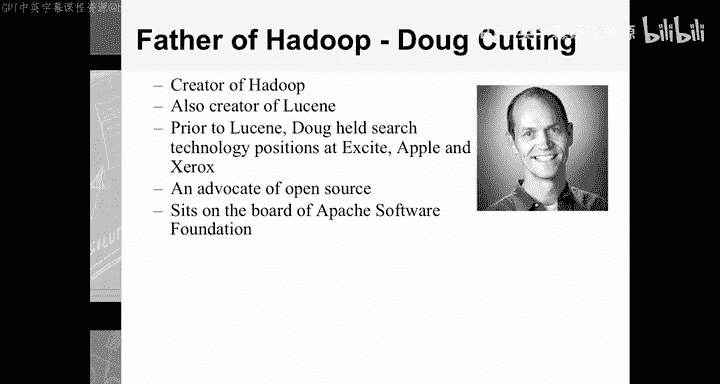
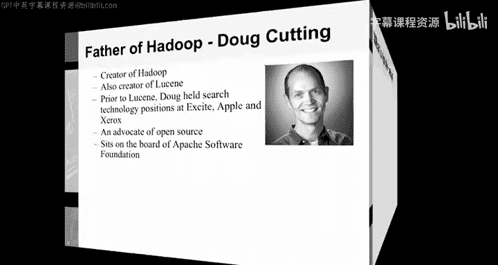
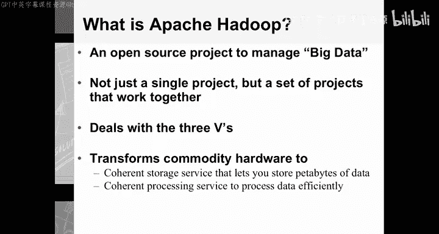
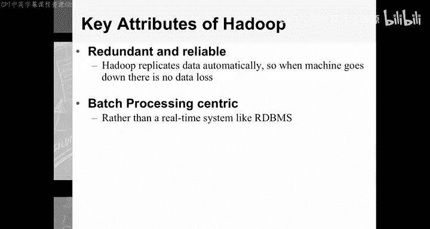

# 010：Hadoop历史沿革 🐘

在本节课中，我们将学习Hadoop的起源与发展历程。我们将回顾其诞生的背景、关键的技术转折点，并最终给出Hadoop的正式定义及其核心特性。课程最后，我们还将了解Hadoop在当今市场的流行程度。

## Hadoop背景与起源

上一节我们介绍了大数据处理的现代技术。本节中，我们来看看Hadoop是如何诞生的。

Hadoop的历史始于2002年至2003年。当时，两位工程师道格·卡丁和迈克·卡法雷拉开始致力于一个名为Nutch的开源项目。他们的目标是构建一个网络规模的分布式网络爬虫和搜索引擎。

在2002至2003年间，市场上有两个占主导地位的搜索引擎：谷歌和雅虎。其他搜索引擎如Infoseek、Alta Vista等基本上都已退出市场。因此，道格·卡丁希望构建一个Apache开源分布式爬虫和搜索引擎。他们确实做到了，并在四个节点上演示了Nutch。但他们发现，要实现可操作性且达到网络规模（即能够爬取数百万个网站、下载内容并建立索引）仍然遥不可及。

## 关键转折点：谷歌论文的启发

他们正在努力寻找解决这个问题的方法。幸运的是，在2003年，谷歌发表了一篇关于GFS（谷歌文件系统）的论文。你可以从 `research.google.com/archive/gfs.html` 下载这篇论文。后来，当我们开始学习HDFS时，会将其与GFS进行比较，届时我们会更详细地讨论GFS。

在这篇关于GFS的论文中，谷歌声称他们的GFS是一个分布式文件系统，而不是连接到单个存储的单一机器。他们还声称GFS成本低廉，因为它构建在商用硬件之上。GFS还通过让多台机器上的多个磁盘协同工作，提供了高聚合性能。我们在上一模块讨论现代数据处理技术时已经看到了这一点。因此，他们能够构建一个高性能、可扩展、容错的文件系统。最重要的是，谷歌将这个大型分布式文件系统用于数据密集型应用。

有趣的是，谷歌没有提供实现或源代码，只发布了白皮书。

2004年，谷歌又发表了一篇名为MapReduce的论文。你可以从 `research.google.com/archive/mapreduce.html` 下载这篇论文。我们将在后面讨论MapReduce架构时更详细地谈论这篇论文。

在谷歌的MapReduce论文中，谷歌描述了一种用于大数据处理的新编程范式。他们说这是一种函数式风格的编程，而不是面向过程或面向对象的编程模型，其核心是map和reduce函数。这些map和reduce函数将使用键值对作为输入，在大型商用机器集群上并行执行，并生成键值对作为输出。当然，谷歌没有为MapReduce提供实现或源代码，只提供了白皮书。

这一切让道格·卡丁和迈克·卡法雷拉开始思考。他们实际上修改了Nutch项目，并将Nutch项目移植到一个新的框架上。这个新框架开始使用谷歌论文中描述的许多概念，即MapReduce论文和GFS论文中的概念。他们当时还没有将这个新框架称为Hadoop，但后来它成为了Hadoop。

## Hadoop发展时间线

我想以时间线的形式来讲述Hadoop历史的其余部分。

我们已经看到，在2002年至2003年间，道格·卡丁和迈克·卡法雷拉开始致力于Nutch项目。在2003年至2004年间，谷歌发表了GFS和MapReduce论文，这给了道格·卡丁如何改变Nutch架构的思路。于是他开始修改Nutch架构，在其中加入DFS和MapReduce支持。

以下是Hadoop发展过程中的关键节点：

*   **2006年**：雅虎雇佣了道格·卡丁。他们所做的就是将Nutch项目拆分为两个部分：Apache Hadoop项目和Nutch项目。因此，Apache Hadoop项目于2006年诞生。
*   **2007年左右**：许多公司开始研究Hadoop，其中一家公司是《纽约时报》。有一个关于《纽约时报》一位工程师使用100台EC2机器转换4TB图像档案的精彩故事。这是Hadoop与云计算结合的经典案例。
*   **2008年左右**：Facebook也开始使用Hadoop。他们不仅使用了Hadoop，还为Hadoop做出了贡献。他们实际上创建了一个名为Hive的开源Apache子项目，你可以编写类似SQL的查询，这些查询会被翻译成MapReduce程序。
*   **2008年**：另一件有趣的事情发生了，雅虎开始进行TB级排序测试。在2008年，雅虎使用910个节点在3.5分钟内对1TB数据进行了排序。在分布式计算中，如果你能进行TB级排序，这很好地说明了你的项目进展如何。正如你所见，Hadoop确实在朝着正确的方向发展。
*   **2008年**：Cloudera公司成立。Cloudera是第一家采用Apache开源项目并开始为企业提供支持的公司。
*   **2009年**：Hadoop峰会创立，有750名与会者参加。2009年发生的另一件有趣的事情是，雅虎使用1460个节点在62秒内对1TB数据进行了排序。他们还使用3658个节点在16.25小时内对1PB数据进行了排序。最后，大约在2009年，Hadoop之父道格·卡丁加入了Cloudera。

## 致谢

如果说有哪些公司值得我们感谢，那应该是谷歌，因为GFS论文和MapReduce论文为我们指明了正确的方向；还有雅虎，他们对Hadoop开源项目做出了所有贡献，他们确实投入了数百万美元以及成千上万的工程师来推动Hadoop项目的成熟。

我们也应该感谢Hadoop之父道格·卡丁。他当然是Hadoop的创造者，也是搜索引擎项目Lucene的创造者。在此之前，道格在Excite、苹果和施乐公司担任搜索技术职位。他是开源项目的积极倡导者，并且是Apache软件基金会的董事会成员。

感谢道格·卡丁为我们带来了Hadoop项目。

## 什么是Apache Hadoop？

上一节我们回顾了Hadoop的历史。本节中，我们来正式定义一下Hadoop。

Apache Hadoop是一个用于管理大数据的开源项目，用于管理组织的大数据。它不是一个单一的项目，而是一组协同工作的项目。因此，当我们谈论Apache Hadoop时，是的，有一个名为 `hadoop.apache.org` 的网站，但还有许多其他Apache子项目与Hadoop协同工作以创建一个生态系统。例如Hive、Pig、Sqoop、Flume、ZooKeeper等项目，我们将在后面的不同章节中讨论其中的许多项目。

当然，Hadoop处理大数据的三个V：速度、多样性和体量。它将商用硬件转化为连贯的存储服务，允许你存储PB级的数据，但不仅仅是存储数据，还提供连贯的处理服务，允许你以高效的方式处理数据。

## Hadoop名称的由来与项目命名

那么，名字里有什么呢？Hadoop不是一个首字母缩写词，它实际上是一个虚构的名字。根据道格·卡丁的说法，这是他孩子给一只黄色毛绒大象起的名字。道格·卡丁认为Hadoop是一个很酷的名字，所以他决定将其用于他的项目。

子项目和其他贡献模块的名称往往与其功能无关，通常它们有一些与大象或其他动物相关的主题。例如，Mahout项目。Mahout在印地语中字面意思是“驯象师”。Mahout实际上是一个机器学习算法，通常在机器学习算法中，你训练数据，使用数据集来训练你的算法，所以这有点道理，我想这就是他们使用Mahout作为名字的原因。

Pig是雅虎创建的一种查询语言。你用Pig Latin语言编写程序来表达你的MapReduce程序，它们会被翻译成MapReduce程序。Pig的另一个特点是它可以消费任何类型的数据，不像我们在Hive中看到的那样有严格的数据结构要求。所以就有了Pig。

## Hadoop的核心特性

了解了Hadoop是什么之后，我们来看看它的核心特性。

冗余性和可靠性是Hadoop的关键属性之一。当你将数据放入Hadoop时，它会自动复制数据，因此当一台机器出现故障时，实际上不会丢失数据。

Hadoop也是以批处理为中心的。不像数据库那样的实时系统，你可以以交互方式进行操作并获得即时响应时间。在Hadoop中，我们有一个以批处理为中心的引擎，当你运行一个Hadoop作业时，可能需要几分钟甚至几小时才能得到结果。

它使得编写分布式应用程序变得容易。编写分布式应用程序是一件相当复杂的事情，因为你必须处理多台机器，必须担心同步问题，必须担心网络问题，做这些事情相当复杂。但Hadoop允许你编写一个分布式程序，该程序不仅可以在一台机器上运行，还可以扩展到数千台机器而无需更改一行代码，而且你实际上不必担心任何这些低层同步问题，它们会自动为你处理。

Hadoop也运行在商用硬件上。你实际上不需要购买任何专用硬件或昂贵的设备或冗余硬件，其可靠性方面已内置在软件中。因此，运行商用硬件就足够了。

如今，Hadoop是市场上增长最快的技术。当今的企业将Hadoop视为其数据中心中另一项必备技术。

## Hadoop的市场流行度

最后，我们来看看Hadoop在市场的流行程度。

为了好玩，我决定将Hadoop与其他一些流行的现代技术进行比较，比如Java EE、MPI编程、iPhone编程和Android编程。以下是我得到的结果。请注意，用橙色表示的Hadoop，其职位数量实际上正在上升。我只是想将其与这些其他技术进行比较，尽管它不如Android编程，甚至不如实际上正在下降的MPI编程，但它在右边，所以我想这是件好事，对吧？

## 总结

在本节中，我们回顾了Hadoop的历史，了解了它是如何开始的。我们也最终正式定义了Hadoop及其关键属性。我们还通过Indeed.com的职位趋势看到了Hadoop生态系统在市场上的流行程度。