# 013：Hadoop技术栈剖析 🗂️

在本节课中，我们将学习Hadoop生态系统中的众多项目。面对诸如Hive、Pig、HBase、Sqoop、Zookeeper、Ambari等层出不穷的项目，初学者可能会感到不知所措。本节的目标是梳理关键的Hadoop项目，理解哪些是通用工具，哪些是解决特定问题的专用工具，并对它们进行分类。我们还将了解如何在Apache孵化器网站上获取关于新兴Hadoop项目的信息。本节将选取几个关键项目进行概览，后续课程中我们会进行更深入的探讨。

## Hadoop技术栈概览

你或许以为Apache Hadoop项目就是全部。但事实上，Hadoop生态系统包含一系列项目。Apache Hadoop位于中心，周围环绕着用于安全的Apache Sentry、用于NoSQL的HBase、用于数据导入的Sqoop、用于分析的Pig和Hive、用于监控的Ambari等众多项目。这个列表还在不断增长。

为了理解这个庞大的技术栈，我们可以将其中的项目进行分组。

## 项目分类详解

上一节我们提到了Hadoop生态系统的庞大，本节中我们来看看如何将它们系统地分类，以便更好地理解。

以下是Hadoop技术栈的主要分类：

*   **数据集成**：这类项目帮助你将数据移入或移出Hadoop集群。例如，Sqoop允许你在关系型数据库和Hadoop之间传输数据。Flume、Chukwa和Kafka则专注于从不同系统导入日志文件或事件流。
*   **数据序列化**：这类项目定义了数据在集群中的存储格式。Avro和Thrift允许你以高级格式存储数据，这种格式可以包含数据的**模式（Schema）**信息。它们还提供了生成代码类的机制，便于在应用程序中读写数据。
*   **数据存储（NoSQL）**：有时你需要以支持实时访问的格式存储数据，以便进行增删改查（CRUD）操作。HBase就是这样一个构建在Hadoop之上的NoSQL数据库。Cassandra是类似的项目，它不直接依赖Hadoop，但常与Hadoop协同工作。
*   **数据访问与分析**：当数据进入集群后，你需要进行分析、聚合和计算。虽然可以编写MapReduce程序，但这需要Java开发技能。Pig和Hive允许你使用更高级的语言（如Pig Latin和HiveQL）进行分析，这些语言会被转换成MapReduce作业。此外，还有基于YARN的新计算框架，如用于图处理的Giraph、用于实时处理的Storm、以及Spark等。
*   **管理与编排**：管理一个包含上百台机器的集群是复杂的。Ambari是一个管理工具，用于安装、管理和监控Hadoop集群服务。Oozie用于协调工作流作业的执行。Zookeeper则提供分布式配置、同步和领导者选举等协调服务。
*   **数据智能与安全**：Mahout是一个构建在Hadoop MapReduce之上的Java机器学习库。对于安全，有Knox和Sentry等项目来保护Hadoop集群中的重要数据。
*   **开发工具**：HTT（Hadoop Development Tools）是一个Eclipse插件项目，旨在简化Hadoop应用的开发。

## 探索新项目：Apache孵化器

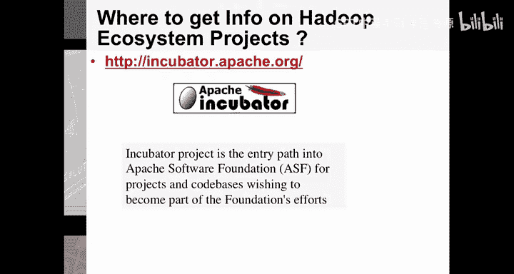

了解现有项目后，你可能会想知道如何跟进最新的技术。Apache孵化器网站是发现新兴Hadoop相关项目的绝佳去处。

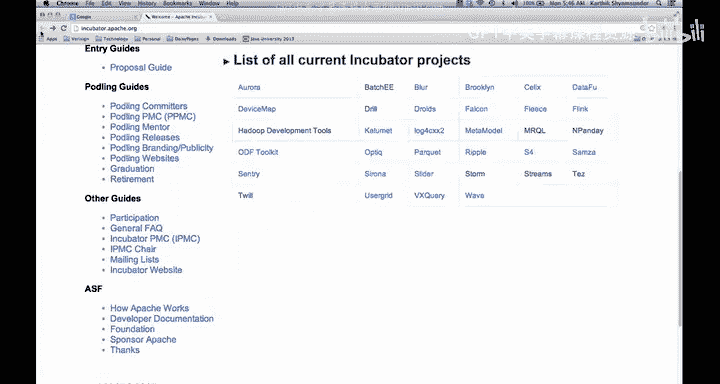

访问 `incubator.apache.org`，你可以看到所有正在孵化的项目列表。其中一些项目与Hadoop紧密相关，例如用于交互式查询的Drill、用于流处理的Storm、以及高级语言Tez等。定期浏览这个页面，有助于你了解生态系统的最新动态。

## 关键项目深度概览

在分类的基础上，我们选取几个最具代表性的项目进行更详细的介绍。

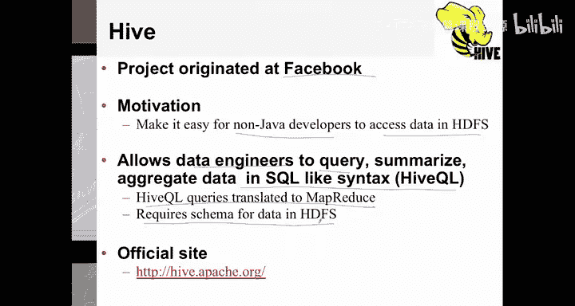

### Hive 🐝

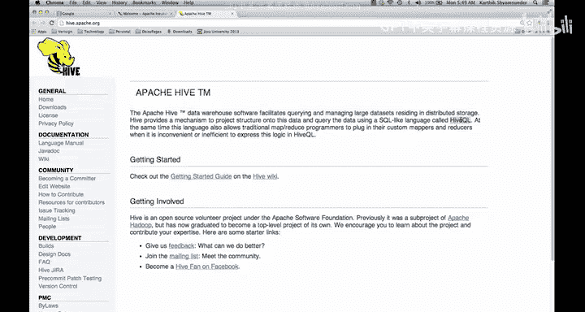

Hive起源于Facebook。其动机是让非Java开发人员（如数据科学家）能够轻松访问HDFS中的数据。用户使用一种类似SQL的语言——**HiveQL**来表达查询，Hive会将其转换为MapReduce代码执行。Hive要求数据具有模式（Schema），你可以通过类似 `CREATE TABLE` 的语法在Hive中定义，也可以使用Avro等序列化格式，将模式信息直接存储在数据文件中。

### Pig 🐷

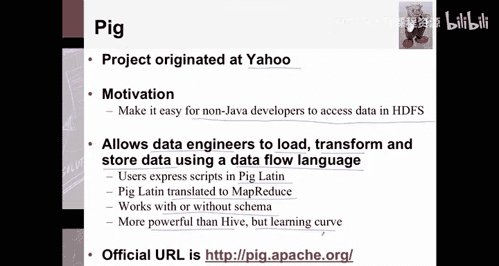

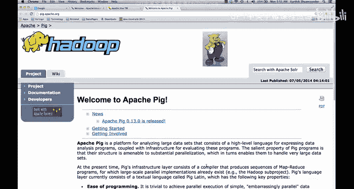

Pig起源于Yahoo。其动机同样是简化数据科学家对HDFS中数据的访问。用户使用一种数据流语言——**Pig Latin**来编写加载、转换和存储数据的脚本，这些脚本同样会被转换成MapReduce作业。与Hive相比，Pig对模式的要求更灵活，有“Pig吃一切”的说法，意味着它能处理有模式或无模式的数据。Pig被认为比Hive更强大，能够编写更复杂的数据处理脚本。

### HBase 🗃️

HBase也起源于Facebook，旨在解决Facebook消息收件箱的实时访问问题。它是一个构建在Hadoop之上的分布式、可扩展的列式NoSQL数据库，支持实时的增删改查（CRUD）操作，这与MapReduce的批处理模式不同。HBase的名称来源于“Hadoop database”，其设计遵循BASE原则（基本可用、软状态、最终一致性），与传统ACID数据库形成对比。

### Sqoop 🔄

Sqoop起源于Cloudera。在客户咨询过程中，Cloudera发现普遍存在将数据从关系型数据库导入Hadoop处理，然后再导回的需求。Sqoop（取自“SQL”到“Hadoop”）正是为此而生。它支持在Hadoop和关系型数据库之间高效地批量传输数据，开箱即用支持JDBC数据源，配置简单。它也可以扩展以集成其他数据存储系统。

### Flume 🌊

Flume同样起源于Cloudera。许多组织需要将遍布各处的Web服务器日志或消息数据收集到Hadoop集群中。Flume就是一个分布式的、可靠的、高可用的服务，用于高效地收集、聚合和移动大量日志数据进入HDFS。它通过配置Source（源）、Channel（通道）和Sink（接收器）来构建数据流。

### Zookeeper 🦁

Zookeeper是一个集中式服务，用于维护集群的配置信息、实现分布式组件间的同步以及提供领导者选举等组服务。在分布式系统中，各机器需要统一的配置信息，Zookeeper提供了这样的中心化配置服务。例如，在HBase中，Zookeeper用于管理活跃的HMaster节点。

### Avro 📄

Avro起源于Cloudera，旨在提供比Thrift或Protocol Buffers更好的数据序列化方案。它是一个富含数据结构的库，允许以紧凑的二进制格式存储数据，并使用JSON定义数据模式。Avro的一个关键特性是**将数据模式与数据本身存储在一起**，这使得Pig、Hive等工具能更容易地读取和理解数据。

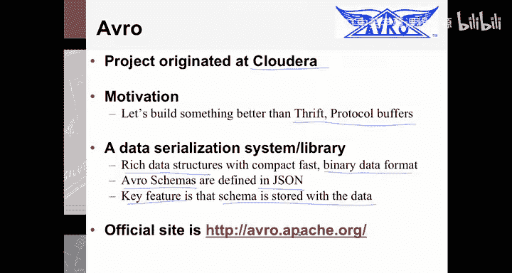

### Oozie ⏰

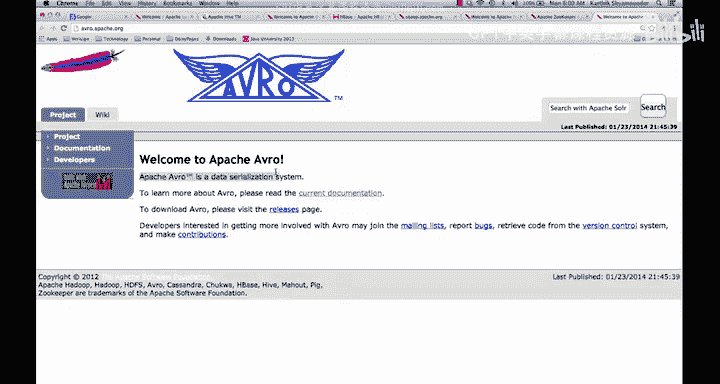

Oozie起源于Yahoo。Yahoo集群中每天运行着成千上万的作业，需要一种机制来管理和触发这些作业。Oozie就是一个工作流协调器，允许你基于时间（类似Cron）或数据可用性来触发Hadoop作业，从而管理复杂的工作流。工作流通常用**有向无环图（DAG）** 来描述。

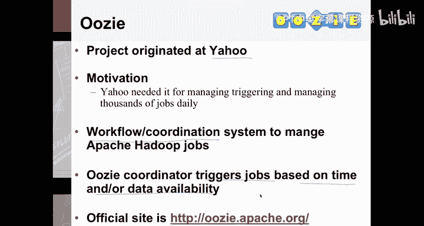

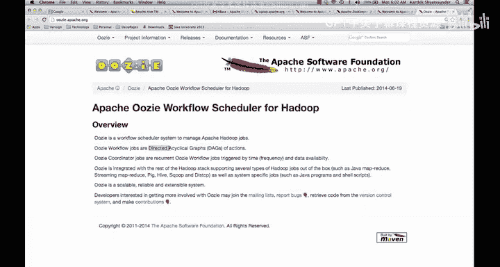

### Mahout 🐘

Mahout是一个基于Java、构建在Hadoop MapReduce之上的机器学习库。其名称在印地语中意为“驯象师”，寓意训练机器学习算法。它实现了可扩展的分布式机器学习算法，主要涵盖三大领域：**聚类（Clustering）、分类（Classification）和协同过滤（Collaborative Filtering）**。

### Ambari 🖥️

Ambari起源于Hortonworks。它是一个基于Web的GUI工具，用于供应、管理和监控Apache Hadoop集群。你可以通过它选择要在集群上安装的服务（如Hive、Pig等），并集中管理所有服务。Ambari的诞生源于Hortonworks希望提供一个完全开源的管理和监控工具，这与一些商业发行版采用专有管理软件的策略不同。

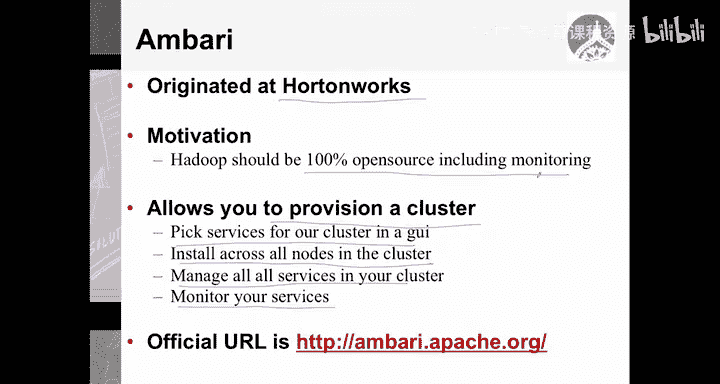

## 总结

本节课中，我们一起学习了Hadoop生态系统的全貌。我们首先将繁杂的项目进行了系统分类，包括数据集成、序列化、存储、分析、管理、安全等类别。接着，我们介绍了如何通过Apache孵化器网站跟踪新兴项目。最后，我们对Hive、Pig、HBase、Sqoop、Flume、Zookeeper、Avro、Oozie、Mahout和Ambari等关键项目进行了深入的概览，了解了它们的起源、动机和核心功能。这为我们后续深入学习具体技术打下了坚实的基础。