# 015：Hadoop文档体系 📚

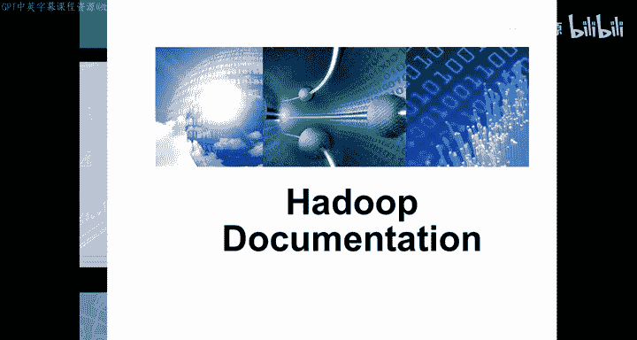

在本节课中，我们将学习如何查找和利用Hadoop的各种文档资源。掌握这些资源对于深入理解和使用Hadoop至关重要。

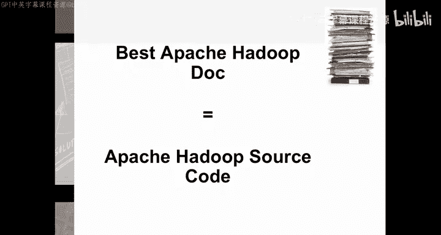

## 概述

Hadoop拥有一个庞大且不断发展的生态系统，其文档来源多样。本节将系统性地介绍官方文档、Wiki、博客、书籍、会议以及最重要的——源代码本身。

## 官方文档

上一节我们介绍了Hadoop的基本概念，本节中我们来看看最权威的官方文档来源。

Apache Hadoop的官方文档位于其项目网站上。访问地址为 `hadoop.apache.org/common/docs/release-number`。如果不指定具体的版本号，页面会列出所有已发布版本的目录。

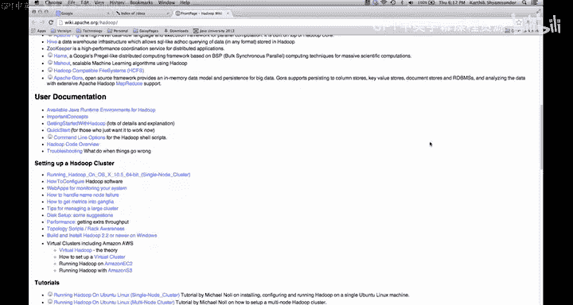

每个目录对应一个版本号，点击即可查看该特定版本的详细文档，其中包含命令指南、快速入门指南、HDFS指南和Hadoop流指南等丰富信息。

## Wiki与最佳实践

除了官方文档，社区贡献的Wiki也是重要的知识库。

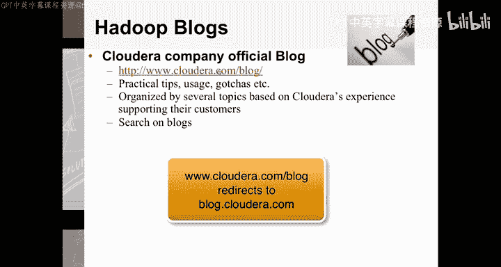

Apache Hadoop Wiki页面位于 `wiki.apache.org/hadoop`。该页面包含了许多在官方文档中可能找不到的实用信息、操作指南和最佳实践案例。

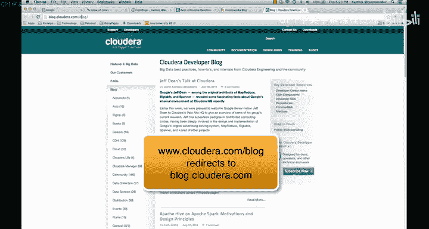

以下是部分Apache Hadoop子项目的Wiki链接，请注意这些链接可能会随时间变化。

## 技术博客

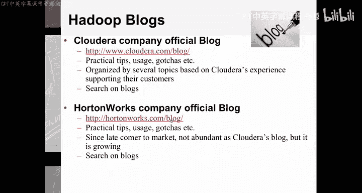

网络上有大量关于Hadoop的博客，但有两个来源特别值得关注。

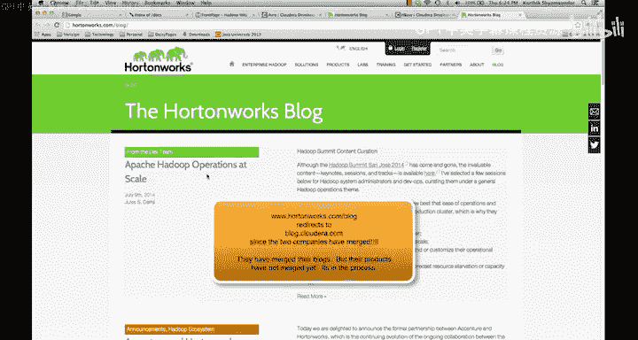

以下是两个主要Hadoop发行商维护的官方博客，它们提供了大量实用技巧、使用案例和注意事项。

*   **Cloudera博客**：地址为 `blog.cloudera.com`。该博客基于Cloudera支持客户的经验，提供了大量实用技巧，虽然侧重于其发行版，但也包含通用的Hadoop信息。博客内容按主题分类，并支持搜索。
*   **Hortonworks博客**：地址为 `hortonworks.com/blog`。同样提供实用技巧和案例，侧重于Hortonworks发行版。作为市场的后来者，其内容量虽不及Cloudera，但也在不断增长。博客内容可按开发团队公告、Hadoop生态系统等分组查看。

## 推荐书籍

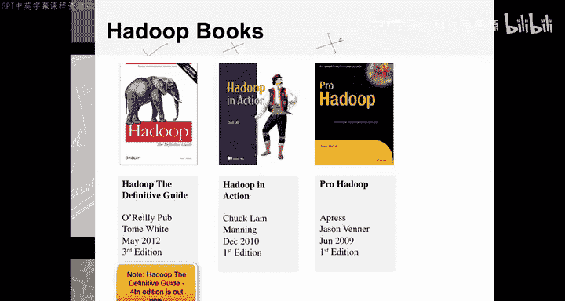

市面上有许多关于Hadoop的书籍，以下是对其中一些的评述。

*   **《Hadoop权威指南》**：作者Tom White（第三版）。这是一本必读的理论书籍，深入讲解了Hadoop及其子项目（如Hive、HBase、Pig）的内部工作原理。
*   **《Hadoop实战》**：作者Chuck Lam（2010年12月）。这是一本较老的书籍，未有新版，目前不再推荐购买。
*   **《Pro Hadoop》**：作者Jason Venner。个人不推荐此书，且内容已过时。
*   **《Hadoop in Practice》**：作者Alex Holmes。本书包含大量使用Hadoop的实用建议，非常值得拥有。
*   **《Professional Hadoop Solutions》**：由Rock`s Publications于2013年9月出版。是一本不错的书，但如果你已拥有《Hadoop in Practice》，则非必需。
*   **《Apache Hadoop YARN》**：作者Arun Murthy（Hortonworks联合创始人）。这是目前唯一一本专注于YARN技术的书籍，对此感兴趣则值得购买。
*   **《Data-Intensive Text Processing with MapReduce》**：作者Jimmy Lin和Chris Dyer。这是一本专注于MapReduce方面的免费PDF电子书，非常值得下载阅读。
*   **《Hadoop For Dummies》**：作为“达人迷”系列丛书，表明该主题很热门，此处不作评论。
*   **《Hadoop MapReduce Design Patterns》**：专注于算法设计。如果已有《Hadoop in Practice》，则非必需。
*   **《Programming Pig》**：作者Alan Gates。如果你要进行Pig编程，这是一本极好的书。
*   **《Programming Hive》**：关于Hive的优秀书籍。
*   **《Hadoop Operations》**：作者Eric Sammer。详细讲解了数据中心运维、Hadoop内部参数设置等，适合从事Hadoop运维的人员。
*   **《HBase权威指南》**：作者Lars George。这是学习HBase的首选书籍。
*   **《HBase in Action》**：一本看起来相当不错的书。
*   **《HBase Design Patterns》**：即将出版的新书。

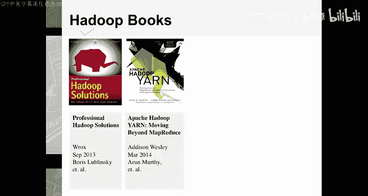

## 社交媒体与会议

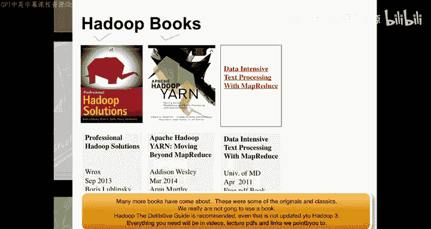

在Twitter上关注领域专家可以获取最新动态。

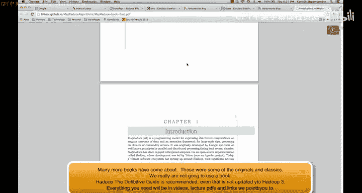

以下是一些值得在Twitter上关注的Hadoop领域专家，他们会不时分享关于大数据和Hadoop的最新动态。

*   Cloudera公司的相关员工。
*   Hortonworks公司的Arun Murthy, Alan Gates 和 Sanjay Radia。
*   MapR公司的Ted Dunning。
*   讲师本人的Twitter账号。

参与行业会议是深入学习的好方法。

以下是两个主要的Hadoop会议。

*   **Hadoop World**：由Cloudera组织，通常在纽约秋季举行。官网是 `hadoopor.com`。
*   **Hadoop Summit**：由Hortonworks组织，通常在旧金山春季举行。官网是 `hadoopsmit.org`。

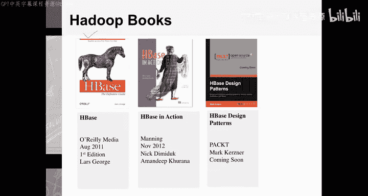

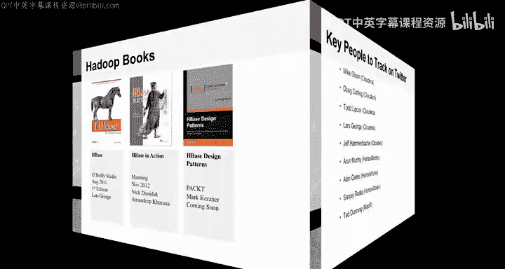

如果你打算深入Hadoop领域，强烈建议至少参加一次其中任何一个会议。

## 最重要的资源：源代码

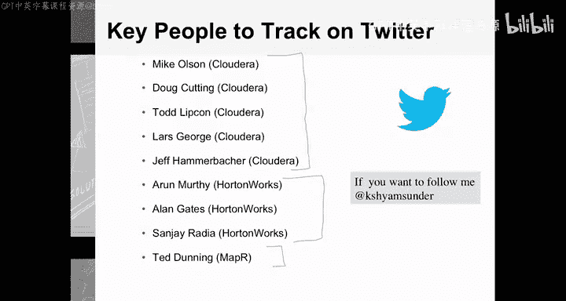

最后，我们必须强调，Apache Hadoop文档的最佳来源是其**源代码本身**。

当你想了解某些功能背后的工作原理，而网页、文章、博客或书籍都无法解答时，直接打开Apache Hadoop源代码，阅读、跟踪、调试代码，是弄清事情真相的根本方法。

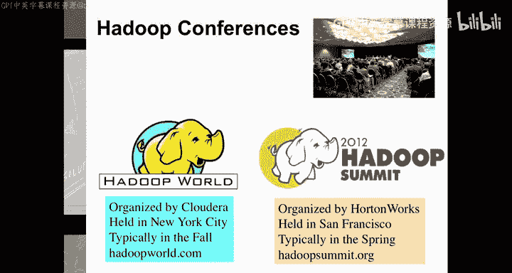

## 总结

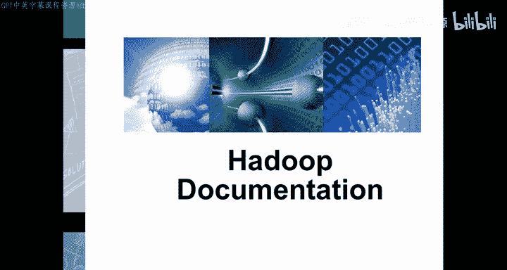

本节课中我们一起学习了Hadoop的各种文档资源，包括官方文档（Docs）、Wiki、博客、书籍和会议。但请记住，最准确、最深入的Hadoop文档始终是其源代码本身。